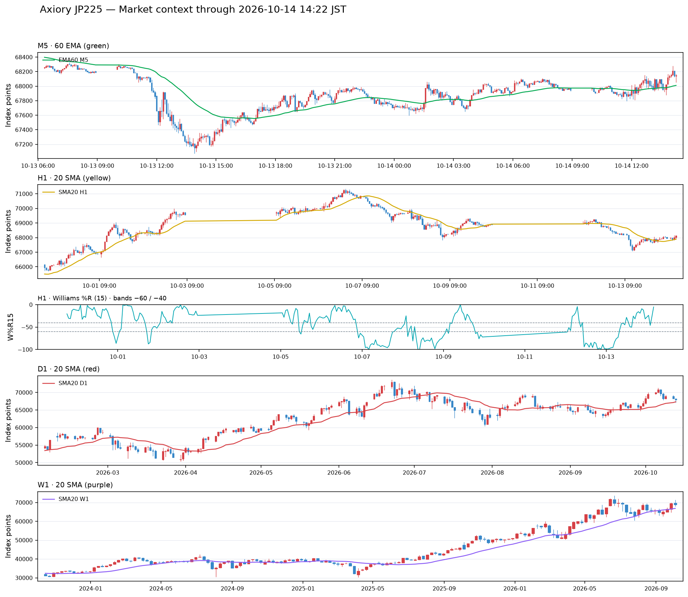
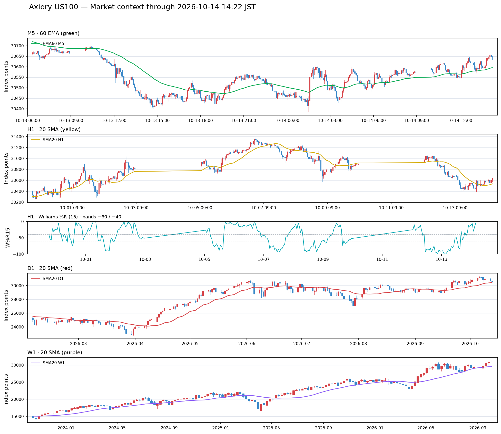

# US100・JP225 日次マーケット指標 — 2026-10-14（JST）

- 生成時刻: 2026-10-14 14:22:46 JST
- データ元: Axiory MetaTrader 5（銘柄名 JP225 / US100）。別口座のJP225Cash/US100Cashとは価格系列が異なります。
- 時刻: CSVはUTC。日誌とチャートはJST。未確定足を除外しています。
- 指標の読み方とチャート規約: [市場コンテキストのレシピ](../../market_context_recipe.md)

| 銘柄 | M5終値 / EMA60（緑） | H1終値 / SMA20（黄） | W%R15 H1 | D1終値 / SMA20（赤） | W1終値 / SMA20（紫） | PO H1 / D1 / W1 |
|---|---|---|---:|---|---|---|
| JP225 | 68,147.91 / 68,010.00（終値が上） | 68,137.91 / 67,890.73（終値が上） | -5.24 上側（≥ -40） | 67,945.19 / 67,337.51（終値が上） | 68,881.78 / 66,838.96（終値が上） | なし / なし / 上昇PO |
| US100 | 30,647.54 / 30,596.04（終値が上） | 30,638.92 / 30,534.94（終値が上） | -2.74 上側（≥ -40） | 30,574.61 / 30,495.23（終値が上） | 30,901.30 / 29,594.19（終値が上） | なし / なし / 上昇PO |

## ソースCSV

- JP225: [M1](../../../market_data/axiory/JP225_M1.csv) / [M5](../../../market_data/axiory/JP225_M5.csv) / [H1](../../../market_data/axiory/JP225_H1.csv) / [D1](../../../market_data/axiory/JP225_D1.csv) / [W1](../../../market_data/axiory/JP225_W1.csv)
- US100: [M1](../../../market_data/axiory/US100_M1.csv) / [M5](../../../market_data/axiory/US100_M5.csv) / [H1](../../../market_data/axiory/US100_H1.csv) / [D1](../../../market_data/axiory/US100_D1.csv) / [W1](../../../market_data/axiory/US100_W1.csv)

## チャート

### JP225

### US100

## データ範囲

| 銘柄 | 足 | 保存本数 | 開始時刻（JST） | 最終足の期間境界（JST） | 今回の差分 |
|---|---|---:|---|---|---:|
| JP225 | M1 | 538,254 | 2025-04-07 10:00 | 2026-10-14 14:22 | 1本 |
| JP225 | M5 | 107,926 | 2025-04-07 10:00 | 2026-10-14 14:20 | 0本 |
| JP225 | H1 | 9,005 | 2025-04-07 10:00 | 2026-10-14 14:00 | 0本 |
| JP225 | D1 | 977 | 2023-01-03 09:00 | 2026-10-14 09:00 | 0本 |
| JP225 | W1 | 196 | 2023-01-08 09:00 | 2026-10-11 09:00 | 0本 |
| US100 | M1 | 538,100 | 2025-04-07 10:00 | 2026-10-14 14:22 | 1本 |
| US100 | M5 | 107,637 | 2025-04-07 10:00 | 2026-10-14 14:20 | 0本 |
| US100 | H1 | 8,980 | 2025-04-07 10:00 | 2026-10-14 14:00 | 0本 |
| US100 | D1 | 977 | 2023-01-03 09:00 | 2026-10-14 09:00 | 0本 |
| US100 | W1 | 196 | 2023-01-08 09:00 | 2026-10-11 09:00 | 0本 |

## 計算ルール

- EMA60(M5): M5終値に対する60期間指数移動平均。
- SMA20(H1/D1/W1): それぞれの足の終値、直近20本の単純平均。
- W%R(15,H1): H1の高値・安値・終値から計算。-60以下=下側、-40以上=上側、その間=中立帯。
- パーフェクトオーダー(PO): 各足でSMA5>SMA20>SMA60かつ各SMAが5本前より上なら上昇PO。逆順かつ各SMAが5本前より下なら下降PO。それ以外は「なし」。
- 同日に再実行した場合は、その日付のレポートとチャートを置き換えます。

## 保存ファイル

- M1/M5/H1/D1/W1履歴: `market_data/axiory/`
- 差分CSV・詳細ログ・実行履歴: ローカルの `market_data/axiory/` 配下（Gitでは追跡しません）
