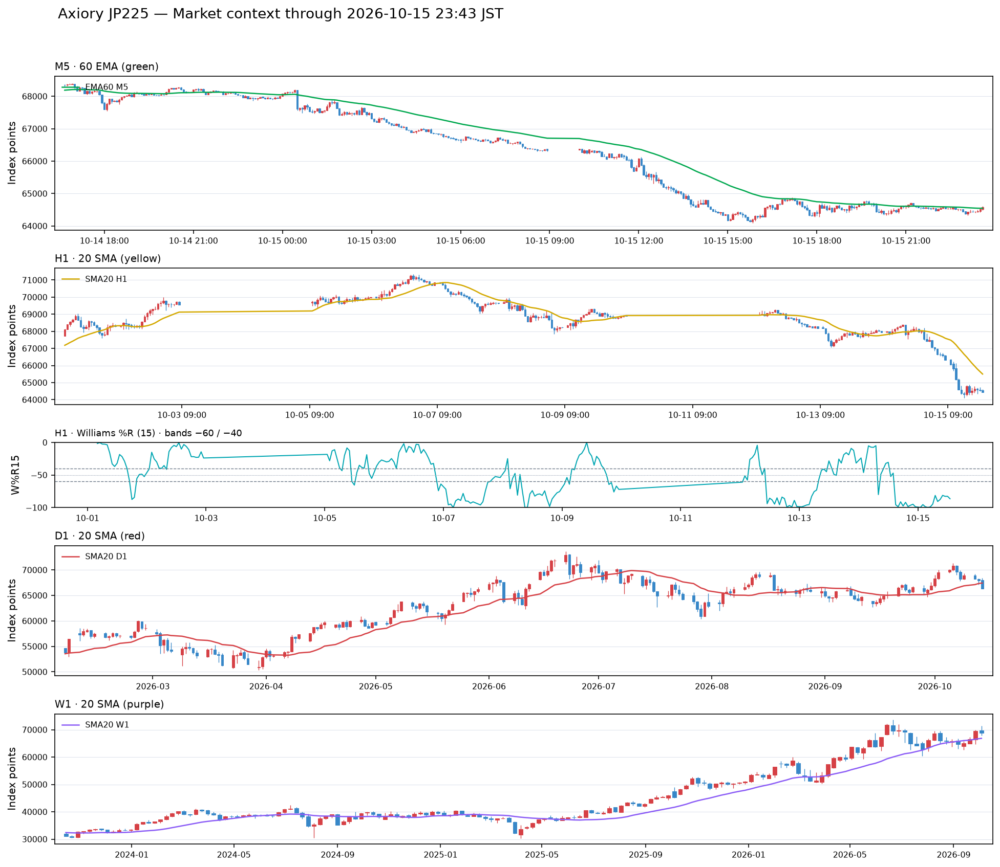
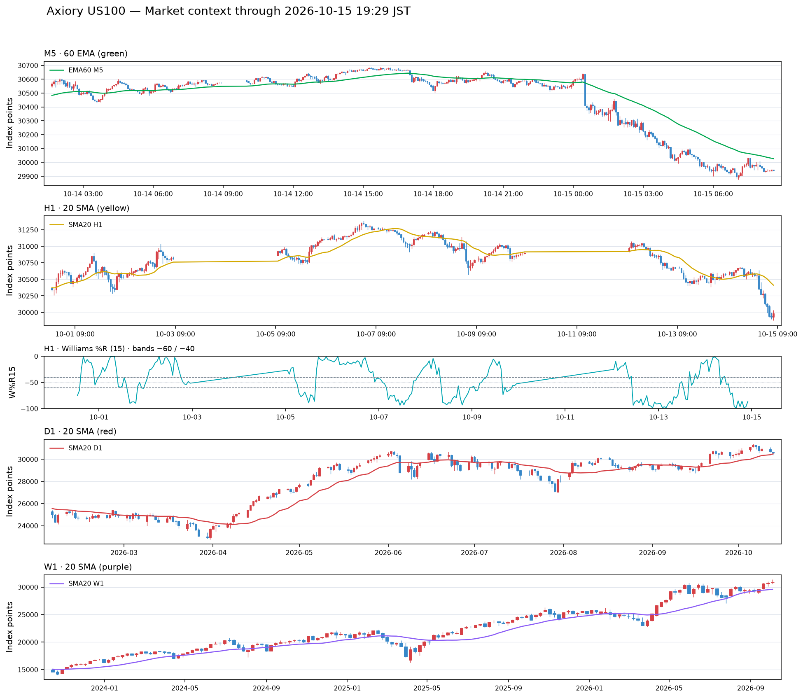

# 2026年10月15日（木）トレード日誌

> 本人の音声実況と振り返りを整理した議事録。朝の記録時点ではチャート、OHLCV、デルタ出来高、約定履歴は未受領。相場・注文・約定情報は本人の口頭報告を基準にし、約定照合は未実施。19:35の保存時にGitHub上の市場コンテキスト資料と価格履歴の存在を確認し、末尾に参照先と更新状況を追記した。実口座／デモの区分は未確認。トレードと無関係な会話は本人の指示で除外した。

## 1. 本日の概要

- 方針は開始前にひとつへ固定せず、実況しながら状況と判断を記録する。
- 朝はナスダックと日経平均の下落継続を認識。
- 本人による前場の分類：BBコンプ後に日経平均が大きく下げた日。ナスダックは上昇N字ダウの期待が失敗したパターンとして記録。
- フジクラのロングを報告。その後、逆指値による損切りを確認した。
- 最後に読み上げた価格・数量は、買い4,712円、決済4,688円、400株。
- 上記の差額からの計算損益は **−9,600円（手数料等を含めず）**。口頭数値に基づく試算で、約定履歴で確認した確定損益ではない。
- 記録受領時刻10:35〜10:37。各観察時点の正確な時刻とは区別する。
- 11:45の前場総括と19:35の全体総括を追記。本人の最新の説明では、日経平均のBBの上下幅が約599ポイント（約600円）へ収縮した後、前夜NY時間から下降が始まり、本日も継続したパターンと分類。

## 2. 朝の環境認識

### ナスダック・日経平均

前夜からナスダックが下落し、本日も下げている。その影響で日経平均も下落して始まるとの見立てだった。下げ止まりを待つか、下降中の戻り売りを検討する状況と考えたが、当日の売買方針を一方へ固定はしなかった。

日経平均は前日の日足サポートとN字ダウの支持を割ったとの観察。上昇の起点65,500円付近への到達にも言及した。「179の出来高」という数値は、対象銘柄・単位・足種が不明のため確定しない。

### BBコンプレッション

- 前日の日経平均について、1時間足のボリンジャーバンドの上下2σが横向きになり、幅が700ポイント以下へ縮小したと認識。
- 08:00頃には約641ポイントまで圧縮されていたと発言。ただし08:00がどの日付を指すかは確認待ち。
- 本人は、この圧縮帯から下へ動いたことで下方向の判断に確信を持ちやすいと振り返った。

これは本人のパターン認識。BBの設定、実際の上下限、ブレイク時刻はデータ照合待ちであり、「下落が必ず続く」という一般則としては扱わない。

## 3. 寄り付き・監視銘柄

| 銘柄 | 本人の観察 | 確認待ち |
|---|---|---|
| 任天堂・トヨタ | 初期確認時点ではまだ寄り付いていないように見えた | 正確な時刻 |
| キオクシア（285A） | 前の基準値14,690円に対し14,000円付近の特別気配で未寄り付き。その後寄り付きを確認 | 基準値が前日終値か、気配値と正式な寄り値 |
| ソフトバンクG（9984） | 5,351円から本日は5,154円付近の特別気配と認識 | 比較対象・正式な寄り値 |
| アドバンテスト（6857） | 38,980円付近の特別気配。その後ギャップダウンで寄り付き、上に戻した | 気配値と正式な寄り値 |
| 太陽誘電（6976） | ギャップダウンで寄り付いて上昇。その後は遅行線・ライン表示でも下方向として戻り売り候補を観察 | 時間足・具体的な戻り条件 |
| フジクラ（5803） | 30秒足のロールリバーサルを根拠にロング。詳細は後述 | 約定履歴・元チャート |
| ディスコ | ギャップダウンスタートと観察。決算発表済みか疑問を持った | 決算発表日と下落理由 |

太陽誘電・アドバンテストの寄り付き時刻の音声は「96分」で、09:06頃を指す可能性はあるが確定しない。

### 決算関連・銘柄名の不明瞭な発言

松屋と、名称が「ネクストユニクスト」、コードが「9458」と聞こえる銘柄の下落を確認していた。名称・コード・価格・決算との関係は不明瞭なので、別銘柄へ推測で置き換えない。

「ユビレール徳」「9,896」「それ維持や4号機」などの発言も銘柄・数値の対応が確認できないため、確定した監視情報にはしない。

外部音声応答ではディスコの決算予定日・速報について説明があったが、出典の提示がないため、この日誌では確認済みの情報として採用しない。

## 4. 1570による指数の確認

日経平均がダブルボトムの底を一度オーバーシュートしたように見えたため、ETF1570の板を確認した。

- 上下で買いと売りがまんべんなく出ているとの認識。
- 68,580円の価格帯と8,500の売りに言及。8,500が板数量か約定株数かは未確認。
- 「13分に……8,000」という売りの発言もあったが、時刻・足種・数量との対応は未確認。

実際に1570へエントリーしたという報告ではない。

## 5. フジクラ（5803）｜逆張りロングから損切り

### エントリー前の認識

- 日足では下方向。
- 日経平均も下げ止まっていないと認識していた。
- 大出来高を伴う陰線の後に上昇し、その上昇第1波の調整・戻しをロング候補と見た。
- 30秒足のロールリバーサルと認識。
- 4,700円の切り番が近く、この水準を割ると下へ走る可能性を意識していた。
- 出来高ダイバージェンスを観察。ただし通常出来高かデルタ由来か、使用指標の条件は未確認。

### 注文・保有の報告

| 項目 | 本人の報告 |
|---|---|
| 方向 | ロング |
| 最初の注文 | 4,793円付近に指値との発言。後の4,700円台前半の価格と整合しないため確認待ち |
| 初期の数量判断 | 3ロットが適切と考え、まず1ロットを成行で入れたとの報告 |
| 追加注文 | 下限4,708円付近などへの指値。その後「3ロット入った」と報告 |
| 後の買い値 | 4,716円との発言。その後、注文履歴を見て4,712円と読み上げた |
| 後の数量 | 逆指値400株との発言。3ロットから400株への経緯は未確認 |
| 保有中の価格 | 4,726円付近まで上がったと報告 |
| 板読み設定 | 大きな約定を見るため、1,500株を基準とするフィルターを設定する意向 |
| 切り番の売買 | 約41万株の約定に言及し、4,700円を一度下へ割ったと観察。集計範囲は未確認 |

「471」など一部の読み上げ価格は桁が省略されているため、正確な指値や約定へ補完しない。ロット数と株数の対応も、約定履歴で確認する。

### リスク管理と決済

保有中は、最大含み損15ティック、25ティック・4ロットなら約1万円といった見積もりを発言。これらは計算過程として扱い、確定損失に混ぜない。

その後、下抜けを観察し、25ティックの自動損切りを設定していたため、すでにロスカットされたことを確認した。

- 損切り時刻：**09:45:19**との口頭報告。
- 途中では4,680円、4,780〜4,787円と聞こえる値にも言及があり、不整合がある。
- 最後に本人が読み上げた取引内容：**4,712円で買い、4,688円で決済、400株**。
- 価格差：24円。本人は24ティックと表現。
- 口頭数値からの計算：**（4,688−4,712）×400＝−9,600円**。手数料等は未反映。
- 音声の「41万円程度」は計算と一致しないため、そのまま確定損失にはしない。
- 約定履歴自体は未受領のため、取引区分・数量・価格・損益の照合は未完了。

### 決済後の値動きの解釈

1分足・2分足で見直すと深い戻しを伴う調整であり、下げ止まりのサインは出ていなかったと反省した。4,700円の切り番で一度跳ねても、上昇失敗から半値戻しを経て、再び4,700円へタッチして下がったと観察。

本人は「デイロールリバーサルの失敗が、フレミングセルのようなパターンになった」と整理した。フィボナッチについて「235」との言及もあるが、比率・対象波は不明のため補完しない。

さらにフジクラがストップ安になったと発言。これは本人の観察であり、値幅制限・価格・時刻は未照合。

## 6. 10:35頃の主観分析｜下落継続と反省

### 日経平均・他指数

日経平均には依然として下げ止まりがなく、戻り高値66,100円から64,952円まで下落したと報告。差額は**1,148円**で、1,000円を超える下げとなった。

%Rは下方向に張り付き、−100付近にあるとの認識。「ストップ安のような状態」は急落の強さの表現として扱い、225Cash自体にストップ安が発生したという記録にはしない。

US100・S&P500も下落しており、本人はこの環境で他の個別銘柄だけが下げ止まるとは考えにくいと判断した。各指数の配信元・正確な値は未確認。

### フジクラのロングに対する反省

下げ止まりを確認できない全体相場の中で、4,700円付近からロングしたことを失敗と評価した。注文履歴を見て後に読み上げた買い値4,712円とは区別し、4,700円は判断した節目として記録する。

本人は、買い手の損切りが出る方向へさらに動く、という見方を重視した。これは本人の相場解釈であり、売買主体の意図や損切り注文を実データで確認したものではない。

また、指数と関連銘柄全体で遅行線がまだタッチしていない点を見落としたと反省。日経平均とのシンクロで見るなら、下げ止まりを示す変化がないまま下降が続いていることを認識すべきだったと振り返った。今回参照した遅行線の足種・設定・タッチ対象はソース確認待ち。

## 7. 10:37追記｜出来高ダイバージェンスを下げ止まりと誤認しやすい形

本人が今回の見誤りやすい形として、以下を追加した。

1. 出来高ダイバージェンスが出ると、下げ止まりそうに見える。
2. 一度値動きが停滞し、安値側がフラットな三角持ち合いになる。
3. トレンドラインのブレイクから上へ向かう展開を期待しやすい。
4. しかし今回は下げ止まらず下落が継続し、ロングが損切りとなった。

本人はこれを「引っかけ」と表現した。下げ止まり期待が外れた形として記録し、誰かが意図して仕掛けたと断定しない。

原文の「トレンドラインを割れたら上に行く」は、ブレイク方向・対象線が曖昧なため、「上抜け確認済み」へ置き換えない。チャート受領後、期待した線と実際に価格が抜けた方向を確認する。

### 教訓リスト

- [ ] 出来高ダイバージェンスだけで下げ止まりと判断しない。
- [ ] 値動きの停滞やフラットボトムの形成を、反転の確認と混同しない。
- [ ] 日経平均・US100など全体の方向と、関連銘柄のシンクロを確認する。
- [ ] 遅行線のタッチ・クロスなど、本人が下げ止まり判断に使う条件を確認する。
- [ ] 切り番で一度反発したことだけをロングの根拠にしない。
- [ ] 逆行するロングでは、エントリー前に確認した根拠と未確認の条件を明記する。
- [ ] 自動損切りの設定と、実際の注文履歴・決済結果を照合する。

以上は今回の本人の反省を行動項目へ整理したもの。個々の指標だけで反転や継続を保証するルールにはしない。

## 8. 前夜の米国株の振り返り・別時間軸の案

サンディスクと思われる音声「3リスク」、テスラ、AMD、NVIDIAについて、じりじり下がる、または下落中のレンジとして観察。本人は、このような値動きではトレードしなくてよかったと振り返った。

大きく下げた銘柄をスイングで買い足したいという案も発言。これは別時間軸の検討であり、今回のデイトレードのロング根拠や、実際の買い増し報告にはしない。

## 9. 指数の定時チェック

| 日時（JST） | 225Cash | US100 |
|---|---|---|
| 10月15日 08:50 | 時点データ未確認 | 時点データ未確認 |
| 10月15日 15:30 | 当該時点の状態は未照合 | 当該時点の状態は未照合 |
| 10月15日 22:25 | 未到来 | 未到来 |
| 10月16日 01:00 | 未到来 | 未到来 |

各時刻の価格、上位足の方向、MAとの位置、1時間足%R（15）の中心上下・レンジ判定、重要なサポレジを記載する。時刻が違う実況を定時の記録として代用しない。

## 10. チャート・写真のルール

| 指標 | 設定 | 色・判定 |
|---|---|---|
| 日足20SMA | 日足・20 | 赤 |
| 1時間足20SMA | 1時間足・20 | 黄 |
| 1時間足%R | 期間15 | 中心−50の上下を記録 |
| %Rレンジ | −60〜−40 | レンジ内と記録 |
| 5分足60EMA | 5分足・60 | 緑 |

- 個別銘柄・ETFのチャートにはローソク足・出来高・デルタ出来高を表示する。
- 225Cashの出来高は省略可能。
- 必要なデータがなければ不足を明記し、推測で作図しない。
- HTML版の写真はクリック／タップで拡大し、拡大したまま前後へ切り替えられるようにする。
- 朝の実況時点では画像・CSV未受領。19:35保存時に別途生成済みの市場コンテキスト資料を確認し、末尾にリンクした。この日誌のHTML版・写真ギャラリーは未作成。

## 11. 朝の実況記録時点の分析ソースと確認待ち

| 必要なソース | 状態・不足による制約 |
|---|---|
| 225Cash・US100・S&P500の価格履歴 | 未受領。実況の価格・方向・時刻は未照合 |
| 1時間足BB・%R、MA・遅行線の設定と履歴 | 一部設定のみ合意済み。当日の具体的な状態は未照合 |
| フジクラのローソク足・出来高・デルタ出来高 | 未受領。ロールリバーサルとダイバージェンスを検証できない |
| フジクラの約定・逆指値履歴 | 未受領。最後の口頭数値から損失を計算した段階 |
| 決算・材料の正式資料 | 未取得。銘柄名・発表日・値動きの原因は未確認 |
| 08:50時点の指数データ | 未受領 |

**分析ソース不足：朝の実況は本人の主観分析と口頭の取引報告を記録したもの。19:35保存時に確認した市場資料の参照先・利用範囲は第14節に記載。個別銘柄のチャート・デルタ出来高・約定履歴との照合は未実施。**

記録は継続中。本日の終了や最終損益を意味しない。

## 12. 11:45追記｜前場の分類：BBコンプ後に大きく下げた日

### 記録タグ

- BBコンプ
- 大きく下げた日
- 上昇失敗パターン

### 日経平均の前場

本人の振り返りとして、10月15日の前場を「日経平均が大きく下がった日」と分類する。

祝日明けから続くBBコンプレッションについて、本人は祝日を挟んだ影響もあり、当初は十分に信用していなかったと振り返った。上下2σの幅が概ね600〜700円台で推移していたところから下へ動き、大幅下落へつながったという見立て。

発言の「祝日明けの月曜日から」は日付・曜日の対応が未確認のため、特定の日を補完しない。既出の1時間足・約641ポイントという観察との対応、収縮開始時刻、下抜け時刻も、後でソースを照合する。

### ナスダックの上昇失敗

ナスダックは、上昇のN字ダウのように見え、一気に上がりそうな形をしていた。しかし、その上昇期待が成立せず失敗したパターンとして残す。

日経平均のBBコンプ後の下落と、ナスダックの上昇失敗を同日の環境認識として関連づける。具体的な先行・遅行関係や因果関係は今回未検証。

### エントリー評価との区別

これは相場の特徴と失敗パターンの分類であり、実際にエントリーできた、または同じ場面で必ず利益を取れたという評価ではない。エントリーの可否・条件・時刻・損切り・利確については、後で別途検証する。

## 13. 19:35追記｜日経平均のBBコンプによる下降トレンド

### 本日のパターン分類

**日経平均のBBコンプによる下降トレンド。BBコンプ・大きく下げた日・上昇失敗パターンとして記録する。**

本人の最新の振り返りでは、日経平均のボリンジャーバンドの上下幅が約599ポイント、約600円まで収縮した後、前夜のニューヨーク時間から下へ崩れ、その流れが本日も続いた。強い下降トレンドが発生し、さらに下へ進んだという認識。

原文では「縮小率」と表現しているが、単位がポイント・円のため、ここでは「収縮後のバンド幅」として整理する。前の約641ポイント、600〜700円台という説明と合わせて発言順に残し、測定時刻の違い・最小幅・足種はソースで確認する。599という値を独立して再計算・検証したわけではない。

### 振り返りの流れ

1. 祝日を挟んだBBコンプレッションを当初は十分に信用していなかった。
2. 上下2σの幅が縮み、横向きの圧縮状態にあったと認識した。
3. 前夜NY時間に下方へ崩れ、本日も下降が継続した。
4. ナスダックの上昇N字ダウへの期待も成立せず、上昇失敗として振り返った。

これは本人による相場パターンの整理であり、「BBコンプが下落の原因と証明された」「このパターンで必ず下降する」という記述ではない。どの時点でエントリー可能だったかは別の検証課題とする。

## 14. GitHub上で確認した市場資料とデータ更新の不足

19:35の保存作業中に、本日19:29:05生成の[US100・JP225市場コンテキスト](market_context/market_context.md)を確認。以下はその資料の記載に基づく参照情報であり、今回CSVを再計算して検証した値ではない。

| 対象 | 資料記載のデータ元・範囲 | 日誌での扱い |
|---|---|---|
| JP225 | Axiory MT5。M1は19:21、M5は19:20、H1は19:00までの確定足 | 本日の後続データの参照先として記録 |
| US100 | Axiory MT5。履歴要求が応答せず前回成功分を利用。M1は08:43、M5は08:40、H1は08:00まで | 午後・夜の状態を表す資料として使わない |

**データ更新不足：US100は19:29に資料が生成されていても、価格データは朝08:43まで。15:30や19:35時点の状態を確認したものではない。**

また、AxioryのJP225／US100と別口座のJP225Cash／US100Cashは価格系列が異なるとの資料注記がある。本人が実況した価格や口座の約定と、同じ価格系列だと決めつけない。

### 市場チャートへの参照

上記はリポジトリ内の既存画像へのリンク。今回画像の表示内容・指標設定を目視検証したものではなく、日誌のチャート必須項目をすべて満たすと確認したものでもない。

価格履歴の保存先：[Axioryの市場データ](../../market_data/axiory/)。今回の保存ではフォルダ内のM1・M5・H1・D1・W1のCSVの存在を確認した。個別銘柄の約定・デルタ出来高の照合資料の代わりにはしない。

