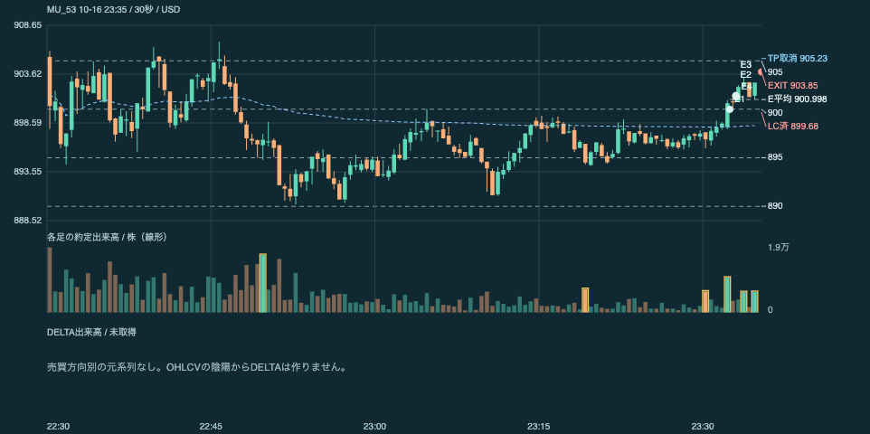
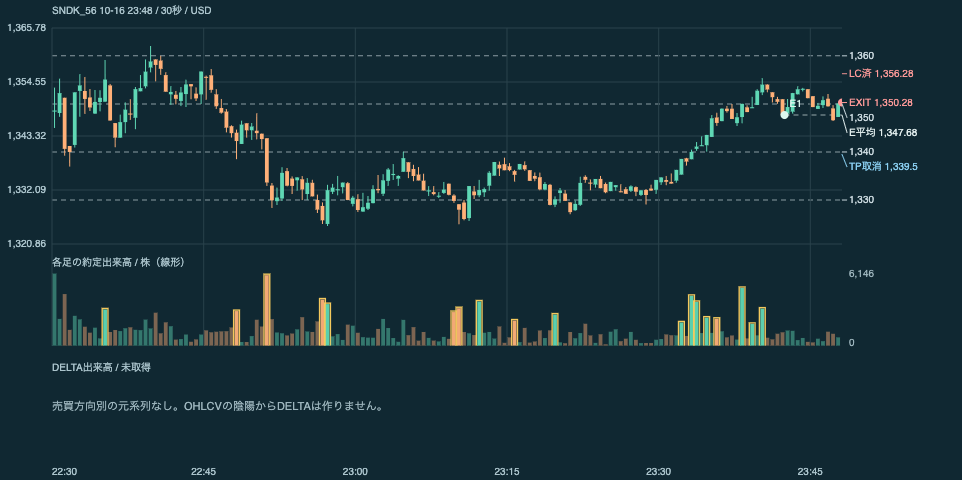
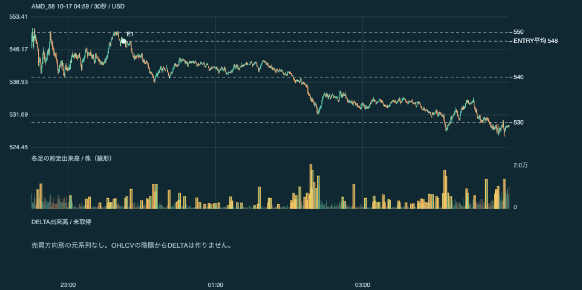

# 2026年10月16日（金）NY時間 トレード日誌

Paper Trading／CSV照合版／FTP別工程。時刻はJST。10/17 11:27書出し資料。

## 結果

- 決済済み7トレード：実現 **-612.71円**。
- MU：5トレード、**+757.67円**。
- SNDK：2トレード、**-1,370.38円**。
- AMD：SHORT10株@548、未決済。書出し資料の評価価格528.75、含み益**+30,401.14円**。実現へ合算しない。
- 手数料0円、税未計上。総額は残高履歴の未丸め値。ENTRY/EXITの損益を二重に足さない。丸めた行の合計と総額には0.02円差がある。
- 昼のキオクシア、前夜10/15 SNDKロングとは別枠。

## 約定一覧

|番号|銘柄|方向|ENTRY JST|EXIT JST|株数|平均ENTRY USD|EXIT USD|値幅損益 USD|実現 JPY|
|---|---|---|---|---|---:|---:|---:|---:|---:|
|51|MU|SHORT|23:12:28|23:22:39|12|897.1|898.83|-20.76|-3,276.52|
|52|MU|SHORT|23:29:46|23:32:27|4|897.02|899.44|-9.68|-1,527.78|
|53|MU|LONG|23:32:28|23:35:22|16|900.9975|903.85|+45.64|+7,203.28|
|54|MU|SHORT|23:37:42|23:39:51|4|903.31|906.38|-12.28|-1,938.13|
|55|MU|SHORT|23:41:08|23:46:35|4|905.11|904.64|+1.88|+296.81|
|56|SNDK|SHORT|23:42:27|23:48:08|2|1,347.68|1,350.28|-5.20|-820.97|
|57|SNDK|SHORT|23:51:03|23:59:04|2|1,345.24|1,346.98|-3.48|-549.42|
|58|AMD|SHORT|23:45:13|未決済|10|548|—|未確定|未確定|

## MU

ショート2回の後、23:32:27に決済し、1秒後にロングへ切り替え。4株ずつ4回で16株へ増やし、23:35:22に全決済。その後のショート2回を含め計5トレード、実現＋757.67円。

**AIの見解**：私なら、MUは「方向の切替」と「最大数量の増加」を中心に復習します。ショート2回の損失後、ロングの4→16株の増加で＋7,203.28円を得ていますが、数量を増やした根拠は未記録です。23:35:22のロング決済後に再び売り、23:39:51にはLCで決済しています。利益の大きさと、方向転換の条件・数量管理を分けて評価します。

**次回条件**：切り替える前に旧建玉が解消されたか、次の方向を支持する観測、最大数量、LC時の合計損失を記録する。TP905.23に届く前にロングを903.85で決済した理由は未記録。

## SNDK

当日はショート2回。23:42:27に2株@1,347.68→23:48:08に1,350.28で決済。23:51:03に逆指値売り2株@1,345.24→23:59:04に1,346.98で決済。合計−1,370.38円。前夜10/15のペナント・ロングとは別の取引。

**AIの見解**：私なら、最初のショートはLC1,356.28・TP1,339.50が記録された時点のR:R約1:0.95と、実際の早い成行決済を並べます。2回目は売り逆指値1,345.50に対して1,345.24で約定。当日のBATS 30秒足で、約定前後のローソク足と区間出来高を確認できるようにしました。逆指値の約定だけでブレイク継続を確定せず、その後の価格維持と決済理由を分けて復習します。

**次回条件**：最初のLC・TPを設定した理由、成行決済した理由、2回目のLCを記録する。当日のSNDK OHLCVの区間出来高と価格維持を、約定・決済時刻に合わせて照合する。

## AMD

23:45:13にショート10株@548.00。今回のポジションCSVで未決済。現在値528.75、含み益＋30,401.14円。TP・LC欄は空欄。価格差の参考値は19.25ドル×10株＝192.50ドル。

**AIの見解**：私なら、AMDの大きい含み益を確定した成績へ加えずに残します。書出し時のCSVではLC・TPが空欄で、保有中の無効化条件は確認できません。現在値の時刻はCSV内にないため、528.75をNY引け値や23:59の値として扱いません。

**次回条件**：保有を継続した理由、無効化水準、決済条件を記録する。決済後の約定CSVを受け取ってから実現損益へ反映する。

## データの範囲

- MU BATS 30秒：完成足は23:36:30まで。以後の約定時点の市場足は未取得。
- SNDK・AMDは追加の当日BATS 30秒足を使用。完成足は10/17 04:59:30まで。DELTAの約定方向元データは未取得。
- 本人のNY実況・体調・気分・決済理由は未受領。
- AMDの評価価格の個別の時刻は未収録。NY引け値としては扱わない。

## タグ

#NY時間 #Paper_Trading #売買方向切替 #数量増加 #逆指値執行 #未決済建玉

[チャート付きHTML](diary_20261016_ny.html)

## 復習チャート画像

### MU #53 LONG・16株合算／決済時点

### SNDK #56 SHORT・決済時点

### AMD #58 SHORT・取得済み市場データの末尾／未決済

