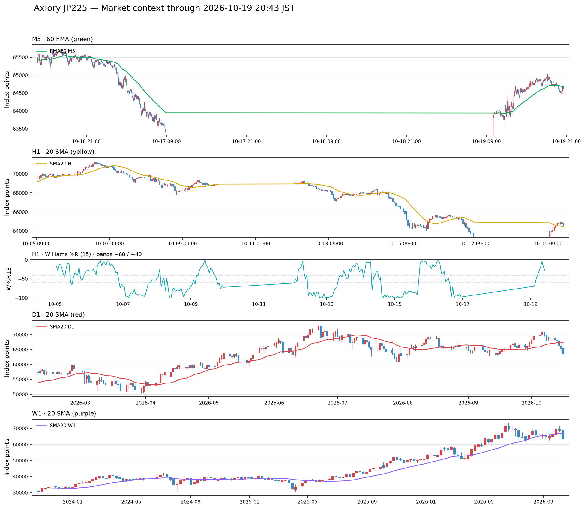
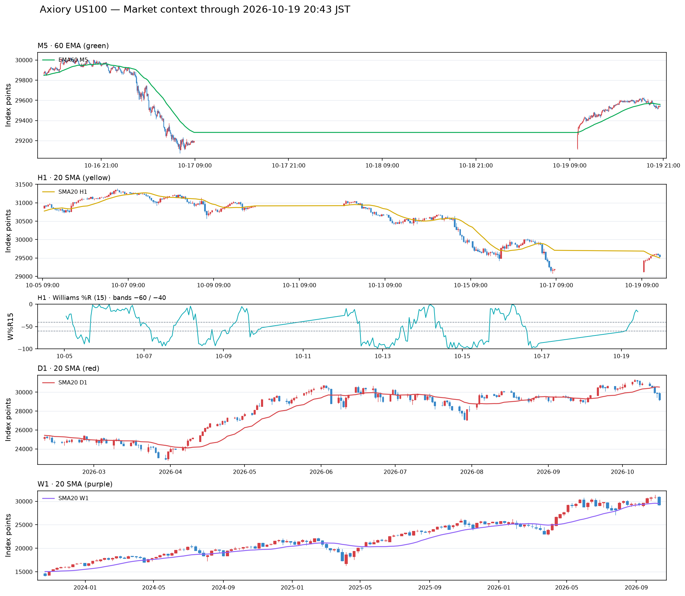

# 2026年10月19日（月）トレード日誌

> 本日の朝の実況から19時59分の振り返りまでを統合。本人の観察・仮説・売買報告・検証候補を区別する。取引履歴・チャートCSVは未照合のため、正確な約定、株数、確定損益、出来高・デルタは後で確定する。実取引／デモの別は未確認。ニューヨーク時間は今回の記録に含まれていない。

## 1. 本日の要点

上位足では日経平均を下方向寄りに見ていたが、大きくギャップダウンした個別銘柄には寄り付き後の買い戻しが入った。日経平均も上下を挟みながら戻しを見せ、10時頃には日経225とシンクロ監視銘柄全体に上昇のプライスアクションがあったと振り返った。

1570ではロングを分割し、最終的に20ロットを自動決済した。10ロットだけを決済する設定のつもりが両方のポジションが決済されたため、注文数量と対象建玉の確認が課題となった。キオクシアではVWAP付近の買い支えを根拠にロングし、出来高の減少と上昇停滞を警戒して撤退利確した。

SHIFTの前日ストップ高水準での買い支え、ソフトバンクGのサポレジ転換、ぐるなびのストップ高後の失速も検証候補として記録する。結果として上昇・下落したことと、その時点で自分のエントリー条件が成立していたかを分けて評価する。

### 売買報告と候補の一覧

| 銘柄 | 区分 | 根拠・きっかけ | 結果・現状 |
| --- | --- | --- | --- |
| 1570（日経レバ） | ロングの売買報告 | 約4万株の買い、押し目、日経平均の戻し、買い支え | 計20ロットを全決済。本人評価はレンジ上限での利確。価格・金額は履歴照合待ち |
| キオクシア（285A） | ロングの売買報告 | VWAP付近の買い支え | 暫定12,983円付近→13,150円。#撤退利確。数量・金額は未確定 |
| SHIFT（3697） | 監視・検証候補 | 前日ストップ高の終値を背に、下がらない状態 | 約10分の持ち合い後に上昇したとの観察。約定報告なし |
| ソフトバンクG（9984） | ロングの検証候補 | 10:56、階段ダウから上昇一波→二波のサポレジ転換 | 11時台の値幅不足を懸念。価格の読み上げに不整合あり |
| ぐるなび（音声表記「グルナビ」） | 売買案・事後検証 | 午後のストップ高張り付き、その後の失速 | 149円買い→164円利確→ショートの構想。実行報告かは未確認 |
| GO（本人指定581A） | 監視・売買候補 | 大出来高、3,080円付近の買い支え、階段ダウ失敗の警戒 | 空売り不可との本人確認。注文・約定報告なし |
| 任天堂（7974） | 監視 | 小幅ギャップアップ、8,533円付近の持ち合い | 約定報告なし |
| テラドローン（278A） | 調査事項 | 価格変化と株式分割の関係への疑問 | 分割の有無・条件は一次資料未確認 |

**本日の合計確定損益は未集計。** 利益幅と利益金額を混同せず、履歴で確認する。

## 2. 朝の環境認識｜日経225と個別銘柄

### 日経平均の上位足と当日の動き

9時2分頃に監視開始。「個別銘柄がまだ貼り付いていない」という発言は、寄り付き状況か画面表示の状態か未確定。銀行関連はマイナス1.1付近との観察だが、対象・単位は未指定。

| 項目 | 本人の初期認識 |
| --- | --- |
| 週足 | 下向き |
| 日足MA | レンジ下限付近で、下へ傾きそう |
| 4時間足 | 下方向 |
| 60分足20SMA | 下方向 |
| 60EMA | 横向き。今回の発言では足種未指定 |
| %R | 下向き。対象足・設定は未確認 |

上位足は下方向寄りだった一方、当日の日足・寄り付き後の値動きには上昇する場面があった。その後、オープンより下で推移する場面を経て、5分足・15分足で再び上方向への戻しを観察した。

**教訓：上位足の下降認識、ギャップ率、寄り付き後の方向を別々に記録する。** ギャップダウンしているという理由だけで、寄り付き後も下落すると決めつけない。

### 個別銘柄のギャップと初動

| 銘柄 | 本人が観察したギャップ | 寄り付き後 |
| --- | --- | --- |
| キオクシア | 約−5% | 買い戻されて上昇。前日終値を戻りの基準にした |
| 村田製作所 | 約−1.35% | 上昇へ切り返した |
| アドバンテスト | 約−6.0% | 約−4.4%まで戻した |
| ソフトバンクG | 約−4.25% | 後にロング候補を検証 |
| 任天堂 | 約＋0.64% | 8,533円付近で上下し、方向感は乏しい |

数値は口頭観察に基づき、正式な始値・前日終値との計算は未実施。

## 3. 日経225シンクロ｜10時頃と1570の10時8分

夜の振り返りでは、**10時頃に日経225のシンクロ監視銘柄全体が上昇するプライスアクションがあった**と述べた。どの銘柄が何時何分に反応したか、出来高・デルタの強さが一致していたかは、並列チャートで確認する。

1570では、より具体的に**10時8分・65,300円付近の上抜け**に言及している。

> 2分足のライン表示で価格推移が密集していた持ち合い帯の上限、65,300円付近を、出来高を伴って上抜けた。レンジを離れて上方向へ進む初動の一波として観察した。

本人の「密度が高い部分」という表現を、ライン表示の持ち合い帯として言語化したもの。価格帯別出来高の厚い帯やオーダーブロックを確認した、という意味には置き換えない。

この動きを基準にアドバンテストなどのシンクロを狙えたかを検討した。もう一銘柄は「オメラタ切削」と聞き取れるため、正式名称は未確定。

ただし本人は、鉄板と言えるほどの形ではなく、ここは新たにトレードしなくてもよかったのではないかと評価した。**上昇した結果だけで、必ず取るべき場面だったとは結論づけない。** 10時頃という全体観察と、10時8分の個別イベントも同一時刻として統合しない。

タグ：#日経シンクロ #レンジ上限ブレイク #上昇一波 #出来高 #見送り検証

## 4. 1570｜分割ロングから全決済まで

### エントリーの根拠

30秒足で約4万株の買いを観察し、上昇一波の後に戻ってきたところを買いたいと考えた。日経平均が5分足・15分足で上方向へ戻す動きを補助材料にした。

約4万株の発生時刻は音声上「84分」で未確定。買いと判断した根拠が通常出来高、デルタ、約定方向のどれかも資料で照合する。初期の価格観察は64,980円付近。

### 注文と保有の経過

| 順序 | 報告内容 | 記録上の扱い |
| --- | --- | --- |
| 初期計画 | 20ロット予定のうち、まず10ロット | 分割エントリー |
| 先行分 | 64,990円で成行ロング | 先行10ロットという文脈の約定報告 |
| 追加指値 | 64,480円で10ロット | 途中の64,520円から言い直し。実際の訂正履歴は未確認 |
| 追加約定の後続報告 | 64,600円の指値が9:39に約定し、計20ロット | 先の注文からの変更経緯は照合待ち。別注文として重複計上しない |
| 損切り移動 | 64,630円へ | 設定の報告 |
| 損切り更新 | 64,660円付近へ引き上げ | この時点の明確な損切り設定 |
| 自動決済設定 | 11:15に10ロット分を設定したつもり | 実際は20ロットが対象になったとの報告 |
| 最終状態 | 両方のポジションが自動決済され、計20ロット全決済 | 本人報告では残存ポジションなし |

9時37分の15秒足で出来高を伴う陰線が発生し、その後買い支えられたと観察。そこを基準にストップを置き、建値へ戻すか上昇するかを待つ考えだった。

### 平均建値とリスク

先行10ロットが64,990円、追加10ロットが64,600円なら、単純平均建値は**64,795円**。本人もこの前提を確認した。

- 64,630円での決済は平均建値より165円下。
- 64,660円へ引き上げても平均建値より135円下。
- 追加分が利益になる水準でも、全体として建値撤退になるとは限らない。
- 1ロット当たりの口数・費用・各約定は未照合のため、金額ベースの損益は算出しない。

### 利確と自動決済の振り返り

**11時30分までに取引を終えたいという目的で、自動決済を設定した。** 本人は階段ダウの上段にあたるレンジ上限で利確したと評価している。

一方、10ロットだけを対象にしたつもりが20ロット全体を決済していた。注文数量、対象建玉、注文の連動などの履歴を確認し、設定ミスやシステム不具合と推測で断定しない。11時15分は設定時刻であり、正確な各決済時刻は未確認。

先に読み上げた「10ロット分・66,152円」という設定値は、今回の説明でも実際の決済価格までは確定していない。**66,152円を確定利確価格として採用しない。**

### 仮想検証との切り分け

「64,660円で買い」「追加」「注文を訂正しなかった場合を仮注文として積み上げる」という不明瞭な発言があった。日足・2分足のチャートやリプレイを使い、実際の約定と仮想結果を比較したい意図が含まれる可能性がある。

64,660円を追加の買い約定として計上しない。比較仕様は未確定であり、チャート・リプレイは未作成。

タグ：#1570 #ロング #分割エントリー #買い支え #レンジ上限利確 #自動決済 #全決済 #注文数量の確認

## 5. キオクシア（285A）｜VWAPロングと撤退利確

### 朝の観察とエントリー

約−5%のギャップダウン後に買い戻された。出来高とボラティリティは大きい一方、上ヒゲで何度も抑えられ、チャネル状の攻防が続いていた。

VWAP付近での買い支えを根拠にロングしたと報告。買値は**12,983円付近**という読み上げを暫定値として残す。SHIFTへの話題訂正が途中に挟まったが、その後キオクシアの決済整理に本人が同意したため、履歴で最終確認する。

### 保有中の警戒と決済

- 損切り設定：**12,935円**。
- 暫定買値から設定までの下値幅：48円。
- 半値付近で止まり、上昇し切れずフレミングセルのようになる可能性を警戒。
- 30分足ではチャネル状と観察。
- 出来高が減少してきたため、**13,150円で利確して撤退**したと報告。
- 本人指定の分類：**#撤退利確**。

暫定買値と決済値の差は167円。数量・費用が未確定のため利益金額へ換算しない。目標に到達した利確ではなく、値動きの停滞や下落リスクを警戒して利益を確保した決済として記録する。

### 夜の振り返り｜その後の波形と指値候補

VWAPのラインに沿って上昇したと観察。最初はチャネル状で、一度上昇の勢いが強まった後に調整し、N字ダウのように下げてから再び上昇したと振り返った。音声の「O、Nのラウン」は、正確な独自パターン名までは確定しない。

下へ調整するなら、**3分足のヘッド＆ショルダーに関連する12,885円付近まで下がってもよい**という見立てもあった。ただし、その価格がネックライン・肩・安値のどれかは未指定。

どこに買い指値を置けたかが検証課題。12,885円への到達や、その価格での発注・約定を報告したわけではないため、過去の約定へ追加しない。

タグ：#キオクシア #VWAP #買い支え #ロング #出来高減少 #撤退利確 #N字ダウ #指値検証 #3分足

## 6. SHIFT（3697）｜前日ストップ高水準の買い支え

朝は本人が見ていたランキングで1位。ランキングの正式名称は未確定。

前日のストップ高の終値付近を背に、買い支えが続くかを監視した。1,055円との発言の後、**1,058円で買い支えられている**と訂正し、上昇したことを強いと評価した。

夜の振り返りでは、**1分足で下がらない状態が約10分続き、その後上へ進んだ**と説明。短時間の一度の反発より、基準価格を割らずに維持する時間に注目した場面として残す。

- 分類：前日ストップ高水準／サポート維持／下がらない持ち合い／上昇候補。
- 注目点：基準価格を維持した時間、出来高・デルタ、上抜け時の反応。
- 実際に買ったとの報告はない。約10分という継続時間と具体的な対象足はチャートで照合する。

タグ：#SHIFT #前日ストップ高 #買い支え #下がらない #1分足 #持ち合い #ロング候補

## 7. ソフトバンクG（9984）｜10時56分のロング候補

階段ダウの形を観察し、**10時56分、上昇一波から二波へつながる部分でサポレジ転換が完成した**と評価した。

| 項目 | 本人の発言・評価 |
| --- | --- |
| 基準価格 | 4,673円 |
| 指値ロング候補 | 6,474円 |
| 時間帯への懸念 | 11時台に近く、ボラティリティが伸びにくそう |
| 評価 | 一応エントリーポイントかもしれない |
| 実行 | 注文・約定の報告なし |

基準と指値候補に価格差があるため、6,474円を4,674円等へ推測で訂正しない。正しい価格は資料・後続説明で照合する。損切り・利確位置、数量、リスクリワードは未指定。

**検証課題：サポレジ転換の成立に加え、時間帯と残る値幅を踏まえて選別できたか。** ボラティリティが実際に低下したかは未検証。

タグ：#ソフトバンクG #階段ダウ #サポレジ転換 #上昇二波 #ロング候補 #時間帯 #ボラティリティ

## 8. ぐるなび｜ストップ高とその後の失速

本人の音声表記は「グルナビ」。銘柄コードは今回未指定のため補完しない。

ストップ高となり、午後に張り付いた後、結局戻していったと振り返った。本人は「午後に張り付いたので弱いのでは」というイメージを持っており、結果がその見立てに近かったと評価した。**午後の張り付きだけで弱さを一般化するのではなく、今回の仮説として保存する。**

### 検証したい売買の流れ

1. 149円付近で買う。
2. 164円付近で利確する。
3. その後の失速を確認し、空売りへ切り替える。

発言は「149円で買って164円で利確、その後空売りでいいのでは」という振り返りの文脈。実際にこの往復取引を行ったかは未確認のため、**売買案・検証候補**に分類する。149円から164円の値幅は15円だが、実現利益として加算しない。

### 課題

- ストップ高後の失速で、空売りの具体的な根拠は何だったか。
- 164円付近から売る場合、どこを利確目標にするか。
- 売買転換の時刻、損切り位置、空売り可否と在庫・費用。
- 午後の張り付きと、その後の価格・出来高の変化をどう組み合わせるか。

本人もショートの利確位置には迷いがある。149円をショートの利確目標として指定したわけではないため、買い候補価格とショートの出口を混同しない。「リモ後」という音声は意味不明瞭なため、具体的な時間帯や材料へ補完しない。

タグ：#ぐるなび #ストップ高 #午後の張り付き #失速 #ロング候補 #ショート候補 #利確課題 #売買転換

## 9. その他の監視・調査事項

### GO（本人指定581A）

本人が名称・コードを明示。良い決算との評価、大きい出来高に注目した。決算内容は未確認。ギャップダウンなし、出来高約14M（1,400万株）、3,125円付近との観察。出来高の集計期間は不明。

- 前々日の3,085円付近を含めて階段ダウを意識し、上昇し切れず下抜ける失敗パターンを警戒。
- 買いの条件候補は3,080円付近の買い支え。
- 3,040円はアラートを置いて観察する候補で、タッチ後すぐ売るという意味ではない。
- ショート候補は3,130円付近のVWAPへの戻り。
- 後に本人が「売れない」と確認。利用口座のその時点の判断として残し、常時・全口座での空売り不可とは一般化しない。
- アラートの設定完了や買いの約定は未確認。こちらでアラートは作成していない。

### 任天堂（7974）

約＋0.64%で始まり、8,533円付近で上下する方向感の乏しい状態。約定報告なし。

### テラドローン（278A）

価格が下がって見えるのは株式分割のためか、本人から質問があった。外部会話のアシスタントの「2分割・基準日等」の回答には確認資料がないため、事実として採用しない。分割の有無・比率・日付、過去価格の調整、当日の前日比下落は区別して確認する。

## 10. 教訓と次回の検証

### 良かった点

- 大きなギャップダウンと寄り付き後の買い戻しを分けて観察した。
- 1570の平均建値と損切りラインの関係を確認し、全体のリスクを認識した。
- キオクシアでは出来高減少と上昇停滞を警戒し、利益を残して撤退した。
- 11時30分までに終えるという時間面の出口を考えていた。
- 出来高を伴うブレイクでも、鉄板でなければ見送ってよいと評価した。

### 課題・教訓リストへの追加

1. **分割ポジションの管理は合計数量と平均建値で行う。** 追加分の利益だけで全体の建値撤退を判断しない。
2. **自動決済を確定する前に、数量と対象建玉を確認する。** 10ロットのつもりが20ロット決済になった経緯を注文履歴で特定する。
3. **価格の出口と時刻の出口を分けて記録する。** レンジ上限の利確判断と、11時30分までの手仕舞い目的は両方残す。
4. **「下がらない時間」を観察材料にする。** SHIFTの支持維持と約10分の持ち合いが、どの条件と重なったか検証する。
5. **チャート形状・出来高・指数のシンクロを照合する。** 個別銘柄のVWAPや波形だけでなく、10時頃の全体の変化を並べて見る。
6. **エントリー候補には出口も用意する。** ぐるなびのショートは、利確位置・損切り位置・売建可否が未確定。形だけで実行可能な取引と評価しない。
7. **出来高を伴う上抜けでも、すべてを取りに行かない。** 鉄板に該当するか、時間帯に残る値幅があるかを確認する。
8. **実況と仮想検証を分ける。** リプレイ上の売買や事後の構想を、実際の約定・保有・実現損益へ加算しない。

## 11. チャート・定時チェック・ソースの状態

### 定時チェック（JST）

| 日時 | 225Cash | US100 |
| --- | --- | --- |
| 10月19日 08:50 | 当該時点は未照合。朝の実況を代用しない | 未記録 |
| 10月19日 15:30 | 当該時点は未記録・未照合 | 未記録 |
| 10月19日 22:25 | 未到来 | 未到来 |
| 10月20日 01:00 | 未到来 | 未到来 |

### 必須のソースと不足の告知

19時59分のまとめ作業時点で、GitHubの10月19日フォルダに確認できたのは日誌Markdownのみ。取引履歴、注文履歴、個別銘柄・指数のチャートCSV、画像は同フォルダに確認できず、今回の実況との照合は未実施。他の場所に資料が存在しないという意味ではない。

**そのため、正確な損益集計、実取引／デモの確定、出来高・デルタの検証、実データからのチャート生成は未完了。** ローソク足や出来高を推測して図にしない。ニュース・決算・株式分割・売建条件の事実確認も今回の記録作業では行っていない。

### チャートを作る際の共通ルール

- 個別銘柄・ETFはローソク足、通常出来高、デルタ出来高を必須とする。
- 225Cashは出来高を省略可。デルタが取得できない場合は未取得と表示する。
- 日足20SMA：赤。1時間20SMA：黄。5分足60EMA：緑。
- 1時間%R(15)：−50の上下と、−60〜−40のレンジ判定を記録する。
- HTMLで掲載する画像はタップ・クリックで拡大し、前後へページ送りできるようにする。今回のMarkdownでは、未提供の画像やHTMLビューアーは作成していない。

### 照合・検証チェックリスト

- [ ] 全取引の実行区分、株数／口数、各約定、費用、本日合計損益。
- [ ] 1570の64,480円の指値から64,600円の約定報告への経緯。
- [ ] 1570の64,660円は損切り設定か、別注文・仮想検証か。
- [ ] 11:15の注文設定、対象建玉、20ロット全決済の各価格・時刻。
- [ ] 先の66,152円という設定値と、決済注文の関係。
- [ ] 約4万株の対象足、9:37の15秒足、10:08・65,300円の上抜け。
- [ ] キオクシアの買値・数量・13,150円決済、VWAP沿いの波形。
- [ ] キオクシアの3分足・12,885円の位置付けと指値候補。
- [ ] 10時頃の各シンクロ銘柄の反応。名称不明の候補「オメラタ切削」。
- [ ] SHIFTの1,058円付近で下がらなかった約10分間の足・出来高。
- [ ] ソフトバンクGの10:56、4,673円と6,474円の正しい価格。
- [ ] ぐるなびの正式銘柄情報、張り付き・失速時刻、149円→164円の実行有無、ショートの出口。
- [ ] 日足・2分足で実約定と仮注文を比較するリプレイの仕様。

## 12. 音声の不明瞭な箇所・訂正の扱い

会話の流れは本文へ統合し、以下は誤った約定や数量を作らないための照合メモとして残す。

| 発言 | 扱い |
| --- | --- |
| 1570の「64,520円」→「64,480円」 | 指値の言い直しとして記録。実注文の変更は履歴待ち |
| 1570の「64,660円で買い」「仮の注文」等 | 損切り設定からの話題転換が不明。追加約定に数えない |
| 11:20受領の「10ロット分6万6,152設定」 | 読み上げ値を保存。12:36に全決済報告があったが、実際の決済価格は未確定 |
| 同発言の「26ポジション」 | 26ロットへ変更しない。後続報告の全決済数量は20ロット |
| 「17,05」「11時半ダウ」「21,000前」「1ブロック書く」 | 意味・時刻・価格を推測で補正しない。受領11:20を11:30の出来事に置き換えない |
| キオクシアの切り番「23,000」 | 13,000円等へ推測で訂正しない |
| 夜の「2855A、記憶社」 | 本日の対象銘柄の文脈からキオクシア（285A）として整理。別銘柄を追加しない |
| SHIFTの1,055円→1,058円 | 後の明示した訂正値1,058円を採用 |
| ソフトバンクGの4,673円／6,474円 | 価格差があるため確認待ち |
| ぐるなびの「リモ後」 | 意味未確定。具体的な材料・時刻へ補完しない |

**本稿は本日ここまでに提供された会話全体のまとめ。数字の確定とチャート検証は、後から添付される取引履歴・CSVをもとに更新する。**

<!-- AUTO MARKET CONTEXT START -->
## 指数の定量マーケットコンテキスト（Axiory）

> データ取得: 2026-10-19 20:43 JST。Axiory `JP225` / `US100` の参考値です。
> `JP225Cash` / `US100Cash` を扱う別口座とは価格系列が異なるため、約定価格や損益の照合には使いません。

| 銘柄 | M5終値 / EMA60 | H1終値 / SMA20 | H1 W%R15 | D1終値 / SMA20 | W1終値 / SMA20 | PO H1 / D1 / W1 |
|---|---|---|---:|---|---|---|
| JP225 | 64,621.60 / 64,676.37 | 64,581.60 / 64,445.73 | -27.27 上側（≥ -40） | 63,465.86 / 67,377.89 | 63,465.86 / 66,702.04 | なし / なし / 上昇PO |
| US100 | 29,543.20 / 29,559.81 | 29,534.81 / 29,502.96 | -16.93 上側（≥ -40） | 29,197.16 / 30,542.90 | 29,197.16 / 29,536.95 | なし / なし / 上昇PO |

- [指標レポート・対象期間・元CSV](market_context/market_context.md)
- [計算・チャート作成レシピ](../market_context_recipe.md)

### JP225（Axiory）

### US100（Axiory）

<!-- AUTO MARKET CONTEXT END -->
