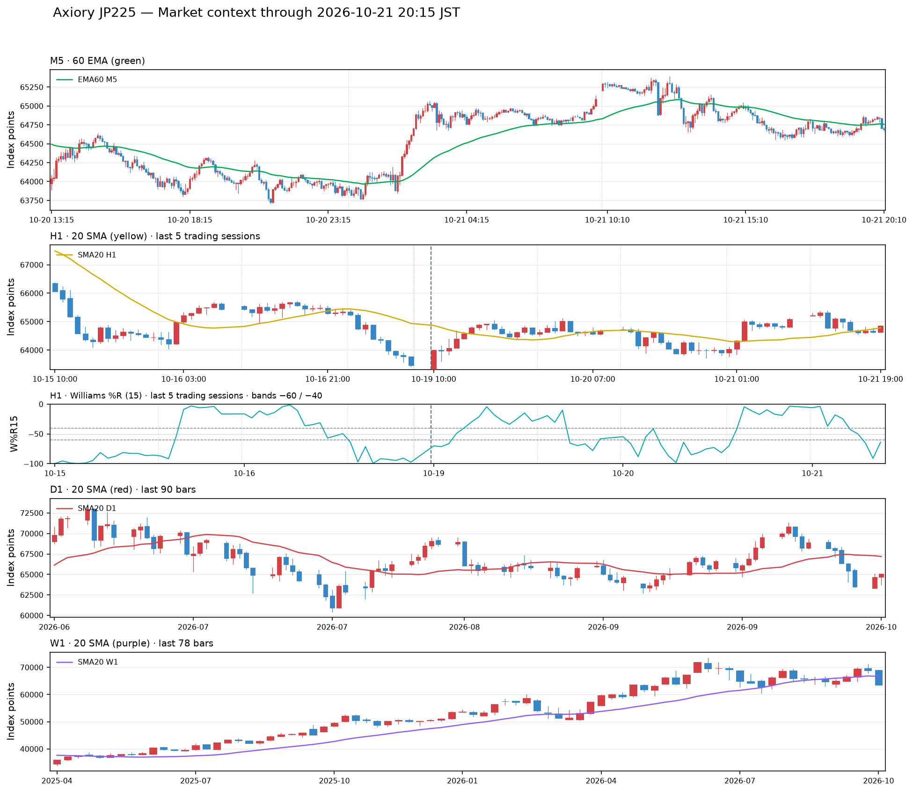
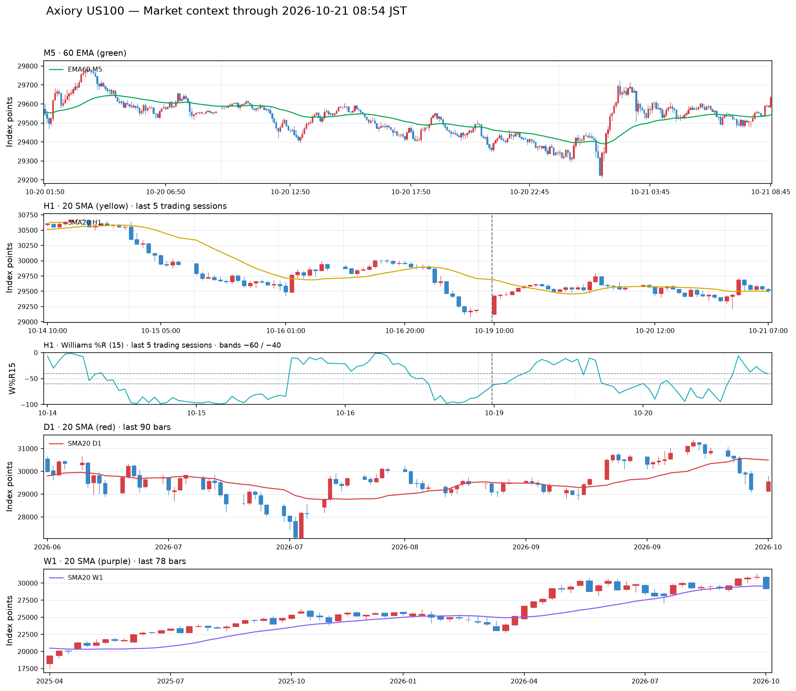

# 2026年10月21日（水）トレード日誌

記録範囲：朝の実況〜後場の保有状況・補足。10月21日NYのサンディスク振り返り（翌22日受領）を別節に収録。
記録根拠：本人の音声実況と既存の太陽誘電監視メモ。価格・時刻・出来高・約定は履歴未照合。実取引／デモの別は今回未指定。日誌は途中記録であり、本日の取引終了を意味しない。

## 1. 前夜からの環境変化｜日経225

本人が明示した対象は日経平均225。トヨタの説明の直後に続いた指数の話を、トヨタの価格として記録しない。

10月20日15時頃には下降三波が出ると考えていたが、下がらなかった。欧州時間に揉み合い、60EMAが横向きとなって、ニューヨーク時間に反発したと振り返った。

- 64,723円付近を背にレジサポ転換して上昇したとの観察。
- 65,000円程度まで上昇し、64,742円付近へ調整した後、さらに上の段へ進んだ。
- 64,723円と64,742円は別の発言値として保存し、同一ラインへ補正しない。
- 60EMAの足種や各時刻・配信元は資料照合待ち。
- 前日の下降三波の仮説は、実際の下落継続とは分けて振り返る。

本日9時のオープンでは陰線で下がる動きを観察。個別銘柄もギャップアップ後に下げる銘柄が多かった。

## 2. 朝の個別銘柄

寄り付いていない銘柄が多いという観察から開始。トヨタは寄り付いており、ギャップアップ後に下へ進んだ。「.52セント」という数字は意味が未確定のため正式な変化率にしない。

| 銘柄 | 本人が観察したギャップ・初動 |
| --- | --- |
| アドバンテスト（6857） | 約＋4.13%のギャップアップ後に下げ |
| キオクシア（285A） | 約＋4.5%のギャップアップ |
| ソフトバンクG（9984） | 約＋3.07%のギャップアップ |
| 太陽誘電（6976） | 約＋2.33%のギャップアップ |
| トヨタ | 後に前日・前々日のレンジを下抜けたと観察 |

ゴールドは日足が横向きかと考えた後、日足はまだ下方向という見立てを述べた。上へ戻してから下がる展開を検討したが、約定報告はない。

## 3. 前場｜アドバンテストのロング・スキャル

### エントリー根拠

- VWAPからの深い戻しの後のサポレジ転換。
- 日経平均・1570が上方向を向いていること。
- 1570がオープンと67,000円の切り番を上抜けたと観察したこと。
- 9時9分頃からの1570の買い支え。
- 下へ行ったものが反発しようとしているプライスアクション。

「下がる要素がない」は本人のその時点の評価であり、下落リスクがなかったと確定する表現にはしない。

### 売買報告

| 項目 | 本人の報告 |
| --- | --- |
| 買い | 9時11分頃・35,270円付近 |
| 数量 | 1ロット・100株と明示 |
| 利確 | 35,600円 |
| 本人の分類 | スキャル |
| 実取引／デモ | 未指定 |
| 費用込み損益 | 未照合 |

読み上げた価格を前提にすると、値幅は約330円、100株で**約33,000円の利益方向（費用除外の試算）**。正確な約定・実現損益は履歴で確定する。

「買ってみるかというサイズのロットではない」と、資金面で軽い判断では入れないという所感があった。数量の良し悪しは資金・損切り条件と合わせて検証する。

タグ：#アドバンテスト #ロング #スキャル #VWAP #サポレジ転換 #1570 #日経シンクロ

## 4. 日経平均｜上ヒゲ三本からレンジ・上抜け

日経平均の5分足にヒゲ三本が出ており、本人が**上ヒゲ**と明示した。

その後、下がりそうな形にもかかわらず下がらず、レンジ化し、クラスターレンジから上へ抜けたと観察。キオクシアやアドバンテストにも上方向への動きがあり、アドバンテストはヒゲを抜けて上がったと述べた。

ただし「上がったからといって買えるか」「難しい」という判断で、この場面の追加買いの約定報告はない。前場に報告済みのスキャルとは分ける。

タグ：#ヒゲ山 #ヒゲ山三本 #上ヒゲ三本 #5分足 #下がらない #クラスターレンジ #上抜け #追加エントリー未報告

## 5. 監視メモ

### 太陽誘電（6976）

**ティック回数ランキング1位**を確認したと本人が明示。

先の外部会話の「出来高ランキング上位」という表現は訂正する。約定回数と株数ベースの出来高を混同しない。このランキングの発言で新規にエントリーしたとの報告はない。

### ソディック（本人指定6143）

**監視した銘柄として名前のみ記録する**という本人の指示に従う。価格・ストップ安・レジサポの仮説を分析対象として掘り下げず、売買報告にも数えない。

### その他

川崎重工は日足目線で下落、三菱重工業は過熱感と下降・下での買い支えに言及。新規売買報告なし。

他にも銘柄・コードの読み上げがあったが、名称と数字の対応が不明瞭なものは正式銘柄として補完しない。

## 6. 後場｜キオクシアの13,200円を背にしたロング

音声の「本日5番、寄り木者」は、後場のキオクシア（285A）の取引という文脈で整理する。本人が現在時刻を**13時33分**と述べた保有中の報告。

### 下げ止まった価格帯の補足｜13,300円から一段下へ

**13,300円付近のレンジで下げ止まったのではなく、そこからもう一段下げ、13,200円付近で下げ止まりの反応が出たことが重要**と本人が補足した。

上の段のレンジ内の反発と、下の段へ移ってからの反応を区別する。先に報告した13,190円付近への下試しと合わせて、支持を探った場所を記録する。

### プライスアクションの呼び名とタグ

本人は、**同程度の大きい出来高が出た陰線を比較したとき、後の足では下へ進む値幅が小さく、ピンバーになった**ことをきっかけとして挙げた。先の43万株・50万株という報告と併記し、「同程度」は概括的な表現とする。値幅の比較には実際のOHLC・ヒゲ・実体の照合が必要。

日誌内の仮の呼び名は、**「大出来高・値幅縮小の下げ止まりピンバー」**とする。本人の「出来高を伴う買い支えの陰線」という捉え方を残す分類名であり、買い吸収を実データで確認した、または反転が確定したという意味ではない。

タグ：**#出来高を伴うピンバー #買い支えの陰線 #下げ止まり #一段下での下げ止まり #出来高に対する下落幅縮小**

### 下げ止まりと判断した出来高・足

1. **2分足・13時14分、大きい出来高を伴う陰線43万株**を観察。
2. その後、さらに大きい**50万株**の出来高を伴う足を観察。
3. 出来高が増えた一方、前の長い陰線より値動きの小さいピンバーとなり、本人は一旦の下げ止まりと判断した。
4. 13,200円を下回る**13,190円付近**を付けた形跡があり、当初は13,200円割れを警戒していた。
5. 下げ止まりの反応後、もう一度13,200円を試すダブルボトムのような形になったが、一気に大きく下へ割れなかった。
6. この反応を見て、13,240円付近でロングに入った。

43万株・50万株は本人が読み上げた出来高。デルタ値へ置き換えない。各足のOHLC・出来高・13時14分という足時刻はチャートCSVで照合する。下げ止まりは本人の判断であり、上昇転換の確定とは区別する。

### 建玉と出口の報告

| 項目 | 本人の報告・状態 |
| --- | --- |
| ロングした価格 | 13,240円付近 |
| 数量 | **3ロット** |
| 平均取得単価 | 言及はあるが正確な数字は未指定 |
| 判断の軸 | 13,200円の切り番、13,190円付近の下試し |
| 当時の観察価格 | 13,305円付近まで上昇 |
| 最初に考えた利確 | 板の発注が薄い13,375円付近 |
| 最新の利確注文 | **13,340円付近に設定した**と報告 |
| 損切り | 下へ割れたら損切りする意図。具体的な価格・注文済みかは未確定 |
| 決済 | 今回の発言では報告なし |

13,375円は当初の候補、13,340円は後に明示した実際の利確設定として分ける。新規注文の発注や約定をこちらで行ったという意味ではない。

損益見積もりについて「平均取得単価を考えると15,500円×3」と発言。算数では46,500円だが、平均建値・1ロットの株数・想定決済価格が揃っていないため、**未検証の本人概算であり、実現利益・確定した利益見込みとして採用しない。** 前場の1ロット100株という説明を、キオクシアの全建玉へ自動適用しない。

### ダウの分岐点と保有判断

13,270円を一旦越え、最初のヒゲ先を基準に見る下降ダウの分岐を突破したように見えたと観察した。13,300円付近にも、ライン上のダウの分岐点があるとの認識。

上抜けた後に戻されて下へ進む形にならなければ、上昇を試す動きとして保有したいと考えていた。ただし発言の終盤では、再び下降方向へ戻されているとも観察している。

2分足の平均足が緑の陽線であり、その足が確定するまで上方向を見る余地があるのではないかと検討。これは保有継続の理由としての本人の考えであり、通常のローソク足と平均足を同一の形として扱わない。

### 指数環境との関係

日経平均は、大きい足・60分足では上目線を持っている一方、10分足・30秒足では下方向と認識。後場の足も陰線という観察だった。

下位足の下降の中にある、一旦の下げ止まりレンジの下限から、上位足方向への上昇トライを狙う構想として記録する。

本人の分類は**「テトラ2」「MAペナント」**。下に20SMAがあり、上から5分足60EMAがかぶさるように、MAに挟まれていると説明した。20SMAの時間足・正確な位置関係は未指定のため、推測で設定を補完しない。

タグ：#キオクシア #後場 #ロング #13200円 #切り番 #出来高 #ピンバー #下げ止まり候補 #ダブルボトム #ダウ分岐点 #テトラ2 #MAペナント #保有中

## 7. 検証課題・教訓候補

- **出来高の増加と値幅の縮小を、下げ止まりの候補としてどう判断したか。** 43万株の陰線と50万株のピンバーを比較する。
- **切り番を再度試しても下へ走らなかったこと**が、ロングの根拠として再現できるか。
- 上位足の上向きと下位足の下降が混在する中で、指数と個別銘柄のどの反応を優先したか。
- MAに挟まれた環境で、ブレイク期待とレンジ内の利確をどう区別したか。
- 平均足の色・確定を待つ判断と、通常足・実際の価格による撤退判断を比較する。
- 保有数量・平均建値・損切り条件を揃え、利確額の概算と注文内容を照合する。
- 前場の上ヒゲ三本が下落につながらず、持ち合いから上抜けた経過を検証する。

ここに記載した項目は振り返りの候補であり、検証済みの新ルールではない。

## 8. ソースの不足と確認事項

今回、取引履歴・注文履歴・個別銘柄／指数のチャートCSV・画像は受け取って照合していない。通常出来高とデルタ出来高の検証、正確な約定、費用込みの確定損益は未完了。

- [ ] アドバンテストの9:11頃、35,270円・100株、35,600円決済。
- [ ] 日経225と1570の配信元・価格系列・対象足の区別。
- [ ] キオクシアの13:14の2分足43万株、続く50万株の足。
- [ ] 13,190円・13,200円の下試しと、13,270円／13,300円の分岐点。
- [ ] キオクシア3ロットの各約定・株数・平均取得単価。
- [ ] 13,340円の利確注文と、13,375円という当初案。
- [ ] 損切り価格・注文設定の有無と、保有・決済の結果。
- [ ] 15,500円×3という本人概算と、実際の建玉の対応。
- [ ] 2分足の平均足と、通常ローソク足の時刻・価格。
- [ ] 20SMAの対象足、テトラ2・MAペナントの状態。

### 定時チェック（JST）

| 日時 | 225Cash | US100 |
| --- | --- | --- |
| 10月21日 08:50 | 当該時点の状態は未照合 | 未記録 |
| 10月21日 15:30 | 本記録の13:33時点では未到来 | 同左 |
| 10月21日 22:25 | 本記録の13:33時点では未到来 | 同左 |
| 10月22日 01:00 | 本記録の13:33時点では未到来 | 同左 |

チャート作成時は、個別銘柄・ETFの通常ローソク足、出来高、デルタ出来高を必須とする。平均足は補助表示として区別する。225Cashの出来高は任意。日足20SMAは赤、1時間20SMAは黄、5分足60EMAは緑。1時間%R(15)は−50の上下と−60〜−40のレンジ判定を記録する。未取得データは作らない。HTML画像はタップ・クリックで拡大し、前後へページ送りできるようにする。個別株の通常ローソク足・出来高・デルタ出来高を照合するチャートとHTML一覧は未作成。Axiory指数の市場コンテキストは本日の日誌に追加した。

<!-- AUTO MARKET CONTEXT START -->
## 指数の定量マーケットコンテキスト（Axiory）

> データ取得: 2026-10-21 20:15 JST。Axiory `JP225` / `US100` の参考値です。
> `JP225Cash` / `US100Cash` を扱う別口座とは価格系列が異なるため、約定価格や損益の照合には使いません。

| 銘柄 | M5終値 / EMA60 | H1終値 / SMA20 | H1 W%R15 | D1終値 / SMA20 | W1終値 / SMA20 | PO H1 / D1 / W1 |
|---|---|---|---:|---|---|---|
| JP225 | 64,692.06 / 64,758.40 | 64,854.56 / 64,780.07 | -64.01 下側（≤ -60） | 65,091.83 / 67,189.89 | 63,465.86 / 66,702.04 | なし / なし / 上昇PO |
| US100 | 29,706.16 / 29,703.90 | 29,729.63 / 29,632.62 | -28.87 上側（≥ -40） | 29,712.85 / 30,445.23 | 29,197.16 / 29,536.95 | なし / なし / 上昇PO |

- [指標レポート・対象期間・元CSV](market_context/market_context.md)
- [計算・チャート作成レシピ](../market_context_recipe.md)

### JP225（Axiory）

### US100（Axiory）

<!-- AUTO MARKET CONTEXT END -->

## ニューヨーク時間の振り返り｜10月21日・サンディスク

10月21日のニューヨーク時間の取引について、翌10月22日に本人が振り返った記録。日本株の前場・後場とは区別する。

### 売りの想定とVWAPゾーン

下降から戻りの上昇フラッグを作り、その後再び下がるパターンを想定していた。本人は「主OVWAP」「3日間のVWAPゾーン」と表現する価格帯を意識していたが、指標の正式名称・起点・算出方法は未確認。

そのゾーンに関連して**「1777」**と発言。後述の1,376ドル・1,380ドルと整合しないため、1,377ドル等へ推測で訂正せず、対象価格は照合待ちとする。「狙っていた」が利確目標・戻り売り位置・撤退基準のどれを指すかも履歴とチャートで確認する。

### 損切りの判断と、その後の上昇

本人は、そのゾーンを上へ抜けたらロスカットするつもりだった。一方、下の方から急激に上がってくる動きとNASDAQの動きを見て、予定したブレイクを待たず、手前で撤退したと説明した。

| 項目 | 本人の報告 |
| --- | --- |
| 対象 | サンディスク |
| ポジション | 文脈上、ショートの損切り。数量は4ロット |
| 最初の売り・平均建値 | 未報告 |
| 損切り価格 | **1,376ドル付近** |
| 損失 | **合計約60ドルに抑えた**との本人報告 |
| 決済後の動き | 買い戻しのブレイクで**1,380ドル付近まで上昇** |
| 実口座／デモ | 今回未指定 |
| 正確な時刻・各約定・費用 | 履歴未照合 |

約60ドルは4ロット全体についての本人概算として扱い、1ロット60ドルと解釈して4倍しない。正確な確定損失額は履歴で確認する。

本人は、損切りしていなければ含み損がさらに大きくなっていたと評価し、1,376ドル付近で切れたことは良かったと振り返った。NASDAQを見た撤退判断と、最初のエントリーの妥当性は分けて評価する。

### NASDAQとの連動と、納得できていない点

本人には、今回のチャートパターンは理解しにくく、納得し切れていないという所感があった。

- 一度ブレイクした後の失望売りなら理解できる可能性があるが、今回の形は見慣れていない。
- 結果的にNASDAQに引っ張られて上昇したように見える。
- 「ES100」という発言は、その後のNASDAQへの言及と併記し、具体的な配信銘柄・価格系列は確認待ち。
- パターンが分からなかったという記録を残し、事後的に既知の成功・失敗パターンへ無理に当てはめない。

### ドテンの検討

ドテンのロングも考えられたのではないかと述べたが、実際に反対売買で新規ロングを約定したとの報告はない。**検証候補に留め、新たなポジションや利益を加算しない。**

### 教訓・検証課題

- **個別のチャート形状だけでなく、NASDAQの方向を撤退判断に使えた点**を振り返る。
- 想定した水準のブレイクを待たずに撤退した根拠を、値動き・速度・指数の反応で具体化する。
- 「損切りが適切だったこと」と「理解できる根拠で入れていたか」を分けて検証する。
- 3日間VWAPゾーン、読み上げ値「1777」、実際の損切り位置の関係を照合する。
- ドテン案は、別の新規エントリー条件・出口を確認する検証として扱う。

タグ：#サンディスク #2026年10月21日NY #ショート #損切り #NASDAQシンクロ #指数を見た撤退 #上昇フラッグ #VWAPゾーン #未理解パターン #ドテン検証

**本人報告：4ロットの損失は合計約60ドル。** 10月21日の日本株の損益や、前夜10月20日のインテル取引と混同せず、履歴照合後に集計する。

## NY時間の続き｜10月22日0時21分・サンディスク再ショート

10月21日のニューヨーク時間の続き。本人が**0時21分（翌10月22日JST）**と指定した保有中の記録。

### 損切り後の動きと再エントリー

先の損切り位置からさらに上昇した後、上へブレイクした水準の**1,376ドル付近を再び下回りそうなプライスアクション**を観察した。

大きく買われたと見ているサポートラインを、**30分足で割ろうとしている**と判断し、**新たに4ロットをセルインした**と報告。

| 項目 | 今回の報告 |
| --- | --- |
| 銘柄・方向 | サンディスク・ショート |
| 数量 | 新規に4ロット |
| 状態 | 0時21分時点で保有・様子見 |
| 判断水準 | 1,376ドル付近のブレイク後のサポート |
| 観察足 | 30分足 |
| 約定価格・正確な約定時刻 | 未指定。1,376ドルを建値として補完しない |
| 撤退方針 | そのサポートを割れなければロスカット |
| 損切り価格・判定の期限 | 未指定 |
| 利確目標・決済 | 未報告 |
| 実口座／デモ | 未指定 |

**下抜けが成立したという報告ではなく、割れそうな反応を見て先に売り、結果を観察している段階。** 30分足の確定を待つか、途中の値動きで判断するかは今回明示されていない。

先の4ロットは損切り済みとして報告されているため、今回の4ロットは別の再エントリーとして扱い、8ロット保有と合算しない。先の約60ドルの損失を取り消したり、この取引の損益として重複計上したりしない。

### 記録・検証する点

- 1,376ドル付近と、大きく買われたサポートラインの具体的な位置関係。
- 再上昇後に、どの足・出来高・値動きを下抜けの兆候と判断したか。
- 実際の約定価格、数量、損切り条件と利確条件。
- 下抜け期待で先に入る判断と、割れを確認して入る場合の比較。

タグ：#サンディスク #2026年10月21日NY #再エントリー #ショート #4ロット #1376ドル #30分足 #サポート割れ期待 #保有中 #未決済
