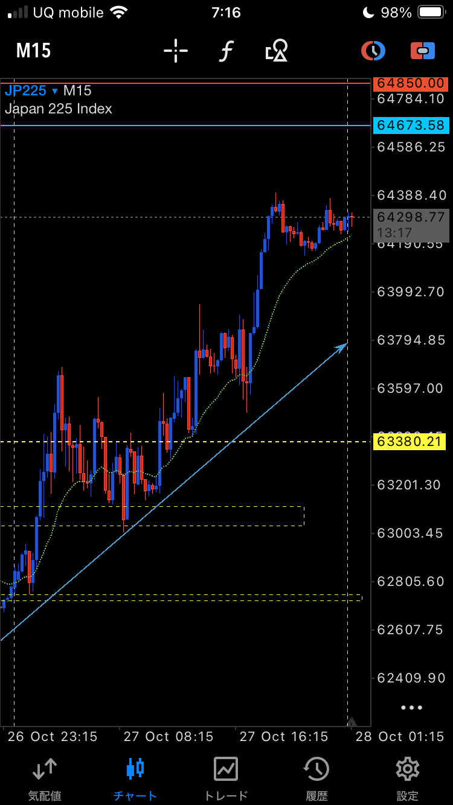
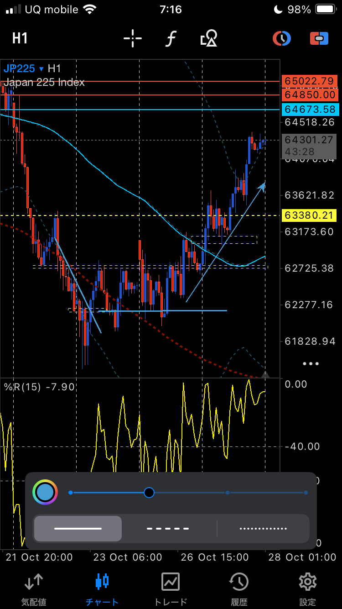
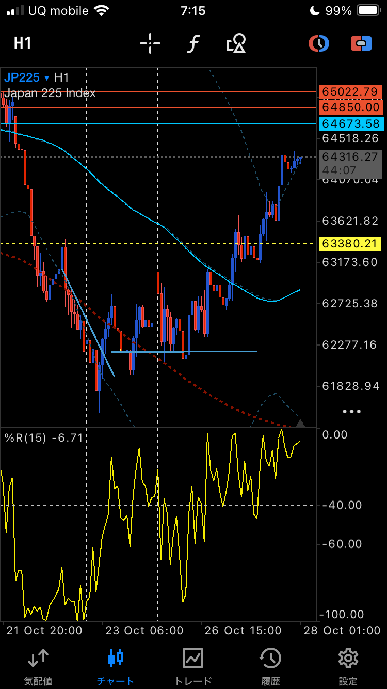

# 2026-10-27（火）トレード日誌

## 記録の扱い

本人の音声実況と本会話の振り返りに基づく。チャート・板・当日の約定CSVとの照合は未実施。価格・時刻・出来高は本人申告として扱い、実取引／デモ／未実行案を分ける。

## ELEMENTS（5246・本人指定：グロース市場）｜1,000円の切り番と出来高枯れ

### エントリーから撤退まで

- 約300万株の約定規模がある銘柄として監視。集計期間・時点は未確認。
- 1,000円の切り番で買われている点を観察。本人は1,000円が意識されていることは明確と判断。
- 15秒足を参照。上下にほとんど動かず、板が薄く、出来高も少ない状態から、下げ止まりを仮説としてロング。
- 当初の口述は1,008円・1,000株。その後「買い1,009円、損切り1,001円」と訂正。正確な約定は履歴待ち。
- 待っても出来高が増えず、値動きも悪いと判断して一旦撤退。実況では9:30〜9:31ごろ。
- 今回の振り返りでは「そのまま1,000円あたりでロスカット」と報告。1,001円は設定値、1,000円付近は本人の決済概算として区別。
- 1,000株が全数なら、1,009円→1,001円の設定リスクは費用前8,000円、1,000円決済なら費用前約9,000円の損失という試算。いずれも確定損益としては集計しない。
- この取引の実口座／Paper Trading区分は未確認。他銘柄のデモ区分から推定しない。

### 撤退後の観察と相談

- 11:30の少し前に、急に出来高が増えて約1,060円まで上昇したと本人が報告。
- 本人の問い：これは「枯れ相場」のようなパターンか。常時監視できないため、出来高増加のアラートで捉えられるか。
- 振り返りの呼称候補：**出来高枯れを伴う底固め（持ち合い）→出来高増加を伴うレンジ上抜け**。実チャート未確認のため、形状の確定ではなく口述からの整理。
- 板の薄さだけで売り枯れ・買い集めを断定しない。薄い板は上下どちらへの急変も起こり得る。前後の高安の切り上がりが未確認なので、特定の三角持ち合いやカップ等には分類しない。
- 後の上昇だけを根拠に、最初の撤退を失敗とは判定しない。「出来高が増えない段階の先行買い」と「出来高増加・上抜け確認後の再エントリー」を分けて検証する。

### 次回の検証案（未実行・有効性未検証）

1. 1,000円付近で止まっている間のレンジ上限・下限を記録する。支持価格の1,000円と、買い再検討の上抜け価格は分ける。
2. 監視用の1分足で「出来高が直前10本の平均の2倍以上」を通知の試案にする。2倍は最適値ではなく検証の出発点。閑散時は平均が小さくなるので、絶対出来高・スプレッドも確認する。
3. レンジ上限の上抜け通知も設ける。出来高だけの通知では下落時にも反応するため、通知後に上抜け方向と実際の価格進行を確認する。
4. 通知後は普段の15秒足へ戻り、上限を支えに変えるか、買い約定で高値が更新されるか、撤退位置と約定可能性を確認する。急騰が進んで撤退幅が大きければ見送る。
5. TradingViewの出来高の固定値通知は「Greater than（より大きい）」を使用する方法が公式に案内されている。平均比の複合条件は対応インジケーター／スクリプトで設定可能か確認する。アラート自体は今回未設定。

タグ：#ELEMENTS #5246 #1000円 #切り番 #出来高枯れ #底固め #持ち合い #レンジブレイク #再エントリー検証 #出来高アラート #板が薄い

## 朝の環境認識と日経225関連の保有

- US100の上昇とともに日経225も上昇。前日高値を少し超え、60分足ボリンジャーバンド上限の＋2σ付近との観察。上下2σ間の幅は約990円、1時間%Rは上方向。
- 日足で約61,700円へのオーバーシュート後の下げ止まりと戻しを見て、約63,156円まで上昇したと説明。
- 先日の20ユニットに10を追加し合計30との本人申告。「ロット」と「ユニット」の表現が混在。正式商品・契約倍率・口座区分は未確認。
- 平均取得価格は最新申告62,911円。逆指値は当初なし→20SMA付近62,635円という説明→最新では62,880円へ変更。実注文履歴は未照合。
- 平均取得から逆指値まで31ポイント。金銭リスクは契約仕様未確認につき算出しない。他商品の29ティック基準を自動適用しない。
- 約63,324円、評価益＋4,076との報告あり。通貨・評価時刻未確認、未実現益として扱う。
- XMとアキシオリーのロット換算の話は本人が確認不要としたため、換算比率を確定しない。
- 日足の下降Nの節目にタッチし、60分足上昇バンドウォークを試す見立て。半値戻し後に再上昇する可能性はシナリオ。
- テトラは後から確認し上方向で揃っていると明言。デルタ出来高の確認済みとは扱わない。
- 30秒足で上昇Nのダウを観察し保有継続。63,135円は最初の見直しラインで、割れたら自動決済する価格ではない。62,880円の逆指値とは区別する。

## 個別銘柄の寄り付き・シンクロ（本人観察）

- 任天堂（7974）：約0.9%ギャップダウン。日足ダブルトップから崩れる見立てに対し、日経225自体は同様に崩れていないと観察。
- 村田製作所・太陽誘電・キオクシアの連動を確認。途中では村田が強く、太陽誘電は陰線、キオクシアも陰線と整理されたが、キオクシアの陰線について本人発言の範囲は不明瞭。
- キオクシア：13,400円、約6.7%ギャップアップ、寄り後陽線との初期報告。
- アドバンテスト（6857）：33,180円特買い未寄り→33,620円で寄ったと報告。その後33,330円センター、33,340→33,500円の反発を観察。ギャップ率は4.7／7%との口述が混在し未確定。寄り値は履歴照合待ち。
- ソフトバンクG：4.79%ギャップアップ後、横ばい・日足陽線と訂正。後のショート／ロングの記録は下記に分ける。
- コンピューターのアラートは無視する指示あり。

## セキュアヴェイル（3042）｜Paper Tradingの利確

- 1,433円特買い未寄りとの観察後、1,641円でスタート、1,643円オープン・約29万株の約定とも発言。寄り値に差があり未照合。
- 本人がPaper Trading、100株と明示。取得約1,648円、決済1,703円。
- 費用前の概算利益は（1,703−1,648）×100＝約5,500円。取得価格が概算のため確定損益にしない。
- 本人は1,703円をストップ高と認識。その後ストップ高が剥がれて1,679円まで下落したと報告。値幅制限や約定は未照合。
- 寄り値と取得価格を混同せず、利確後の下落だけで判断の優劣を確定しない。

## その他の監視・取引報告

- 6203：前日ストップ高張り付き銘柄として監視。本人の「東亜工業」という音声に対し会話側で豊和工業と整理された。コードを基準に名称照合待ちとする。
- ソフトバンクG：ショートは検討ではなく保有中と本人が訂正。その後「一旦トライするもロングかな、3ロット」と発言。ショートの決済・ロング転換の約定は未確認。4,317円のサポレジ、4,304円への戻し、4,500円の損切り案、4,400円／4,394円等の検討値は混在し、実注文として確定しない。損失4,600円に対し高値まで約3万円というリスクリワードの本人試算も、方向・数量・価格の照合が必要。
- ゴールド：下方向との本人の見立て。売買報告なし。

## 参考（パターン・通知方法の一般資料）

- [Charles Schwab：出来高と値動き・ブレイクアウト](https://www.schwab.com/learn/story/trading-volume-as-market-indicator)
- [TradingView：出来高アラートでGreater thanを使う理由](https://www.tradingview.com/support/solutions/43000744212-the-issue-with-crossing-alerts-on-the-volume-indicator/)
- [TradingView：アラートの条件と通知頻度](https://www.tradingview.com/support/solutions/43000763312-learn-how-to-configure-alerts/)

一般資料は当日のチャート・取引を裏付けるものではない。

## ELEMENTS追記｜数十分単位の値幅収縮という時間軸の補足

### 本人の補足

- 「枯れ相場」は長期間の相場環境という意味ではなく、デイトレ中の**数十分単位の、ごく短い区間でのボラティリティ減少**を指す。
- 本人は「11時頃までの間」と補足。1,000円の切り番付近で、出来高が減少し、上下の値幅が小さくなった状態を観察していた。
- 先の「11:30の少し前に約1,060円へ急伸」という本人申告も保持する。持ち合いの開始・終了、出来高増加と上抜けの正確な時刻は未照合であり、11時と11:30を同じ時刻に統一しない。

### 日誌で使う表現

**「1,000円付近での短時間の値幅収縮と出来高減少から、出来高を伴って上放れ」**

ELEMENTSは、1,000円の切り番付近で、数十分単位の短い時間軸で出来高が減少し、値幅の小さい持ち合いを形成した。その後、出来高の増加とともに持ち合いを上抜け、1,060円付近まで急伸した、という本人の観察として記録する。

「日中の短時間の持ち合い」「値幅収縮」「出来高減少」を組み合わせて時間軸を明示する。パターンの名称候補であり、チャートを確認して特定の形状を確定したものではない。今回の補足による新たな売買・損益の追加はない。

追加タグ：#日中の短時間の持ち合い #値幅収縮 #出来高減少 #短期ボラティリティ収縮

## NY市場の実況｜22:34時点の上昇トライ

本人申告の時刻は22:34。「ニューヨーク時間」との発言はNY市場監視の文脈で保持し、表示時刻のタイムゾーンは未確認。今回の会話で受領した10月27日分として保存する。以下は本人のチャート観察であり、市場データとは未照合。エントリー・決済の報告なし。

### サンディスク｜下降トレンド中のレジサポ再到達

- ダウの分岐点のような位置から下降ダウ・下降トレンドになっていたと観察。
- 戻り売りを意識する局面の中で、一旦上昇を試し、再びレジサポのラインに到達しているとの説明。
- 発言価格は**1,273ドル付近**。始値は**1,261ドルぐらい**と本人申告。桁・小数点を推測で修正しない。
- 10分足で始値付近から上昇する陽線を観察。22:34時点で、その価格帯を試して上昇しようとしている見立て。
- 「前日」との発言あり。前日由来のラインを指すのか、前日の値動きを指すのかは今回の口述では未確定。
- 現段階の整理は「下降トレンド中の戻しと、レジサポ付近での上昇トライ」。上抜け確定や下降ダウの転換を確認した報告ではない。

### 指数・指標の環境認識

| 対象 | 本人の観察・見立て |
|---|---|
| 日経225関連 | 下げ止まりから上方向で見る |
| ナスダック | 日足の下げ止まりから上方向への戻し。「半値戻し的」との表現はあるが、厳密に半値である必要はないと本人が補足 |
| %R | 上方向。今回の発言では対象銘柄・時間足・数値の指定なし |

全体として一旦上を試す動きと捉えている。指数の上方向の見立てと、サンディスク自体の下降トレンド中の位置関係を区別して残す。出来高・デルタ・上抜け後の支持確認は今回まだ報告なし。

タグ：#NY市場 #サンディスク #下降ダウ #戻り売り帯 #レジサポ #上昇トライ #10分足 #日足下げ止まり #パーセントR上方向

## JP225チャート画像｜10月27日分の振り返り資料

ユーザー指定により、以下の画像3枚を**10月27日分**に保存。スマートフォン上部は7:15〜7:16、チャート右端の日付目盛は28 Octとなっているが、チャート時刻のタイムゾーンは未確認。撮影時刻・チャート表示時刻を約定時刻とみなさない。

### 添付画像の表示内容

| 原本 | 時間足 | 画像から読み取れる表示 |
|---|---|---|
| IMG_2624.png | JP225 M15（15分足） | 表示価格64,298.77。上昇後、64,300付近でもみ合う形。右上方向の水色の描画線あり |
| IMG_2623.png | JP225 H1（1時間足） | 表示価格64,301.27、%R(15) −7.90。上昇方向の水色の描画線を追加した画面。下部の一部は描画設定パネルで隠れている |
| IMG_2622.png | JP225 H1（1時間足） | 表示価格64,316.27、%R(15) −6.71。下落後の底固めと、その後の上昇推移を表示 |

共通して確認できる水平線のラベルは63,380.21、64,673.58、64,850.00。H1の2枚には65,022.79も表示。これらは**チャートに引かれた線の表示値**であり、実際の注文価格・建値・利確目標と確定するものではない。

今回の依頼は画像の保存。新規エントリー・追加・決済・損益の報告はない。以前の日経225の保有記録に、決済や保有継続を推定で追加しない。

### 15分足｜IMG_2624.png

### 1時間足・描画線あり｜IMG_2623.png

### 1時間足｜IMG_2622.png

タグ：#JP225 #日経225 #15分足 #1時間足 #チャート画像 #10月27日振り返り

## CFD225｜下降ダウの分岐点での攻防から上昇トレンドへ（本人の振り返り）

対象日：**2026年10月27日**。本人が日付を指定した追記。

- **9:00〜11:30**：下降ダウの分岐点で攻防し、クラスターレンジを形成。
- **その後の結果**：クラスターレンジを上抜け、上昇トレンドが完成したと本人が評価。
- **NY時間のエントリー目線**：この上抜けと上昇トレンドの形成を背景に、上目線でエントリーを考える。

まとめ：**「下降ダウの分岐点で9:00〜11:30に形成したクラスターレンジを上抜け、上昇トレンドが完成。NY時間は上目線でのエントリーを意識した。」**

「エントリー目線」は今回の判断・方針として記録し、新たな買い約定を意味するものとしては扱わない。分岐点・レンジ上下限の価格、上抜けの正確な時刻、トレンド完成を判定した時間足は今回の発言では未指定。前節のJP225画像3枚と併せて振り返る資料とする。

タグ：#CFD225 #JP225 #下降ダウの分岐点 #クラスターレンジ #レンジ上抜け #上昇トレンド完成 #NY時間 #上目線
