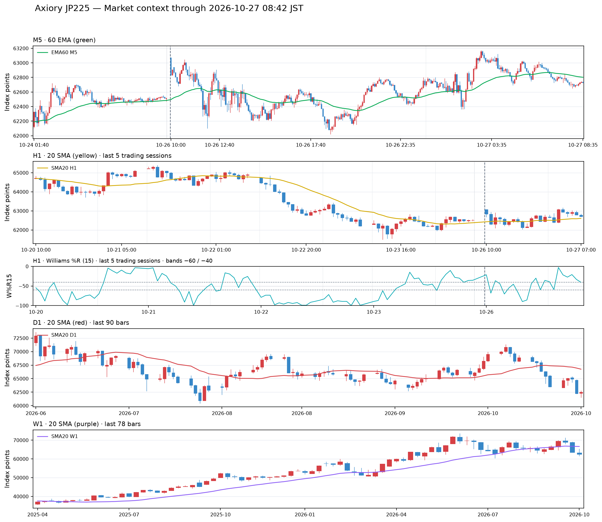
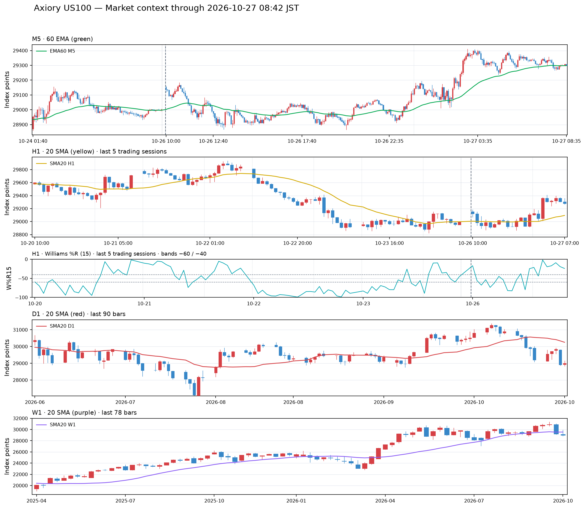

# US100・JP225 日次マーケット指標 — 2026-10-27（JST）

- 生成時刻: 2026-10-27 08:42:13 JST
- データ元: Axiory MetaTrader 5（銘柄名 JP225 / US100）。別口座のJP225Cash/US100Cashとは価格系列が異なります。
- 時刻: CSVはUTC。日誌とチャートはJST。未確定足を除外しています。
- チャート表示: 足データのない時間帯は圧縮します。H1/W%Rは直近5取引日、D1は90本、W1は78本を表示します。M5/H1/W%RにはJSTの日付線、月曜の最初のOPENには強調線を表示します。
- 指標の読み方とチャート規約: [市場コンテキストのレシピ](../../market_context_recipe.md)

| 銘柄 | M5終値 / EMA60（緑） | H1終値 / SMA20（黄） | W%R15 H1 | D1終値 / SMA20（赤） | W1終値 / SMA20（紫） | PO H1 / D1 / W1 |
|---|---|---|---:|---|---|---|
| JP225 | 62,728.30 / 62,802.79（終値が下） | 62,705.80 / 62,605.93（終値が上） | -40.60 中立帯（-60～-40） | 62,517.52 / 66,751.09（終値が下） | 62,517.52 / 66,636.78（終値が下） | なし / なし / なし |
| US100 | 29,297.17 / 29,297.91（終値が下） | 29,279.33 / 29,094.28（終値が上） | -24.21 上側（≥ -40） | 29,003.20 / 30,252.67（終値が下） | 29,003.20 / 29,547.14（終値が下） | なし / なし / 上昇PO |

## ソースCSV

- JP225: [M1](../../../market_data/axiory/JP225_M1.csv) / [M5](../../../market_data/axiory/JP225_M5.csv) / [H1](../../../market_data/axiory/JP225_H1.csv) / [D1](../../../market_data/axiory/JP225_D1.csv) / [W1](../../../market_data/axiory/JP225_W1.csv)
- US100: [M1](../../../market_data/axiory/US100_M1.csv) / [M5](../../../market_data/axiory/US100_M5.csv) / [H1](../../../market_data/axiory/US100_H1.csv) / [D1](../../../market_data/axiory/US100_D1.csv) / [W1](../../../market_data/axiory/US100_W1.csv)

## チャート

### JP225

### US100

## データ範囲

| 銘柄 | 足 | 保存本数 | 全履歴の最古足（JST） | 最終足の終了時刻（JST） | 今回の差分 |
|---|---|---:|---|---|---:|
| JP225 | M1 | 550,356 | 2025-04-07 10:00 | 2026-10-27 08:42 | 721本 |
| JP225 | M5 | 110,352 | 2025-04-07 10:00 | 2026-10-27 08:40 | 144本 |
| JP225 | H1 | 9,207 | 2025-04-07 10:00 | 2026-10-27 08:00 | 12本 |
| JP225 | D1 | 985 | 2023-01-03 09:00 | 2026-10-24 09:00 | 0本 |
| JP225 | W1 | 198 | 2023-01-08 09:00 | 2026-10-25 09:00 | 0本 |
| US100 | M1 | 550,240 | 2025-04-07 10:00 | 2026-10-27 08:42 | 721本 |
| US100 | M5 | 110,065 | 2025-04-07 10:00 | 2026-10-27 08:40 | 144本 |
| US100 | H1 | 9,182 | 2025-04-07 10:00 | 2026-10-27 08:00 | 12本 |
| US100 | D1 | 985 | 2023-01-03 09:00 | 2026-10-24 09:00 | 0本 |
| US100 | W1 | 198 | 2023-01-08 09:00 | 2026-10-25 09:00 | 0本 |

## 計算ルール

- EMA60(M5): M5終値に対する60期間指数移動平均。
- SMA20(H1/D1/W1): それぞれの足の終値、直近20本の単純平均。
- W%R(15,H1): H1の高値・安値・終値から計算。-60以下=下側、-40以上=上側、その間=中立帯。
- パーフェクトオーダー(PO): 各足でSMA5>SMA20>SMA60かつ各SMAが5本前より上なら上昇PO。逆順かつ各SMAが5本前より下なら下降PO。それ以外は「なし」。
- 同日に再実行した場合は、その日付のレポートとチャートを置き換えます。

## 保存ファイル

- M1/M5/H1/D1/W1履歴: `market_data/axiory/`
- 差分CSV・詳細ログ・実行履歴: ローカルの `market_data/axiory/` 配下（Gitでは追跡しません）
