# 2026年11月4日（水）トレード日誌

## 画像資料の現在の状態（11月5日訂正）

**OneDriveの11月4日画像は提供済み。画像なしではない。** 本人の指示に基づき、当日フォルダ直下の35枚を[screenshots](screenshots/)へ移動した。既存のNY画像5枚と合わせて40枚を保管。その後、この会話で追加提供されたGOLDチャート8枚とフォルダ確認画面1枚を追加し、現在49枚（取引資料48枚・フォルダ確認画面1枚）を保管。再添付のIMG_9585は保存済み画像と完全一致のため重複保存していない。画像の内容は変更せず、日誌の参照リンクを移動先へ更新した。

OneDriveの元フォルダパス・撮影メタデータは未確認。画像が存在することと、各取引の直前・10分後・引けの場面に正確に対応すること、取得機能で視認できたことは区別する。以下の実況時点の「画像未取得」は当時の照合状況であり、現在画像がないという意味ではない。現在の確認結果は「追加資料の照合」を参照。

## 記録方法
- 「ソル」と呼びかけられた場合のみ返答し、それ以外の実況は議事録として整理する。
- 出典：11月4日朝の本人の音声報告。以下の市況・価格は本人の観察であり、リアルタイム相場を独立確認したものではない。

## 前日NY時間の振り返り（11月3日分・本人申告）

### GOLD
- リテールのロング比率が70％超と観察。ダブルトップを上抜けできないと考えてセルイン。
- 22:40頃にショートし、一時逆行後、23:10頃に3,950ドル付近で利確したとの報告。
- 最初の発言では3,970ドルから3,935ドル付近までの値動きに言及。後続発言の実際の利確価格3,950ドルを優先する。正確な約定入口価格は未確認。
- 理想の利確ポイントは3,930ドル。どこまで伸ばすか迷い、最終的には金額を基準に利確。
- デモトレード側は時間帯が異なるとの補足あり。報告時刻と履歴時刻の対応、口座区分、数量、確定損益は未確認。
- [11月3日の既存記録](../2026-11-03/diary_20261103.md)にはAxioryの3,975.5のSELL注文は未約定との報告がある。今回の売買報告と同一注文・同一口座とは断定せず、別途照合する。

### AMD
- 30秒足で押し目ロング。1回目の押し目を取り、2回目の押し目では494.76ドルまで取ったとの報告。
- TradingViewのペーパートレード記録があるため照合するよう依頼あり。
- 494.76ドルのリポジトリ内検索では該当資料を発見できず、約定履歴は未取得。口述をCSV確認済みの値として扱わない。入口価格、数量、各約定時刻、確定損益は未確認。

## 9時台｜日経の環境認識・ロング検討
- 週足：レンジ。
- 日足：MAに挟まれているとの観察。対象MAの期間は未確認。
- 60分足：BB±2σの幅は約1,530円。横向きから広がっており、拡散、BBコンプではないと認識。
- 上向き、％Rも上向きとの観察。「60MAの下の下限」との発言は対象線・位置関係を未確認として残す。
- 9時頃、1ロット相当で一度ロングエントリーする意向を表明。実行・約定、商品系列（日経平均／先物／CFD）、口座区分、価格、数量換算、損切り位置は未確認。

## 時系列資料の取得状況
| 時点 | 対象・時間足 | 終値・確定状態 | 資料と状況 |
|---|---|---|---|
| 9時台・ビフォー | 日経・60分足ほか（系列未確認） | 未取得 | 上記の本人の環境認識のみ。画像・板・歩み値未取得 |
| エントリー直前 | 日経ロング検討、GOLDショート、AMD押し目ロング各回 | 未取得 | 本人申告の根拠のみ。確定足・約定履歴未取得 |
| エントリー10分後 | 各取引 | 未取得 | 約定時刻未確認のため基準時刻を確定できない |
| 前引け11:30 | 日本株 | 未取得 | 朝の報告時点では未到来。NY取引の引けとしては適用しない |
| 大引け15:30 | 日本株 | 未取得 | 朝の報告時点では未到来。NY取引の引けとしては適用しない |

## 照合・検証待ち
- 松井証券CSV・当日日経1分足・板／歩み値の原データは未取得。TradingViewペーパー履歴とOneDrive当日画像は後続の追加資料で提供済み。照合結果は後段を参照。
- GOLD：実利確位置と理想位置を分け、Axiory未約定報告との関係、口座と時刻の違いを照合する。
- AMD：ペーパー履歴の所在と11月3日NY分の約定を確認する。
- 寄り付き回避ルールの例外根拠、デルタ上サイン、撤退判断、分割利確、準備の実施状況は、今回の発言だけでは順守を確定しない。

## 朝の実況追記（本人申告・履歴未照合）

### AMDの補足
- 「2回約定」との発言あり。0:02:30の押し目で、出来高を伴う陰線の価格490.27ドルに言及。1:05に494.70ドルでセルアウト注文による自動利確と報告。
- 先の494.76ドルという概算に対し、後続申告は494.70ドル。二つの時刻・価格が入口と出口を指すか、複数取引の内訳かは履歴照合待ち。NYセッション中の午前0時以降の発言で、暦日も履歴で確認する。

### 日経・個別の観察と9:34頃の撤退
- 日経：週足レンジ、日足下、4時間足は判断不明、60分％R上との補足。その後、日経・シンクロ銘柄とも下方向、％R下、MA下、BB拡散で下げ止まらないとの見立てへ変化。
- フジクラ：9:28の大出来高陰線で買われたとの観察。その部分を背に3ロットのロングに言及。「583」「3のETF」「3,700円切り番」の対象・数量換算・正確な価格は未確認。
- 太陽誘電：大陰線スタートからサポートを割り、さらに下降との観察。1321も大きく売られていると観察。
- 9:34:30頃、ロスカット「1万円ぐらい、1万4千」と発言。9:34:29で区切りとの報告もあり、時刻は概算。対象銘柄と確定損失は未確認。
- 本番ではしない規模、規模が大きすぎるとの自己評価。実取引／デモの区分は今回未確定。下降認識がありながらロングを考えた点を検証事項として残す。
- エレメンツ：1,000円割れ後、下で大出来高を伴い買われているように見えるとの観察。下げ止まり候補という本人の見立てで、反転・買い吸収の確認済みとは扱わない。
- データセクションに売り指値の発言あり。価格・数量・約定は未確認。

### 9:46｜アドバンテストのロング
- 本人報告：アドバンテスト、34,240円でロングエントリー、9:46（JST）。
- 「四ロング」と聞こえる発言あり。4ロット等の数量を意味するか未確認のため数量を確定しない。
- 実取引／ペーパー区分、損切り位置、デルタ上サイン、正確な約定秒は未確認。
- エントリー直前：口述価格は約定申告であり、確定足終値ではない。チャート・板・歩み値は未取得。
- エントリー10分後（9:56）：資料未取得。

## 続報｜アドバンテストのセルインと買いの弱さ

出典：本人の追加実況。正確な発言時刻・注文時刻は未提示。以下の価格・板・約定の観察は本人申告で、CSVや板・歩み値の原資料による確認は未実施。実取引／Paper Tradingの区分は未確認。

### 売買の経過と方向の不一致への振り返り

- アドバンテストでセルインしながら、シンクロ監視銘柄である太陽誘電ではロングしていたと本人が振り返り、「めちゃくちゃなことをやっている」と方向の不一致を自己評価した。
- 太陽誘電は一旦逃げることに言及。実際の決済完了、価格・数量・損益は未確認。
- 直前の9:46・34,240円のアドバンテストのロング報告から、今回の売りへ移った具体的な注文経過は未提示。ロング決済・ドテン・両建てのいずれかを推測せず、今回のセルインは続報として記録する。

### アドバンテスト｜セルインを実行している根拠

- 本人は日経レバーを見ながら、日経平均の動きと買いの弱さを確認している。直前の文脈では日経レバーとして1570を監視しているが、今回の数値がすべて1570の観測かは未確認。
- 「100、400買われていない」「約定が100とかしか発生していない」と発言。買いが少なく、売り余りと見ている。100・400の単位、対象銘柄、集計期間・観測時刻は未提示のため、株数・注文件数・約定総数には確定しない。
- アドバンテストは**34,390円付近で停滞し、売りの発注に対して買われていかない**と観察。その様子と日経平均の動きを見て「これを見てセルインをしています」と、新規売りを行っている旨を報告した。
- 34,390円は今回の停滞価格の観察であり、正確な売り約定価格・ローソク足終値とは確定しない。途中の「三四六」は意味が未確認のため、価格・数量に換算しない。
- 「売り余り」「買っている人がいない」は本人の板・約定からの解釈として残す。市場全体で買い手が存在しないと独立確認したものではない。
- 今回のセルインの価格・数量・時刻、損切り・利確位置、決済結果は未提示。損益や新たな約定回数は補完しない。

### 時系列資料と検証課題

| 時点 | 対象・観測時刻 | 時間足・足時刻・終値・確定状態 | 出典・判断 |
|---|---|---|---|
| 9時台・ビフォー | 日経・アドバンテストほか。既存の朝の実況を参照 | 各系列の足・確定終値は未取得 | 本人実況。朝の上目線から下目線への変化は既記録 |
| セルイン直前 | アドバンテスト、日経平均・日経レバー。正確な時刻は未確認 | 足・確定終値は未取得。34,390円付近は停滞価格の本人観察 | 買い約定の少なさ、売り発注に対して買い進まない様子を根拠にセルイン |
| エントリー10分後 | 正確な新規売り時刻が不明のため基準時刻未設定 | 足・確定終値・画像は未取得 | 建玉・決済のその後は未報告 |
| 前引け11:30 | 日本株 | 前場終値・参照足・画像未取得 | 今回の実況では未報告 |
| 大引け15:30 | 日本株 | 当日終値・参照足・画像未取得 | 今回の実況では未報告 |

- アドバンテストの売りと太陽誘電の買いを同時に選んだ根拠を、指数・各銘柄の方向と照合する。今回の売り判断と、先の逆張りロングの判断を分けて検証する。
- 小さい買い約定と価格停滞が続いた後、実際に安値更新・下抜けへつながったか、買いが増えて戻されたかを、板・歩み値と価格推移で確認する。
- 当日のmainには日誌以外のメモ・source-dataは見当たらず、今回の売買の約定履歴・板・歩み値・チャート画像は未取得。確認済みの市場データとしては扱わない。

## 9:59〜10:02頃の続報｜10時の足確定と下落継続・アドバンテスト利確

出典：本人の実況。時刻はJST。市況・価格・利益は本人申告であり、約定CSV・OHLC・板・歩み値・画像は未取得。先のセルインの経過として記録し、同じ建玉を新規取引として重複計上しない。

### 10:00の確定足とシンクロの観察

- 9:59から10:00へ切り替わる場面を観察。日経平均の60分足が確定し、ヒゲで少し戻していると認識。「ここから下がれば下降継続になるのか」と条件付きで見ていた。確定したという本人の報告であり、足の開始時刻・確定終値・配信系列は未取得。
- 日経平均の5分足は下降のN字ダウという認識。その後も日経平均は下方向を継続し、**10時という境目で割れて下へ進んだ**と振り返った。具体的なブレイク水準は未提示。
- アドバンテストも下へ動き、平均足では10分・3分・2分・1分がいずれも下方向との観察。平均足の判断であり、通常ローソク足の確定終値とは区別する。
- アドバンテストでサポートとして意識していた価格は**34,400円**。前項の34,390円付近の停滞観察とは別に、今回明示された監視水準として残す。
- 日経レバー1570などが買われていかないと観察。一時は「日経平均は下継続なのに、アドバンテストはそれほど下がらない」と、指数と個別の下落速度の差も見ていた。
- アドバンテストは何度も上を試すものの、買い進まれない動きだったとの本人の評価。途中の「13215652」は対象・数値の区切りが不明のため、銘柄コードや価格へ補完しない。

### 10:02頃｜アドバンテストのデモ利確

- **10:02頃、1321・アドバンテストが一気に下がったと観察し、アドバンテストを一旦利確した**と報告。
- 数量は**4ロット**、利益は「**84,000円かな**」との本人の概算。本人は今回のロットについて「デモじゃないと動かせない」と明示しており、この利確報告は**デモ取引**として扱う。ロットを株数へ換算せず、約84,000円を実資金の利益やCSV確認済みの確定損益にはしない。
- 利確の正確な価格・秒、全決済か一部決済かは未確認。「一旦利確」だけから分割利確の実行を確定しない。
- 今回のデモの説明は上記のアドバンテスト取引に対応する。朝の他の売買・損切りまで一律にデモと確定しない。

### 銘柄を絞る判断・実験と追加セル

- 「5031回諦めて、1本のアドバンテストに絞った」と発言。対象をアドバンテストへ絞ったことは記録するが、「5031回」の意味は未確認で、銘柄コードや回数に確定しない。
- **実験の1ロット**に言及し、「これはデモでしかできない」と説明。新規エントリーか保有継続か、方向・時刻・価格、4ロットの利確との具体的な数量関係は未提示。別の約定として数量や損益を追加しない。
- 日経平均がさらに下がる中、**日経平均側も1ユニット分だけセル**したと報告。実際の商品（現物・先物・CFD等）・配信系列、約定時刻・価格、1ユニットの換算、口座区分、決済状況は未確認。アドバンテスト側のデモとの区分を自動的に同一にしない。
- アドバンテストはその後さらに下がり、目安としていた**週のオープン33,938円**へ到達したとの観察。この値は本人が示した週始値の目安・到達価格であり、今回の利確約定値やセッション終値ではない。
- 「代わりにキオクシアでできたのだろうか」と代替銘柄を検討。「記憶者」は本人が以前訂正したキオクシアHD（285A）として整理し、今回キオクシアを実際に売買したという記録にはしない。

### 時系列資料の補足

| 時点 | 対象・時刻（JST） | 足・終値・確定状態 | 資料・状況 |
|---|---|---|---|
| 9時台・ビフォー | 日経・アドバンテスト。9:59までの観察は既存記録と本節を参照 | 確定終値・参照足時刻・画像は未取得 | 本人実況 |
| セルイン直前 | アドバンテストの売り、日経平均側の追加セル。各約定時刻は未確認 | 足・確定終値・画像は未取得 | 10:00の日経60分足確定、5分足下降N字、買い進まない観察。これらが各売りの前か後かは厳密に未照合 |
| エントリー10分後 | 各セルの新規時刻が不明のため基準時刻未設定 | 終値・足・画像未取得 | 10:02頃の利確やその後の33,938円到達を、機械的に10分後へ割り当てない |
| 前引け11:30 | 日本株 | 前場終値・参照足・画像未取得 | 今回の実況では未報告 |
| 大引け15:30 | 日本株 | 当日終値・参照足・画像未取得 | 今回の実況では未報告 |

### 振り返り・検証課題

- 指数が先に下がり、アドバンテストが下がりにくく見えた時間に、上試しが続いても買い進まれないことを売り継続の根拠にできたかを、当時の板・歩み値で確認する。
- 10:00の足確定と下抜けの対応、34,400円のサポートの扱い、10:02頃の利確判断、後の週始値33,938円到達を時系列で照合する。後から到達した価格を、当初から確実に取れた目標とは扱わない。
- 4ロット・約84,000円のデモ結果と、実資金で動かせる数量・許容損失を分けて振り返る。実験の1ロットと日経側1ユニットの各注文を、履歴が得られた時点で照合する。

## 当日の振り返り｜戻りを待たず下落した相場と逆張りロングの抑制

出典：本人の追加の振り返り。価格推移・売買結果は本人申告で、今回も約定履歴・チャート・板・歩み値の追加資料は未取得。既存の売買の補足として扱い、取引回数・損益を重複計上しない。

### 相場環境と実行できなかった戻り売り

- アドバンテストなど監視銘柄は、オープンからの流れを引き継いで下落を続けたとの振り返り。振り返り時点では一旦戻していたが、全体としては下方向だったと認識している。
- 時刻の口述は「今二次台」。正確な観測時刻は未確認であり、特定の足の時刻・終値に割り当てない。
- 戻り売りをしたいと考えていたものの、**待っていた戻りの水準まで戻らず、一気に下落したため、狙った戻り売りは実行できなかった**。これは戻りを待った未実行案の振り返りであり、既に記録したアドバンテストのセルインを未実行へ訂正する発言とは扱わない。

### 太陽誘電｜逆張りロングと早期撤退の補足

- 太陽誘電などで一瞬逆張りのロングに入り、すぐにやめたと本人が明言。先の「一旦逃げる」への補足として、短時間で撤退したとの本人申告を記録する。正確な建値・決済値・時刻・数量・損益は未提示。
- **下げ止まりのサインが出ていなかったのに、心理的に買ってみたくなった**ことを問題として挙げ、まずこの衝動を抑制する必要があると振り返った。
- 「実際の実トレードでやっていたら大負けしていた」との評価は、実資金で同様に行った場合の仮定であり、実際の大損を申告したものではない。今回の朝の取引すべての口座区分を、この一文だけで一律に確定しない。

### アドバンテスト｜資金量によるリカバリーの評価

- 実資金では入れないロットを使い、資金量でカバーしてセルインし、損失をリカバリーしたと本人が振り返った。既記録の**デモ取引**の経過として整理する。
- 今回の利益の表現は「8万何本のプラス」。先の「4ロット・84,000円かな」という概算に続く申告であり、別の利益として加算しない。今回の発言だけでは、8万円台が売り単体の利益か、損失を含む当日純損益かは確定しない。
- 結果がプラスでも、本人の実資金で再現できない数量による回復だった点を、取引の良し悪しとは分けて検証する。

### 本人の結論・次に検証すること

- **トレンドに逆らわない。下げ止まりのサインがない間は、下降継続を前提に判断する。**
- 当日は順張りならセルインの方向だったと評価。「順張りの売りで進めていれば大きくプラスだったと思う」は事後の仮定であり、未実行の利益を計上しない。
- 下げ止まり未確認で買いたくなる場面を認識し、その衝動を抑えることを改善課題とする。
- 板読みで強さ・弱さをどう判断するかを検証する。既記録の「上を試しても買い進まれない」「売り発注に対して買い約定が少ない」という観察が、下落継続の判断にどう結び付いたかを照合する。
- 戻り売りの待ち水準・見送り条件、逆張りロングの根拠と撤退条件、実資金で扱える数量と許容損失を、デモの結果とは分けて確認する。

### 資料・時系列の継続事項

新しいエントリー時刻や終値の提示はないため、各取引の9時台・エントリー直前・10分後・11:30・15:30の照合欄は既存の表を継続使用する。各時点の銘柄・足時刻・確定終値・画像・板・歩み値は引き続き未取得。振り返り時点の戻しを前場終値・大引け終値として代用しない。mainの当日フォルダは日誌のみで、新しい当日メモ・source-dataは見当たらなかった。

### 追加の検証課題｜日経225・アドバンテストの売りを保有する根拠

- 対象は**日経225とアドバンテスト**。本人は、下げ止まりを確認していなかったため、下降継続を前提に、セルポジションをもっと保有していてもよかったのではないかと振り返った。
- 課題は、**どの根拠が有効な間、どこまで売りを保有できたか、何が起きたら保有根拠が崩れたと判断するかを明確にすること**。具体的な保有期限・目標価格・撤退水準は今回未提示で、確定ルールとして補わない。
- 「下げ止まり未確認なので下降継続」は本人の相場判断として記録し、その後の下落を保証する事実とは扱わない。当時見えていた下降の構造・買いの弱さと、事後に分かった値動きを分けて検証する。
- これは既存ポジションの保有・利確に関する事後の検討であり、新たなセルインや実際の保有継続を申告したものではない。既存の利確報告を保持し、保有していれば得られたはずの利益は計上しない。
- アドバンテストは既記録のデモ取引の振り返り。日経225側の商品・口座区分・決済状況は引き続き未確認。新しい価格・数量・時刻・終値・資料の追加はなく、既存の時系列照合欄を継続使用する。

- 本人の再補足：今回欲しかったのは、**下げ止まりのサインが出るまでセルを保有し続けるための根拠**だった。その根拠があれば保有を続け、利益をもっと伸ばせたのではないかと振り返った。保有終了の判断を「下げ止まりの出現」に結び付けて検証したいという意図を追記する。どの時間足・どのサインを下げ止まりとするかは未提示。「かなり大きなプラスにできた」は事後の仮定で、実現損益や追加取引には計上しない。

## 16時台｜GOLDのリテール偏りと利確レンジの仮説

出典：11月4日の本人の見立て。時刻は「16時、4時」との発言から16時台（JST）として整理する。前日NYのGOLDの振り返りとは別の当日観察。今回は実取引・デモの注文や約定の報告はなく、売買案として記録する。

### 観察と本人の解釈

- リテールの偏りが低下した後、価格が上昇してきたという経過に言及。「リテールが下がった」の具体的な数値・対象比率・時刻は未提示。
- サポレジのラインを通過して上昇したとの説明があるが、口述は「レジサポのラインを割れて上昇」で、抜けの方向・対象水準・足は未確認。上抜け・下抜けを確定して補わない。
- ある程度上がったところで、**リテールのロング比率が再び70％に到達したアラートを16時頃に受け取った**と本人が報告。アラートの配信元・集計対象・更新時刻・元画面は未取得で、独立確認したセンチメント値ではない。
- 本人はこの価格帯をロング側の利確候補と捉え、**一方向の下落というより、利益確定に伴うレンジが形成されるのではないか**と見ている。参加者が実際に利確したことや、レンジが既に成立したことを確認した記録ではない。

### 未実行の売買案

- レンジが形成された場合、**上限でセルインし、下限で利確する**案を検討。
- レンジの上限・下限価格、確認に使う時間足、エントリートリガー、損切り・撤退条件、数量・口座区分は未提示。注文・約定・損益は追加しない。
- 70％の買い偏りから直ちに下落を確定するのではなく、今回の本人の見立ては「上昇後の利確によるレンジ」を想定している点を残す。

### 確認資料・検証課題

- 70％アラート前後の価格・比率の推移、サポレジの正確な位置、上限・下限の反応を照合し、想定した利確レンジが形成されたかを確認する。
- 当日GOLDのチャート・OHLC・板等の原資料、センチメントの元データ・アラート記録は未取得。mainの当日フォルダにも追加のメモ・source-dataは見当たらなかった。
- 9時台・11:30・15:30のGOLDの観測価格は今回未提示で、終値・参照足・確定状態・画像は未取得。日本株の前引け・大引けをGOLDのセッション終値に読み替えない。実際のエントリーが報告されていないため、直前・10分後の基準時刻は未設定。

### 16:55頃の続報｜GOLDのセルイン実行・建値への移動

出典：本人の追加実況。時刻はJST。上記の売買案に続き、今回はセルインを実行したとの本人申告。実取引／デモの区分、口座・商品系列、数量・約定価格は未確認。先の検討段階の記録は保持する。

- 70％のアラート後、上値が重いと感じ、一旦レンジに入ったと認識。その**レンジ上限への3回目のタッチ付近と思われる場面で、16:55頃にセルイン**したと報告。「3回目あたりかな」という本人の概数であり、タッチ回数はチャート未照合。
- 利確候補は**レンジ下限側の、最初の押し目に当たる部分**。上限・下限・目標の具体的な価格、参照時間足は未提示。
- エントリー後、**約60pips動いたため、一旦建値へ移動した**と報告。口述の「縦値」は文脈から「建値への移動」として整理する。損切り位置を建値へ移した趣旨として記録するが、注文変更履歴・具体的な設定価格は未取得で、建値決済したという報告ではない。
- 約60pipsは本人申告の値幅。配信業者の商品仕様・pipsの定義が未確認のため、ドル値幅・金額損益へ換算しない。今回、利確・損切りの約定や実現損益は報告されていない。

#### 時系列資料の補足

| 時点 | 対象・基準時刻（JST） | 足・終値・確定状態 | 出典・状況 |
|---|---|---|---|
| 9時台・ビフォー | GOLD、観測時刻未提示 | 参照足・終値・画像未取得 | 今回の追加報告なし |
| エントリー直前 | GOLD、16:55頃の直前 | 時間足・足時刻・確定終値・画像未取得 | 本人申告：上値が重く、レンジ上限3回目のタッチ付近 |
| エントリー10分後 | 17:05頃（16:55頃を暫定基準） | 足・終値・画像未取得 | 建値への移動時刻は未提示で、この時点と同一とは扱わない |
| 前引け11:30 | GOLD | 観測価格・足・確定終値・画像未取得 | 日本株の前引けをGOLDの引けに読み替えない |
| 大引け15:30 | GOLD | 観測価格・足・確定終値・画像未取得 | 日本株の大引けをGOLDの引けに読み替えない |

検証時には、上限タッチと上値の重さ、最初の押し目・レンジ下限の位置、建値へ移動したタイミング、その後の決済結果を照合する。実際の建値・数量・pips仕様・口座区分が判明するまで損益を補完しない。

## 追加資料の照合｜11月4日決済のPaper Trading・画像・リテールデータ

本節はmainに追加された資料を確認した結果。上記の「履歴・画像未取得」「口座区分未確認」は各実況の記録時点の状況を示す。以下のCSVで確認した取引は**すべてTradingView Paper Trading**であり、実資金の売買・損益に読み替えない。本人の口述を残し、不一致や同一売買か未確定の箇所は併記する。

### データソースと集計方法

- [取引履歴](paper-trading-trade-history-2026-11-04T11_26_13.689Z.csv)：番号133〜152の20件。各取引の入口・出口に同じ損益があるため、**決済行だけを1回ずつ集計**。
- [注文履歴](paper-trading-order-history-all-2026-11-04T11_26_12.758Z.csv)：注文IDによって秒単位の約定と取消を照合。分割約定は同じポジション内にまとめる。
- [残高履歴](paper-trading-balance-history-2026-11-04T11_26_12.793Z.csv)：11月4日決済の20行について純損益を照合。
- [アクティビティログ](paper-trading-activity-log-2026-11-04T11_26_12.803Z.csv)：直近の注文変更・発注・約定を補足。保存行は10:05以降で、朝全体を網羅したログではない。
- [注文一覧](paper-trading-orders-all-2026-11-04T11_26_12.748Z.csv)：未約定注文の確認。[ポジションCSV](paper-trading-positions-2026-11-04T11_26_12.717Z.csv)は0バイトのため、それだけで全口座の保有ゼロを証明する資料にはしない。
- ファイル名の出力は11月4日11:26 UTC（20:26 JST）頃。本文の日時欄にはタイムゾーンがないが、画面のUTC+9時刻・口述との整合から本節ではJSTとして整理。元のエクスポート設定の独立確認は未実施。
- 同フォルダの6個の `.csv.crdownload` は、それぞれ完成版CSVと同じblob SHA（空のポジションも含む）。原本を保持し、重複データとして集計しない。
- 11月3日に建てた番号133・134の入口は[11月3日の日誌](../2026-11-03/diary_20261103.md)にも補足する。決済損益はJSTの決済日である11月4日にだけ集計。11月2日以前の既存行は再計上しない。

### CSV確認済みの決済一覧

入口時刻は最初の約定、建値はポジションの平均値。個別株の数量は株、OANDA系列はCSVのunits。本人の「ロット」と自動換算しない。価格はTSE・JP225YJPYがJPY、AMD・XAUUSDがUSD。価格はいずれも約定値であり、ローソク足終値ではない。

| 番号 | 銘柄・配信系列 | 方向 | 初回約定（JST） | 平均建値 | 数量 | 全決済（JST） | 決済価格 | 純損益JPY（取引履歴表示） |
|---|---|---|---|---:|---:|---|---:|---:|
| 133 | NASDAQ:AMD | 買い | 11-03 23:55:35 | 486.56 | 10 | 11-04 00:02:30 | 489.16 | +4,116.53 |
| 134 | OANDA:XAUUSD | 売り | 11-03 23:18:32 | 3,944.92 | 1 | 11-04 00:18:56 | 3,930.92 | +2,216.59 |
| 135 | NASDAQ:AMD | 買い | 11-04 00:14:29 | 489 | 10 | 11-04 01:04:04 | 494.59 | +8,863.17 |
| 136 | OANDA:XAUUSD | 売り | 11-04 00:45:56 | 3,933.87 | 1 | 11-04 08:37:25 | 3,931.07 | +444.44 |
| 137 | OANDA:JP225YJPY | 買い | 11-04 09:00:51 | 62,912.2 | 20 | 11-04 09:14:11 | 62,677.7 | -4,690.00 |
| 138 | TSE:5803 | 買い | 11-04 09:30:43 | 3,711.333333 | 300 | 11-04 09:33:14 | 3,706 | -1,600.00 |
| 139 | TSE:5803 | 買い | 11-04 09:33:39 | 3,709 | 200 | 11-04 09:34:38 | 3,684 | -5,000.00 |
| 140 | TSE:6857 | 買い | 11-04 09:33:06 | 34,380 | 100 | 11-04 09:34:43 | 34,200 | -18,000.00 |
| 141 | TSE:6857 | 売り | 11-04 09:35:11 | 34,120 | 200 | 11-04 09:37:16 | 34,190 | -14,000.00 |
| 142 | TSE:6857 | 売り | 11-04 09:41:23 | 33,940 | 100 | 11-04 09:41:51 | 33,940 | 0.00 |
| 143 | TSE:5803 | 売り | 11-04 09:35:38 | 3,679 | 300 | 11-04 09:42:03 | 3,650 | +8,700.00 |
| 144 | TSE:6857 | 買い | 11-04 09:46:26 | 34,240 | 200 | 11-04 09:47:08 | 34,190 | -10,000.00 |
| 145 | TSE:6976 | 買い | 11-04 09:45:56 | 7,522 | 300 | 11-04 09:47:41 | 7,509 | -3,900.00 |
| 146 | TSE:6976 | 買い | 11-04 09:48:55 | 7,561 | 300 | 11-04 09:51:46 | 7,546 | -4,500.00 |
| 147 | TSE:6857 | 売り | 11-04 09:48:36 | 34,370 | 400 | 11-04 10:04:31 | 34,160 | +84,000.00 |
| 148 | TSE:6857 | 売り | 11-04 10:05:01 | 34,130 | 1 | 11-04 10:07:10 | 33,980 | +150.00 |
| 149 | OANDA:JP225YJPY | 売り | 11-04 10:06:53 | 61,797.7 | 1 | 11-04 12:48:58 | 60,374.7 | +1,423.00 |
| 150 | OANDA:XAUUSD | 買い | 11-04 16:14:39 | 4,020.34 | 1 | 11-04 16:28:36 | 4,023.4 | +483.87 |
| 151 | OANDA:XAUUSD | 売り | 11-04 16:36:10 | 4,027.08 | 1 | 11-04 16:36:12 | 4,027.61 | -83.81 |
| 152 | OANDA:XAUUSD | 売り | 11-04 16:48:34 | 4,027.52 | 1 | 11-04 17:03:18 | 4,027.24 | +44.28 |

全20件の決済を残高履歴と照合できた。価格差×数量×CSV記載の換算レート・point valueからの再計算も、元データの丸め誤差内で一致（最大差0.001円未満）。取引履歴の手数料欄は全件0円。実口座の費用を表すものではない。

| 集計範囲 | 決済件数 | JPY純損益 |
|---|---:|---:|
| AMD・日付またぎを含む深夜〜朝のGOLD（133〜136） | 4 | +15,640.73 |
| 日本株・JP225の日中分（137〜149） | 13 | **+32,583.00** |
| 16〜17時台のGOLD（150〜152） | 3 | +444.34 |
| 11月4日決済の取引履歴・表示額の合計 | 20 | **+48,668.07** |
| 残高履歴の未丸め値を合計して小数2桁へ丸めた額 | 20 | **+48,668.08** |

約0.01円の差は、各行を小数2桁で表示してから足す場合と、残高履歴の未丸め値を足して最後に丸める場合の差。残高差も未丸め合計48,668.0806106329円と一致する。いずれも今回取得したペーパー口座・出力範囲の集計で、当日の実資金損益ではない。

### 本人申告との照合・訂正ではなく出典別の差分

**AMD（番号133・135）**
- CSVでは2回のロングを確認。133は11/3 23:55:35に486.56 USDで10株買い、11/4 00:02:30に489.16 USDで決済。口述の00:02:30はこのCSVでは入口ではなく出口で、490.27 USDとは一致しない。
- 135は11/4 00:14:29に489.00 USDで10株買い、01:04:04に494.59 USDで利確。494.54 USDの利確指値が494.59 USDで約定し、485.84 USDの損切り注文は取消。自動利確という説明と注文種別は整合するが、口述の01:05・494.70／494.76 USDとは時刻・価格に差がある。
- 口述の押し目・出来高・30秒足の判断と各注文の厳密な対応は未確定。価格を口述に合わせて変更しない。

135の保有中に対応する00:38:37 UTC+9の画面では、AMD30秒足・建値489.00・数量10・TP494.54・SL485.84を確認。入口直前や正確な10分後の画像ではなく、保有中の事後資料。

133決済直後の候補として、[00:02:40のAMD画面](screenshots/2026-11-04.png)も確認。[別画面のAMD2分・日足・30秒足](screenshots/%E3%82%B9%E3%82%AF%E3%83%AA%E3%83%BC%E3%83%B3%E3%82%B7%E3%83%A7%E3%83%83%E3%83%88%202026-11-04%200.03.25.png)では画面内の時間帯・選択足が異なるため、表示価格を00:02:30の約定や確定終値へ置き換えない。

**日本株・JP225（番号137〜149）**
- 日経側の朝のロングはOANDA:JP225YJPYのペーパーで確認。09:00:51に10 units・62,994.7、09:11:05に10 units・62,829.7を追加し、平均62,912.2・20 units。09:14:11に逆指値注文が62,677.7で約定し−4,690円。最終指定の逆指値62,703.6と約定値には25.9の差がある。最初の10 unitsの注文設定は09:01:11画面の62,734.8で、その後の変更後の値と区別する。
- フジクラの口述09:28の観察と、最初の買い約定09:30:43を分ける。300株の最初のロング（138）、200株の次のロング（139）、300株のショート（143）を確認し、銘柄計は**+2,100円**。139の3,684円逆指値は実際に約定、3,785円利確指値は取消。
- 09:34頃の口述損失は対象・額が曖昧だったが、CSVには09:34:38のフジクラ−5,000円、09:34:43のアドバンテスト−18,000円、09:37:16のアドバンテスト売り−14,000円が別々にある。「1万4千」を09:34の1件へ機械的に割り当てない。
- 09:46のアドバンテスト34,240円ロングは、09:46:26・27の100株ずつ、計200株（144）。口述の「四」を4ロットとしない。09:47:08に34,190円で決済し−10,000円。
- 太陽誘電は300株ロング2件（145・146）、計**−8,400円**を確認。「一瞬入りすぐやめた」という口述の具体的な候補だが、各回との対応は分けて照合する。
- アドバンテストのリカバリー（147）は、09:48:36に34,420円100株、09:51:29に34,400円100株、09:56:35・36に34,330円100株ずつ。**400株・平均34,370円 → 10:04:31に34,160円で全決済、+84,000円**。口述の10:02頃との差を残す。34,390円の停滞観察や34,400円の監視水準を平均建値と混同しない。
- 147の34,350円損切り注文・34,090円利確注文はともに取消で、そこでの約定ではない。口述の4ロットに対しCSVでは400株を確認したが、一般的なロット換算のルールを作らない。
- 実験の1ロット候補（148）は、**1株**を10:05:01に34,130円で売り、10:07:10に33,980円で決済して+150円。33,920円TPと34,420円SLは取消。147とは別のポジションだが、口述と同一かは数量単位を含めて確認待ち。
- 日経側の1ユニット候補（149）は、OANDA:JP225YJPYを10:06:53に61,797.7・1 unitで売り、12:48:58に60,374.7で全決済して**+1,423円**。ペーパーの実際の保有期間は約2時間42分。「もっと保有できたか」という振り返りと実際の決済を区別する。
- アドバンテスト全6件は**+42,150円**。147決済前の日中10件は−52,990円、147単体+84,000円に、148・149を加えた日中13件計は+32,583円。**+84,000円を日中全体の純利益としては扱わない**。
- 1570・1321を買い／売りした約定は今回の日付のCSVにはない。板の監視記録と売買記録を分ける。

朝の準備・入口付近に対応するJP225の09:00:44と09:01:11の画面。各画面の右端は進行中の足を含み、観測価格を確定足終値にはしない。

セルイン前の監視資料として、[BRISKのアドバンテスト板・歩み値（09:12:36表示）](screenshots/2026-11-04%20%286%29-DESKTOP-brisX.png)と、次の1321全板（09:29〜09:30の歩み値）を確認。静止画像であり、売買方向や数量の継続的な変化を独立確認したものではない。1321の表示価格を1570や指数の値へ換算しない。

[09:19:44のアドバンテスト2分足](screenshots/2026-11-04%20%289%29.png)と[09:20:29の30秒足・戻り売り指値案](screenshots/2026-11-04%20%2810%29.png)では売り指値34,810円が表示され、注文履歴では09:29:20に取消。この未約定案を147の売りと混同しない。画像中の週始値ラベルは33,930円と読め、口述33,938円とは差がある。どちらも実際の利確価格とはしない。

**GOLD（番号134・136・150〜152）**
- 11月3日NYの口述「22:40頃ショート・23:10頃3,950 USD利確」と別に、ペーパー134では11/3 23:18:32・3,944.92 USD売り → 11/4 00:18:56・3,930.92 USDの利確指値約定（指定3,931.185）を確認。Axioryの3,975.5未約定報告とも口座・時刻が異なるため、同一注文にはしない。
- 136は00:45:56・3,933.87 USD売り → 08:37:25・3,931.07 USD買戻し。日中のリテール変化に基づく16時台の取引とも別。[00:38:52の1時間足](screenshots/2026-11-04%20%282%29.png), [00:39:44の1時間足](screenshots/2026-11-04%20%283%29.png), [00:45:45の30分足](screenshots/2026-11-04%20%284%29.png), [00:46:24の売り保有・注文変更](screenshots/2026-11-04%20%285%29.png), [09:38:56の3分足振り返り](screenshots/2026-11-04%20%2812%29.png)を対応資料として確認。描画の77％表記はユーザーの注記で、比率の元データそのものではない。
- 150は16:14:39・4,020.34 USDの1 unitロング → 16:28:36・4,023.40 USD成行決済。151は16:15:01に出した4,027 USD売り指値が16:36:10に4,027.08 USDで約定し、2秒後に損切り逆指値4,027.025が4,027.61 USDで約定。4,026.925 USD利確指値は取消。これらはCSVで初めて確認した別のペーパー取引。
- 口述の16:55頃セルインに対応する候補は152。CSVの入口は**16:48:34・4,027.52 USD・1 unitの売り**で、口述時刻とは差がある。実口座で同じ取引を行った証拠はなく、口述の口座区分まで自動確定しない。
- 152のTPは4,017.227 USD、SLは当初4,034.147 USD。ログでは**16:56:00にSL4,026.839、17:01:06に4,026.168、17:01:11に4,026.647**へ変更。最後は17:03:18に逆指値で**4,027.24 USD**買戻し、TPは取消。純損益**+44.28円**。
- 「建値へ移動」という口述に対し、確認できた変更後SLはいずれも売り建値4,027.52より低い水準。建値と同値の注文ではない。最終SLと約定値にも0.593 USDの差があり、「建値撤退＝損益ゼロ」と決めつけない。約60pipsの換算仕様は引き続き未確認。

152の17:01:13保有中画面には、売り4,027.5付近、SL4,026.647、TP4,017.2付近が表示される。入口直前・正確な10分後とは異なる時点の資料。

17:12:20の2分足画面では、いったん下げた後に上へ戻り、先の上限付近を越えている様子を確認。16時台のレンジ仮説の事後検証用であり、その後の上昇を入口時点で既知だった根拠にしない。

### 各エントリーの直前・10分後と終値の取得状況

次の表は20件それぞれの基準時刻。**対象銘柄のOHLC原データは今回ないため、各時点の時間足・足開始終了時刻・確定終値は未取得**。平均建値を直前終値として使わない。増し玉のある137・138・139・141・143〜147は初回約定を共通の基準として示し、後から完成した平均建値を初回時点で既知だった値にしない。

| 番号・対象系列 | 入口直前の基準時刻（JST） | 初回約定10分後（JST） | CSVでの建玉経過 |
|---|---|---|---|
| 133・NASDAQ:AMD | 11-03 23:55:35直前 | 11-04 00:05:35 | 10分後より前に全決済済み |
| 134・OANDA:XAUUSD | 11-03 23:18:32直前 | 11-03 23:28:32 | 10分後は当該決済より前 |
| 135・NASDAQ:AMD | 11-04 00:14:29直前 | 11-04 00:24:29 | 10分後は当該決済より前 |
| 136・OANDA:XAUUSD | 11-04 00:45:56直前 | 11-04 00:55:56 | 10分後は当該決済より前 |
| 137・OANDA:JP225YJPY | 11-04 09:00:51直前 | 11-04 09:10:51 | 10分後は当該決済より前 |
| 138・TSE:5803 | 11-04 09:30:43直前 | 11-04 09:40:43 | 10分後より前に全決済済み |
| 139・TSE:5803 | 11-04 09:33:39直前 | 11-04 09:43:39 | 10分後より前に全決済済み |
| 140・TSE:6857 | 11-04 09:33:06直前 | 11-04 09:43:06 | 10分後より前に全決済済み |
| 141・TSE:6857 | 11-04 09:35:11直前 | 11-04 09:45:11 | 10分後より前に全決済済み |
| 142・TSE:6857 | 11-04 09:41:23直前 | 11-04 09:51:23 | 10分後より前に全決済済み |
| 143・TSE:5803 | 11-04 09:35:38直前 | 11-04 09:45:38 | 10分後より前に全決済済み |
| 144・TSE:6857 | 11-04 09:46:26直前 | 11-04 09:56:26 | 10分後より前に全決済済み |
| 145・TSE:6976 | 11-04 09:45:56直前 | 11-04 09:55:56 | 10分後より前に全決済済み |
| 146・TSE:6976 | 11-04 09:48:55直前 | 11-04 09:58:55 | 10分後より前に全決済済み |
| 147・TSE:6857 | 11-04 09:48:36直前 | 11-04 09:58:36 | 10分後は当該決済より前 |
| 148・TSE:6857 | 11-04 10:05:01直前 | 11-04 10:15:01 | 10分後より前に全決済済み |
| 149・OANDA:JP225YJPY | 11-04 10:06:53直前 | 11-04 10:16:53 | 10分後は当該決済より前 |
| 150・OANDA:XAUUSD | 11-04 16:14:39直前 | 11-04 16:24:39 | 10分後は当該決済より前 |
| 151・OANDA:XAUUSD | 11-04 16:36:10直前 | 11-04 16:46:10 | 10分後より前に全決済済み |
| 152・OANDA:XAUUSD | 11-04 16:48:34直前 | 11-04 16:58:34 | 10分後は当該決済より前 |

各分割エントリーの直前は次表の各約定時刻より前、10分後は右欄を照合基準とする（すべて11/4 JST）。足・確定終値・対応画像は未取得。

| 番号 | 分割約定の各時刻 | 対応する各10分後 |
|---|---|---|
| 137 | 09:00:51／09:11:05 | 09:10:51／09:21:05 |
| 138 | 09:30:43／09:30:45／09:30:46 | 09:40:43／09:40:45／09:40:46 |
| 139 | 09:33:39／09:33:41 | 09:43:39／09:43:41 |
| 141 | 09:35:11／09:35:15 | 09:45:11／09:45:15 |
| 143 | 09:35:38／09:35:40／09:35:41 | 09:45:38／09:45:40／09:45:41 |
| 144 | 09:46:26／09:46:27 | 09:56:26／09:56:27 |
| 145 | 09:45:56／09:45:58／09:45:59 | 09:55:56／09:55:58／09:55:59 |
| 146 | 09:48:55／09:48:56／09:48:58 | 09:58:55／09:58:56／09:58:58 |
| 147 | 09:48:36／09:51:29／09:56:35／09:56:36 | 09:58:36／10:01:29／10:06:35／10:06:36 |

全取引の日本株基準の11:30・15:30終値／対応画像は未取得で、GOLD・AMDの市場の引けとは扱わない。

ファイル名で10:13:07・10:23:35・10:23:45・12:48:54とされる画像は、今回の取得機能では1MB超の内容が空で返り、別のblob取得も画像をUTF-8として読めないエラーとなったため**未視認**。対応時刻候補としてリンクのみ残す。特定の取引や正確な10分後の画像と断定しない。
- [10:13:07候補](screenshots/%E3%82%B9%E3%82%AF%E3%83%AA%E3%83%BC%E3%83%B3%20%E3%82%B7%E3%83%A7%E3%83%83%E3%83%88%202026-11-04%20%E3%81%AB%2010.13.07%20%E5%8D%88%E5%89%8D.png)
- [10:23:35候補](screenshots/%E3%82%B9%E3%82%AF%E3%83%AA%E3%83%BC%E3%83%B3%20%E3%82%B7%E3%83%A7%E3%83%83%E3%83%88%202026-11-04%20%E3%81%AB%2010.23.35%20%E5%8D%88%E5%89%8D.png)／[10:23:45候補](screenshots/%E3%82%B9%E3%82%AF%E3%83%AA%E3%83%BC%E3%83%B3%20%E3%82%B7%E3%83%A7%E3%83%83%E3%83%88%202026-11-04%20%E3%81%AB%2010.23.45%20%E5%8D%88%E5%89%8D.png)
- [12:48:54候補（149決済4秒前に当たるファイル名。画像内容は未確認）](screenshots/%E3%82%B9%E3%82%AF%E3%83%AA%E3%83%BC%E3%83%B3%20%E3%82%B7%E3%83%A7%E3%83%83%E3%83%88%202026-11-04%20%E3%81%AB%2012.48.54%20%E5%8D%88%E5%BE%8C.png)

### 新しい環境認識資料・準備の記録

**朝のヒートマップ**
08:38:58のBRISK米国全銘柄ヒートマップは、NVDA+3.78％、AMD+11.54％、MU+4.43％、AAPL−2.19％等の画面表示。米株15分遅延と明記されており、取得した画面内の値として扱う。本人が準備を完了したという口述とは分け、同日の資料が存在することを確認した記録とする。

[08:39:11候補画像](screenshots/%E3%82%B9%E3%82%AF%E3%83%AA%E3%83%BC%E3%83%B3%E3%82%B7%E3%83%A7%E3%83%83%E3%83%88%202026-11-04%208.39.11.png)も存在するが、1MB超で今回未視認。OneDriveの原保存パス・撮影メタデータは未取得。

**追加の個別監視**
- [09:10:34・データセクション3905](screenshots/2026-11-04%20%288%29.png)：売り指値1,759円、TP1,684円、SL1,806円。20:26頃の注文一覧でも100株の売りはWorking、子注文はInactiveで、今回の履歴に約定はない。売り検討・未約定注文として扱う。
- [10:06:22・キオクシアHD285Aの30秒足](screenshots/2026-11-04%20%2813%29.png)：下落継続の画面。今回のCSVに同日の285A約定はなく、代替銘柄の検討資料として使う。
- [16:16:53・さくらインターネット3778](screenshots/2026-11-04%20%2815%29.png)：日足・4時間足と注文入力画面。最終更新15:30の市場クローズ表示は**2,880円**。画面表示に基づく終値候補で、OHLC原本で独立確認した終値ではない。200株の買い入力・指値線は見えるが、当日のCSVに3778約定はなく、実際の購入を追加しない。

**日経225の夜の事後資料**
20:56:40 UTC+9のOANDA:JP225YJPY画面では、午前の大幅下落後に午後から戻し、夜には午前の下落を大きく取り戻している。本人の「下げ止まりまで売りを保有する根拠」という課題には、下落が続いた区間だけでなく、下降の判断が崩れたかを検証する区間も含める。画像だけで反転の正確な時刻・確定足終値・実際の保有可能利益を作らない。

### リテールデータと70％アラートの照合限界

リポジトリの[説明](../../GOLDandForex/README.md)、[日次CSV](../../GOLDandForex/GOLD_retail_daily.csv)、[3時間集計CSV](../../GOLDandForex/GOLD_retail_raw.csv)を確認。説明上の取得元はforexsentiment.liveで、OANDA等の別のポジション集計と同じ母集団ではない。

| JSTの観測時刻（保存CSV） | ロング％ | ショート％ | 備考 |
|---|---:|---:|---|
| 11/4 00:00:06 | 59 | 41 | 3時間集計 |
| 11/4 03:00:03 | 58 | 42 | 3時間集計 |
| 11/4 06:00:05 | 60 | 40 | 3時間集計・11/3 UTCの日次最終値とも整合 |
| 11/4 09:00:05 | 61 | 39 | 3時間集計 |
| 11/4 12:00:03 | 58 | 42 | 3時間集計・11/4 UTCの日次暫定値 |

日次行の価格3,953.77は「形成中の日足終値」という列定義で、3時間集計行の3,934.96は該当H1足の始値という別の価格種別。これらを12時の同時点価格・確定終値として混ぜない。**保存データは12時までで、16時の70％アラートを確認も否定もできない**。

[MT5・16:00表示のGoldRetailBias](screenshots/2026-11-04%20%2821%29.png)には58／42という表示も見えるが、日次データの描画・チャート時刻の設定があるため、本人が受け取ったリアルタイムの70％アラートとは別の資料。元アラートの取得元・時刻・集計単位は引き続き未確認。[Axiory・GOLD2分足](screenshots/2026-11-04%20%2816%29.png)、[GOLD複数時間足の画面1](screenshots/2026-11-04%20%2814%29.png)、[GOLD複数時間足の画面2](screenshots/2026-11-04%20%2825%29.png)は配信元・時刻設定をOANDAと分けて参照し、実口座タイトルだけから約定があったと断定しない。

### 画像の確認範囲と今後の照合

当日フォルダのPNG35枚のうち30枚を視認。上記の5枚は取得制限により未視認。画像中の時刻・時間軸・進行中足・クロスヘアの時刻は撮影時刻や約定時刻と区別した。描画の矢印・損益ツールは注文約定の証拠にしない。本人の補足によりOneDrive画像は提供済みとして記録する。今回の確認経路はGitHubであり、OneDriveの元パスは未確認。画像の内容を保持したままscreenshotsへ整理した。

(18)〜(21)には指標作成・設定・表示に関する画面、(23)・(24)にはGitHub設定画面が含まれる。取引のない操作画面から新しい売買を作らず、当日の取引再現に必要な画像だけを該当場面へ関連付けた。

残る課題は、口述とCSVの時刻・価格差の原因、各取引前後の確定足、11:30・15:30の各銘柄終値、70％アラートの原記録、実資金口座の約定履歴。今回のペーパー結果を実資金での再現可能性やルール順守の証明に使わない。

## NY時間の追加記録｜AMDロング・セル／GOLD逆張りセル

出典：本人の「今日のNYトレード」の報告、添付MT5画像5枚、および[NY素材](ny-source-data/README_NY_SOURCE_20261104.md)。既存の日中・深夜の記録は保持する。今回のAMDはCSVでPaper Tradingと確認。MT5画像のGOLDは口座名・実口座／デモ・通貨を確認できず、ペーパーCSVと別ソースとして記録する。

### AMD｜本人報告とペーパー履歴の確認

本人は「AMD Long」「AMD sell」と報告。23:46頃出力の[取引履歴](ny-source-data/paper-trading-trade-history-2026-11-04T14_46_11.330Z.csv)、[注文履歴](ny-source-data/paper-trading-order-history-all-2026-11-04T14_46_10.659Z.csv)、[残高履歴](ny-source-data/paper-trading-balance-history-2026-11-04T14_46_10.675Z.csv)を注文IDで照合した。本文の日時は設定自体未確認だが、従来と同じくJSTとして整理する。

| 番号・区分 | 新規約定 | 数量・平均建値USD | 決済 | 決済値USD | CSV純損益JPY |
|---|---|---|---|---:|---:|
| 153・ペーパーロング | 11/4 23:38:37 | 10株・488.48 | 23:39:54 | 497.86 | +14,867.65 |
| 154・ペーパーショート | 23:41:11に501.79で10株、23:42:15に504.91で10株 | 20株・503.35 | 23:44:01 | 505.82 | −7,831.33 |

- 153の決済売りを新規ショートに数えない。154は別の新規売りを2回に分けて建てたポジション。
- 2件合計は取引履歴の表示額で**+7,036.32円**。残高履歴の未丸め額の合計+7,036.324090003967円とも丸めの範囲で一致。手数料欄は両件0円。
- 既存20件にこの2件だけを追加すると、11月4日のペーパー決済は22件、取引履歴表示額の合計**+55,704.39円**。未丸め残高履歴を合計してから丸めると**+55,704.40円**。従来と同様、各行の丸め順の差を区別する。GOLDのMT5表示額はこの合計へ混ぜない。
- AMDの具体的なエントリー判断・撤退理由・時間足・チャート画像は今回未提示。GOLDのレンジ下限TPをAMDのTPへ割り当てない。

### GOLD｜逆張りセルとTPの考え方

- 本人報告：**GOLDは逆張りセル。TPはレンジ下限、±100pipsを目安**。±の意味、pips仕様、損切り条件、具体的な下限価格は未提示のため補完しない。
- 画像には上昇後の持ち合い、上側の売り矢印と下側の買い矢印・接続線が表示される。正確な価格・数量・約定時刻は矢印位置から推測せず、詳細履歴を優先。
- 3分足の右端4,036.77、5分足の4,037.34は画面の観測価格で、確定足終値・TP指定値ではない。端末時計23:56〜23:57とチャートの16時台の表示に差がある。サーバー時刻の時差は独立確認できず、一定時間を加算してJSTに確定しない。

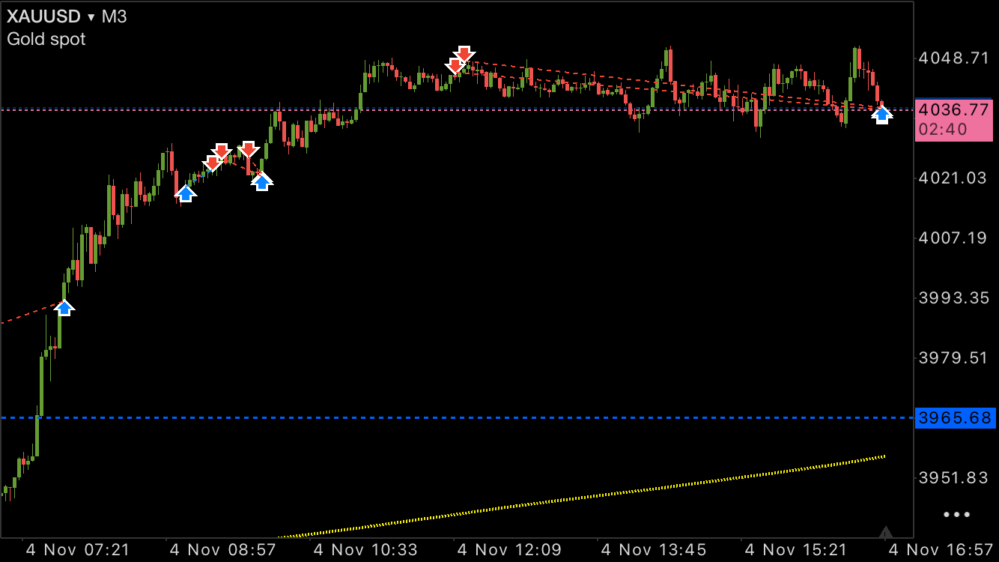
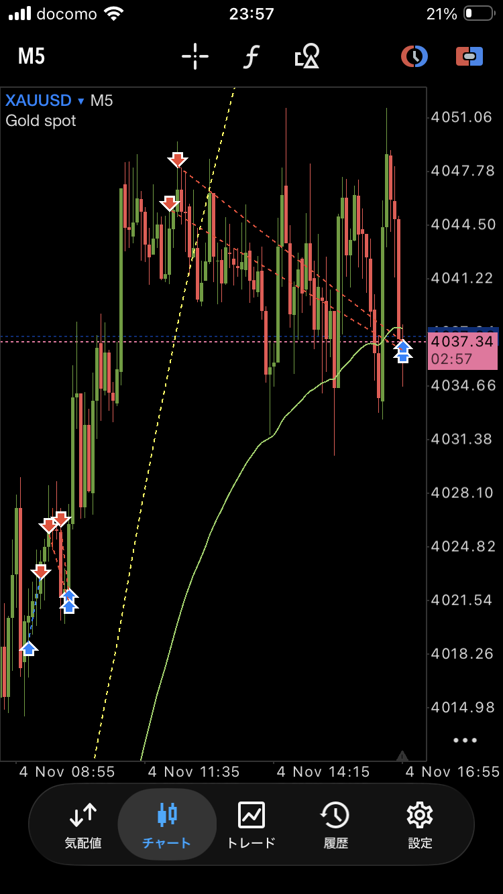

### MT5画像で確認した詳細履歴（表示時刻のまま）

価格は画像のXAUUSD表示値。数量はMT5表示のロット。損益・手数料の通貨は画面内で未確認。下記3件は同じ画面の背景一覧にも重複しており、背景から別取引として加算しない。

| チケット | 売買・数量 | 新規→決済（MT5表示） | 建値→決済値 | 損益表示 | 手数料表示 | SL／TP表示 |
|---|---|---|---|---|---:|---|
| 46806693 | sell 0.1 | 11/4 09:35:21→10:00:59 | 4,025.74→4,021.53 | +6,654 | −95 | 4,042.11／4,015.64 |
| 46810850 | sell 0.01 | 11/4 12:09:10→16:56:27 | 4,045.44→4,036.85 | +1,362 | −10 | 両方「−」 |
| 46810845 | sell 0.01 | 11/4 12:15:43→16:56:31 | 4,048.11→4,037.37 | +1,702 | −10 | 両方「−」 |

- 履歴の決済値がTP欄と異なる、またはTP欄が「−」なので、今回の決済が自動TP約定だったとは断定しない。本人の「レンジ下限・±100pips目安」という管理方針と、注文欄の値を区別する。
- 各詳細のスワップ表示は「−」。利益表示が手数料込みかも未確認のため、純利益を再計算しない。
- 背景一覧には、11/4 07:48:00のsell 0.01（3,961.71→3,992.64、−4,885）、09:28:28のbuy 0.1（4,018.95→4,022.92、+6,275）、10:00:56のsell 0.1（4,026.14→4,022.17、+6,274）も読める。いずれも表示時刻・表示損益で、入口時刻・チケット・口座区分・通貨・費用は未確認。追加の確定日次損益へは合算しない。
- これらの画像履歴は、OANDAペーパー番号150〜152と価格・数量・時刻が異なる。同一取引として上書き・合算しない。表示日11/3の背景行は[11月3日の日誌](../2026-11-03/diary_20261103.md)へ参考記録として追記するが、JST換算後の日付は未確定。

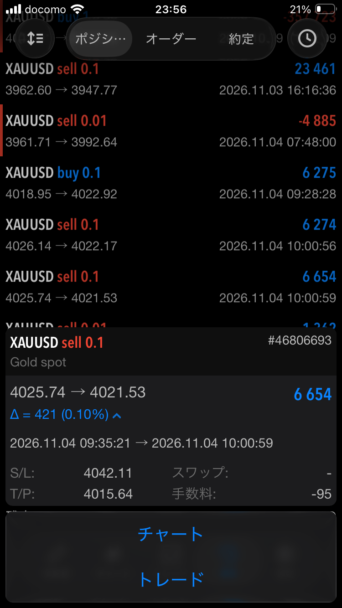
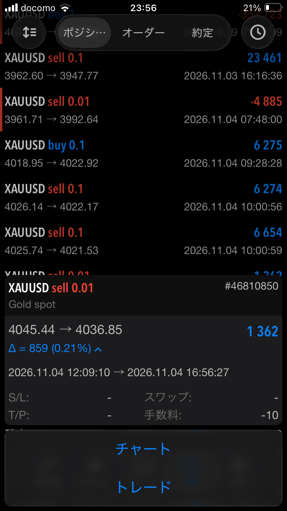
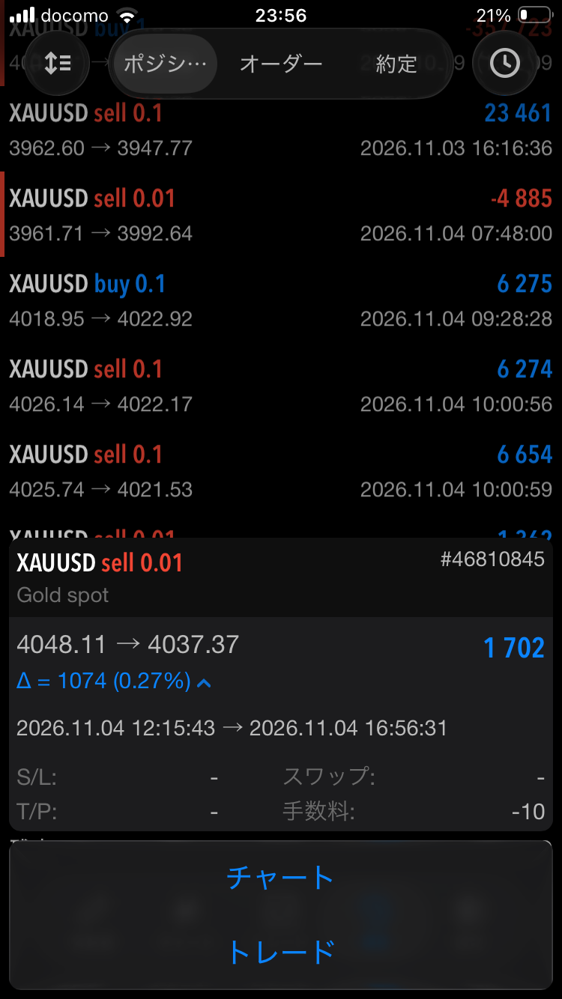

### 時系列・検証課題

- 9時台・11:30・15:30：既存の確認欄を継続。今回のNY取引の確定終値・対応画像は未取得で、日本株の引けをNYの引けとしない。
- AMDのエントリー直前は23:38:37直前／23:41:11直前／23:42:15直前。10分後は23:48:37／23:51:11／23:52:15。各時点の足・時刻・確定終値・画像は未取得。取得CSVは23:46頃までで、両ポジションは10分後より前に決済。
- GOLD詳細3件の直前は上表の各新規時刻直前。10分後はMT5表示で09:45:21／12:19:10／12:25:43。JST対応、該当足・確定終値・画像は未取得。今回の3分・5分足画像を正確な入口直前や10分後の画像とは断定しない。
- 検証事項：AMDの買いから売りへの切替理由、GOLDの逆張りを許容した上限反応・レンジ否定条件、想定下限と実際の決済位置、pips定義と時間帯・口座の照合。実施済みの順守ルールを推測で追加しない。

## 翌日の本人の補足｜Googleの方向・決算後AMDのV字回復

出典：11月5日に「昨日」として振り返った本人の発言。11月4日のNY分析・売買の補足として記録する。

- **Googleは上方向へ動いた**との観察。GOOG／GOOGLの別、対象時間足・時刻・価格は未提示。Googleを実際に売買したという報告ではない。
- **AMDは決算後、V字回復して上方向へ進んだ**と認識。決算内容・発表日時や上昇との因果は独立確認しておらず、本人の環境認識として残す。
- **ロットをコントロールしてエントリーした**との本人申告。具体的な数量調整の基準・許容損失・各注文との対応は未提示。既記録のペーパーロング153・ショート154に関する補足として照合するが、新しい取引回数・数量・損益は追加しない。実資金へ切り替えたとも扱わない。
- 日本の決算時の動きと比べて、**ゆっくりした値動きに感じた**との所感。今回の観察に基づく比較であり、米国株・日本株全般の値動きの性質として一般化しない。
- 検証課題：決算後のV字回復のどの段階を捉えたか、その値動きの速さに対して数量をどう調整したかを、当時のチャート・注文履歴と対応付ける。今回、新しい終値・足時刻・画像は未提示で、既存の時系列照合欄を継続使用する。

## 追加添付画像の照合｜11月4日GOLDの推移と注文画面

11月5日にこの会話へ添付された原画像を変更せず保存。チャート横軸の11月4日表示と既存記録に関連付ける。端末時計のタイムゾーン・日付、MT5サーバー時刻、口座区分・配信元は未確認。端末時計とチャート横軸に差があるため、一定の時差を加えてJSTへ確定しない。以下の右端価格は未確定足の観測価格であり、確定終値・約定価格ではない。

### 上昇前後の観察・注文検討
- IMG_9541：端末14:59、XAUUSD・3分足、右端3,997.47。SELL STOP 0.1・3,962.85、TP 3,933.42の注文編集画面。46,512 JPY／2943 pointsの表示は画面上の試算として扱い、実現利益ではない。送信・受付・約定はこの画面から確認できない。
- IMG_9542：端末15:00、1時間足、右端4,000.06、水平線3,965.68。下落後の戻し・上昇の事後観察資料。矢印から新たな取引を追加しない。
- IMG_9543：端末15:46、15分足、右端4,016.12。上昇局面と過去の矢印・接続線を確認。既存履歴との正確な対応は未確定。

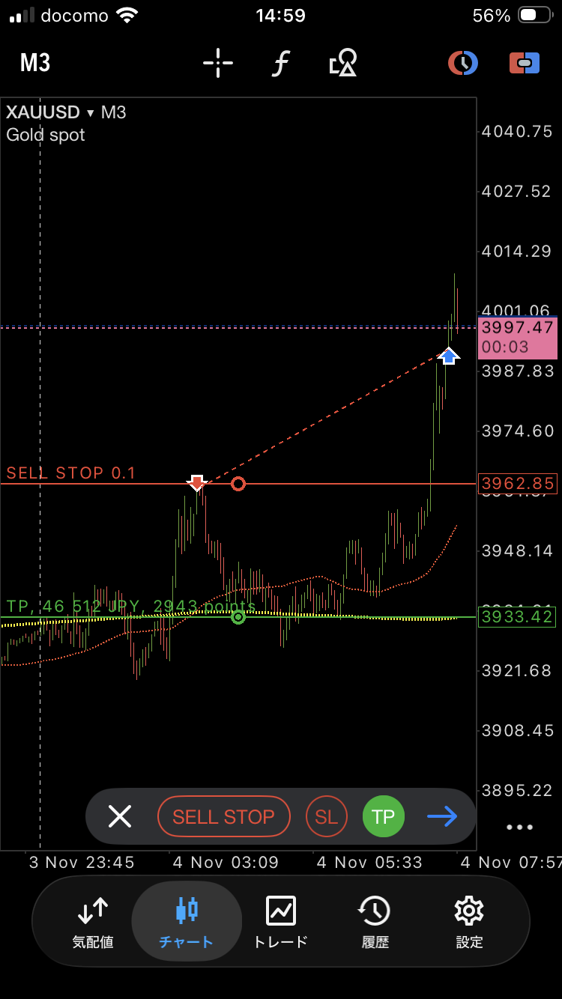
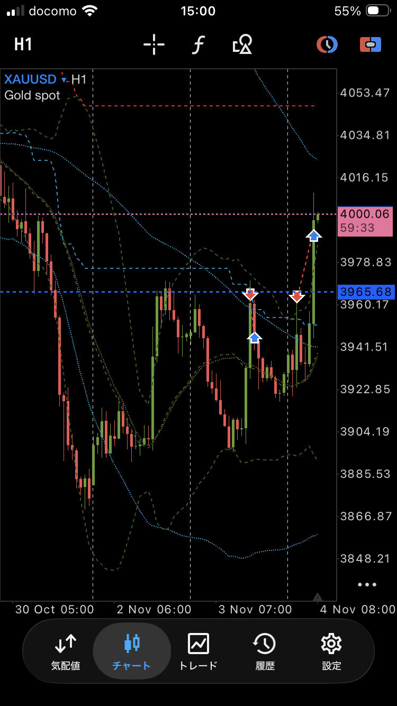
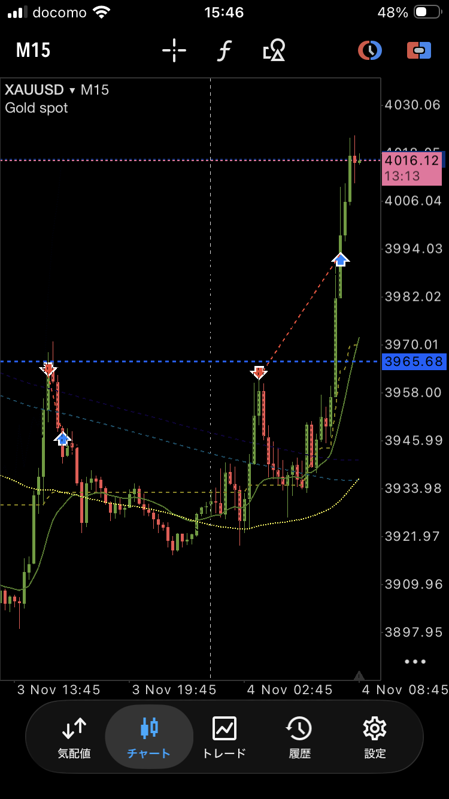

### 16時台の70％メモ・注文線・その後の推移
- IMG_2722：端末16:05、15分足、右端4,016.43。「Long70 Tp@16:00」の注記、水平線3,991.61・3,975.59。本人の16時70％アラート・利確レンジの見立てに対応する補足資料。注記は提供済みだが、センチメント配信元の原アラートログではない。
- IMG_9544：端末16:15、3分足、右端4,020.43。「BUY 0.1」「SELL LIMIT 0.1」、4,026.45、TP 4,015.64、SL 4,007.29の線・表示がある。複数の注文線が重なるため、各SL・TPを特定の建玉へ推測で割り当てない。後の約定履歴とのチケット対応も未確認。
- IMG_2723：端末17:16、3分足、右端4,028.56。4,035付近まで上昇した後の押しを視認。16:55のセル申告や17:05目安の10分後に正確に一致する画像ではなく、その後の推移資料とする。

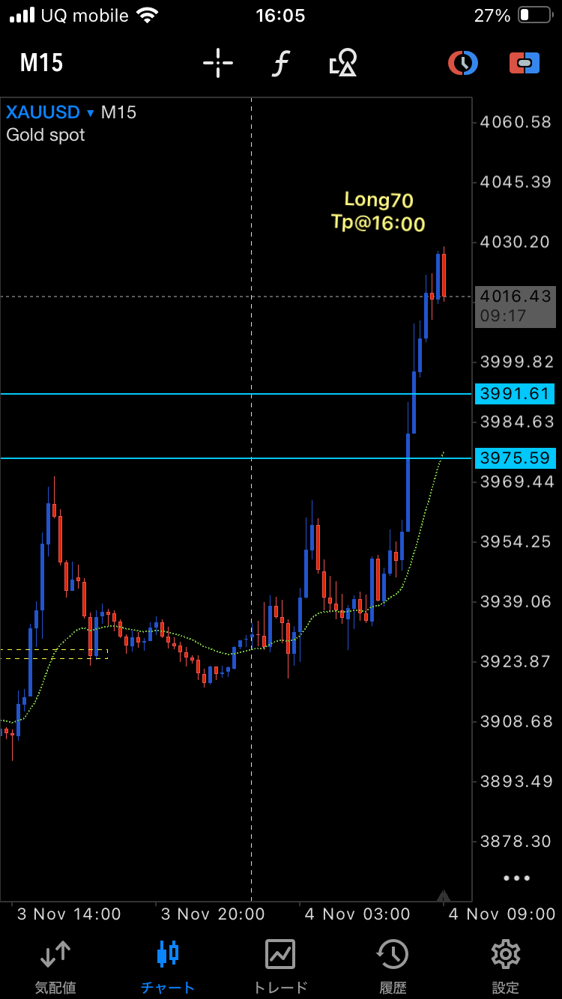
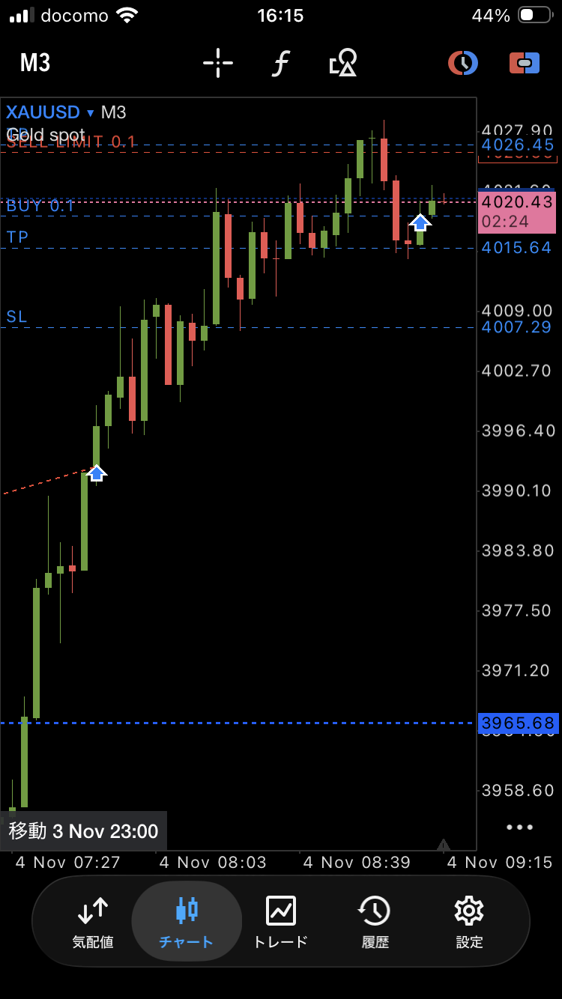
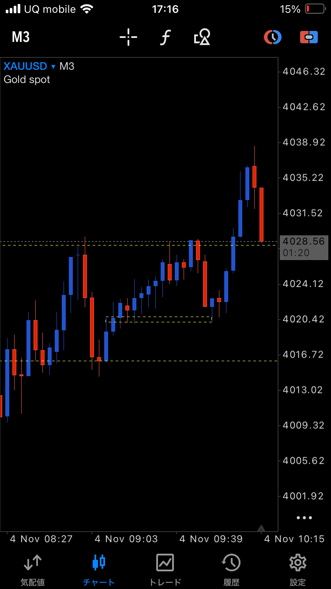

### 19時台の再度の70％メモ
- IMG_2724：端末19:03、3分足、右端4,042.20。4,049付近への上昇後に持ち合う様子。
- IMG_2725：端末19:04、3分足、右端4,041.93。「70%Buy>@19:00」の本人注記。16時の注記と別の時刻として残す。画像だけで70％到達の配信元・正確な集計値や注文実行を独立確認したとは扱わない。
- 既存のMT5詳細履歴（チケット46810850・46810845）の上限売り・決済との関係は、時刻設定・注文番号を照合して確認する。新しい売買・損益は追加しない。

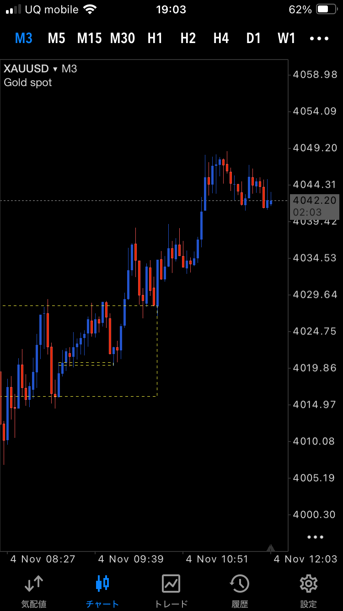
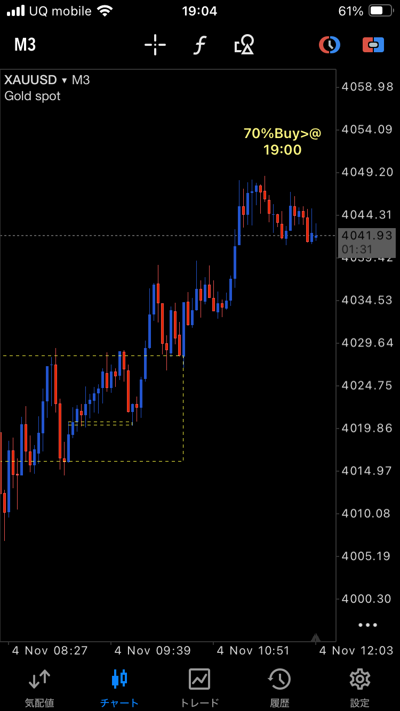

### 重複資料・フォルダ確認画面
- 再添付のIMG_9585(1).pngは、既存の[IMG_9585.png](screenshots/IMG_9585.png)とファイル内容が完全一致（チケット46810845）。約定・利益を再計上しない。
- [IMG_2748・GitHubフォルダ確認画面](screenshots/IMG_2748.png)は日誌フォルダ直下にPNGがあった時点の操作資料。取引チャートではない。現在の画像保存先はscreenshotsで、この古い画面を現状の配置として扱わない。
- 今回の追加でGOLDの場面資料は増えたが、各約定の直前・正確な10分後、11:30・15:30の確定終値や元アラートログはなお未取得。既存の時系列欄を引き継ぐ。OneDrive元パスは未確認で、今回確認できた入手経路は会話添付。
