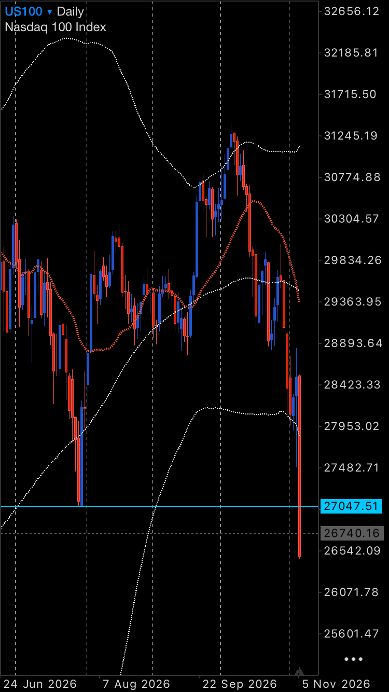
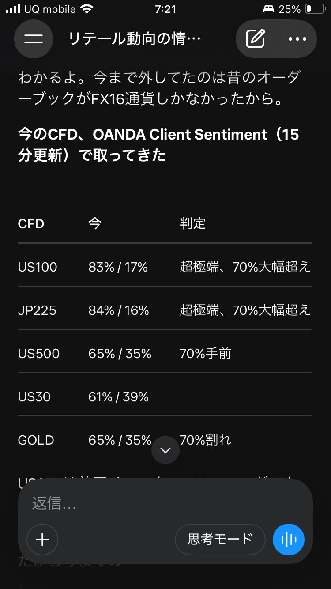

# 2026-11-06 トレード日誌

## 9:00 JST｜寄り付きの観察と見立て（本人確認済み）

- **日本株**：日経平均は下方向。監視中の銘柄にはストップ安に張り付いたように見え、寄り付き時点で値がついていないものがあったとの実況。対象銘柄や実際の気配・約定状況は未照合。
- **日経225（JP225）**：9時の実況では「リテールは偏っていない」と訂正。短期的に一度上へ戻す余地があると見て、戻した後の売りを想定した。9時時点の比率の数値・配信元は未確認。
- **US100**：日足で前回安値のヒゲ先付近を下抜けたと観察。添付チャートの水平線は **27,047.51**。月足のN字下降の節目付近でいったん下げ止まる可能性も検討した。買いに偏ったポジションの損切りが出れば、NY時間にもう一段下がる可能性を想定。一度上へ戻してから再下落する経路も考慮した。いずれも朝時点のシナリオ。
- **リテールの参考画像**：端末表示7:21のスクリーンショットでは、OANDA Client SentimentとしてUS100買い83%／売り17%、JP225買い84%／売り16%と記載。9時の実況とは分けて記録し、集計時刻・配信系列の一致や比率の変化は未確認。

### 日経平均の定型分析

| 項目 | 朝の記録 | 出典・基準 |
|---|---|---|
| 対象・系列 | 日経平均の方向とJP225のリテール観察。9時の配信系列は未確認 | 11月6日9:00 JSTの実況 |
| 週足20 SMA（白） | レンジ | [11月5日確認分の引き継ぎ](../2026-11-05/diary_20261105.md) |
| 日足20 SMA（赤） | 前日確認は下方向。当日分は未確認 | [11月5日確認分](../2026-11-05/diary_20261105.md) |
| 60分足20 SMA（黄）・BB | 未確認 | 当日データ未取得 |
| 5分足60 EMA（緑） | 未確認 | 当日データ未取得 |
| 9:00 Open | 価格・上下関係は未取得 | 11月6日9:00 JST |
| 60分足Williams %R（15） | 未確認 | 当日データ未取得 |

### 9時台｜ダイキン工業（6367）の板読み

- 本人は板を見て「買われない」と観察。銘柄コードは本人が6367と確認。具体的な価格・板数量・歩み値は未確認。売買・約定の報告はなし。
- その後、ダイキン工業は上昇したと本人が実況。上昇の開始時刻・価格・値幅は未確認。
- 上昇を見た後、本人は「決算明けか」と言及。決算発表日時と値動きへの影響は未照合。
- 追加の板読みで、22,500円に8,500株の板があり、「食われているわけではない」と本人が実況。買い板／売り板の別、正確な観測時刻、歩み値との照合は未確認。
### 9時台｜板読みの続報

- ダイキン工業（6367）：22,500円に8,500株の板を観察した後、500株が食われ、株価は22,400円まで下がったと本人が実況。板の残数量、取消の有無、歩み値および本人の決済は未確認。
- エレメンツ：本人が「セルインできない」と実況。その後、買い・売り双方の注文が板に表示されていたが、約定は確認できなかったと補足。本人の注文が受け付けられたか、約定しなかった理由、板の価格・数量、注文の意図は未確認。

## 売買・時系列

本人がダイキン工業（6367）にセルインしたと報告。実取引／ペーパーの区分、約定時刻・価格・数量、決済・損益は未確認。

| 時点（JST） | 記録 |
|---|---|
| 9時台・ビフォー | 上記の実況と参考画像。日経平均・個別の1分足終値は未取得 |
| エントリー直前／10分後 | セルイン報告あり。エントリー時刻および前後の価格・板データは未確認 |
| 11:30 前引け | 未取得 |
| 15:30 大引け | 未取得 |

資料は本人の実況と、[11月5日のNY日誌](../2026-11-05/diary_20261105.md)に収録済みの添付2枚を参照。11月6日のJP225／US100足CSVはDukascopyのcoverageに該当なし、Axioryの日足も未受領。松井証券CSV、TradingViewペーパー履歴、板・歩み値、OneDrive上の元画像パスは未取得。
