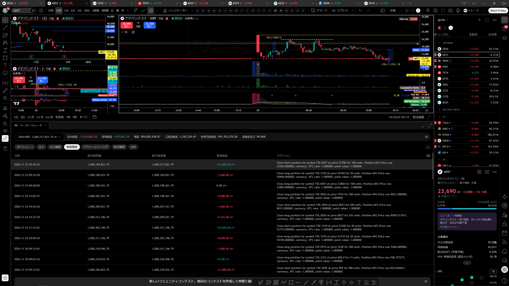

# 2026-11-25 トレード日誌

## 本日の要約｜TradingView Paper Trading

当日決済3件の実現損益は **＋19,400円**。内訳はアドバンテストのロング0円、1570のロング−3,600円、アドバンテストのショート＋23,000円。取引履歴のエントリー行と決済行には同じ損益が載るため、決済行だけを集計し、残高履歴の3件と照合した。時刻は日本時間。約定の秒単位は注文履歴とアクティビティログで確認した。

| 銘柄・方向 | 新規約定 | 決済約定 | 実現損益 |
|---|---|---|---:|
| アドバンテスト（6857）LONG 100株 | 09:18:17、23,860円 | 09:28:00、23,860円 | 0円 |
| 1570 LONG 20口 | 09:23:55、10口×51,050円。09:29:14、10口×50,830円。平均50,940円 | 09:34:38、20口×50,760円 | −3,600円 |
| アドバンテスト（6857）SHORT 100株 | 09:34:51、23,930円 | 10:10:16、23,700円 | ＋23,000円 |

6857・1570とも、CSVの書き出し時点のペーパー建玉一覧に記載なし。松井証券の実取引は未照合。

## 朝の環境認識（本人申告・JST）

- **日経平均**：前日11月24日の東京時間に上昇した後、ニューヨーク時間帯は小幅に下げたとの見立て。ニューヨーク時間帯に観察した価格系列は未確認。
- **US100**：大きな値動きはなく、レンジ内で推移しているとの見立て。日足ではじりじり下げる形に見えるが、値幅は小さいとの認識。

## 売買と資料

- 最初の共有は相場観察。前場に追加で報告された売買は下記参照。
- 最初の記録時点では対象日のメモ・原資料はリポジトリ内で確認できなかった。Dukascopyの取得一覧は11月23日UTC分までで、今回の観察に対応する価格・値幅は未照合。[取得一覧](../../market_data/dukascopy/coverage.csv)

## 前場の追記（本人申告・JST）

JP225キャッシュは9:07ごろ、日足の下目線の中で朝の戻しに勢いがあると観察。その後、5分足で前日支えられたラインを割り、5分足60EMA（緑）と60分足20SMA（黄）の下に位置するとの見立て。いったん戻した後の下げ幅は限られ、のちに225と1570の戻しを観察。東京エレクトロンとアドバンテストは大幅ギャップダウンとの口述。寄り付きの下落率とJP225のサポート価格は未照合。

### アドバンテスト（6857）｜100株ロング、建値撤退

- ギャップダウン後のVWAP上抜けと日経225の戻しを根拠に、短期反発を狙って約23,830円でエントリーしたとの口述。ペーパー約定は09:18:17に23,860円で100株。東京エレクトロンとの同調も観察。
- 24,000円の節目を上抜け、24,105円付近まで戻したと報告。24,280円は上値の観察水準。利確を検討した場面では、板が一時薄く、出来高は増えていたとの口述。
- エントリーから約10分の確認時、直近安値を割る前に価格が買値付近へ戻ったため、建値近辺で撤退。本人の説明ではほぼイーブン。09:28:00に同値の23,860円で100株決済し、実現損益0円。保有は9分43秒。口述に出た23,920円の意味は未確認。
- 振り返りは、節目を上抜けた後に利確を検討した時点で、出来高の増加に対して価格がどこまで伸びていたか。ペーパーの新規買いは09:18:17で、朝の寄り付き回避の時間帯（9:00〜9:30）に入っていた。デルタ上サインの確認・分割利確の実施は未確認。

### 1570（ETF）｜買い増し後に20口決済

- 50,780円の既存ロングを保有継続と申告。追加のロングエントリーを口述。ペーパーでは09:23:55と09:29:14に各10口を買い、09:34:38に20口を一括決済した。ペーパーの50,780円の建玉との対応は未確認。
- 追加数量について「14ユニット、16ロット」と口述。口述数量とペーパー約定の対応は未確認。ペーパーの決済対象は20口・平均50,940円で、2回の買いはともに9:30前。
- 1570は1ロットから購入可能との本人メモ。

### 時点別の資料

| 時点（JST） | 確認できた内容・出典 | 確定足・対応画像 |
| --- | --- | --- |
| 9時台・ビフォー | 9:07ごろのJP225環境認識、本人実況 | 終値・足時刻・画像未取得 |
| エントリー直前 | 6857のVWAP上抜けと225の戻し、本人実況。1570は未取得 | 終値・足時刻・画像未取得 |
| エントリー10分後 | 6857のロングは起点＋10分の09:28:17時点で決済済み。1570の初回買い＋10分の09:33:55時点では20口保有。6857のショートは09:44:51時点で保有継続（注文履歴） | 終値・足時刻・画像未取得 |
| 前引け 11:30 | 未取得 | 終値・足時刻・画像未取得 |
| 大引け 15:30 | 未取得 | 終値・足時刻・画像未取得 |

出典は当日朝の口述。約定CSVと10:10:41のTradingView画像を今回照合。当日の個別銘柄の板・歩み値は未取得。添付のJP225画像は11月16〜17日の15分足であり、今回の場中の5分足確認には使用していない。

## 前場の追加観察（本人実況）

- レーザーテックは34,000円、リクルート（6098）は17,430円と読み上げ。いずれも場中の観察値。
- アドバンテストは建値撤退後に再上昇したと報告。口述の「2万円」が指す金額は未確認。ペーパーのロング決済損益は0円。
- 実況中の運用：本人が「利確する」と伝えたときだけ音声で応答し、その他の実況は議事録に残す。

### アドバンテスト（6857）｜新規ショート

- **エントリー（本人申告）**：23,950円で新規売り。先の100株ロングは建値撤退済み。ペーパー約定は09:34:51に23,930円で100株。10:10:16に23,700円で買い戻し、実現損益＋23,000円。
- **根拠**：前回高値を上抜いた動きが上ヒゲで終わり、市場参加者の利確売りが出たように見えた。日経平均も本人の判断で「テトラ」の売り条件にあったため、指数の売り方向と合わせてセルインした。
- **手仕舞いの想定**：VWAPが横ばいで、レンジ相場と判断。上限付近から売る場合は下限付近を利確候補とした。上下限の具体値は未確認。
- **地合い（本人の印象）**：約10%のギャップダウンで始まった企業が多そうだと観察。銘柄数や下落率は未照合。
- **板とレンジの観察（本人申告）**：23,910円付近の買いが多く見え、買い手が手放せば下に動く可能性があると見た。値幅はまだ小さく、上下どちらにも動き得るとの判断。23,910円は板の観察水準。
- **ショート継続（本人申告）**：直前に想定していた下方向への動きは出ていないと観察。上値側の板が厚くなる可能性を見て、売りポジションを維持した。板が実際に厚くなったかは未確認。
- **9:39の実況（JST・本人申告）**：値動きが売りに傾いたと観察。VWAPから当日安値までの動きと見て、安値付近でショートを手仕舞う判断に言及。実況では「29,000円」「3,000円」の両方がプラス額として聞こえたため、金額は確認保留。9:39の口述と決済を照合した結果、実際のペーパー決済は10:10:16、＋23,000円だった。

アドバンテストの30秒足とペーパー残高履歴（画面時計10:10:41、日本時間）。画面の価格表示は約定値や確定足終値と区別した。

## 使用資料

- [取引履歴](paper-trading-trade-history-2026-11-25T09_08_20.247Z.csv)
- [アクティビティログ](paper-trading-activity-log-2026-11-25T09_08_19.223Z.csv)
- [残高履歴](paper-trading-balance-history-2026-11-25T09_08_19.199Z.csv)
- [注文履歴](paper-trading-order-history-all-2026-11-25T09_08_19.173Z.csv)
- [建玉一覧](paper-trading-positions-2026-11-25T09_08_18.813Z.csv)

## 朝の実況補足（本人申告・JST）

- **日経225の反発シナリオ（検討）**：日足の大きな下方向は続き、%Rも下という見立て。前日の急落後にダブルボトムのような形があり、下げ止まりを確認できれば買いを検討した。1時間足ではレンジを上抜けた後、上の段のレンジ下限付近と観察。口述の下限価格は聞き取りが不明瞭で未確定。この発言に対応する指数の買い約定は未確認。
- **9:07ごろの確認点**：朝の上昇の勢いが止まるかを見ながら、キオクシアやアドバンテストが寄った後に、指数がその動きにつられる可能性を考えた。
- **半導体株の寄り付き**：東京エレクトロンは約9%安、アドバンテストは約10%安のギャップダウンと実況。本人の概算で、寄り付きデータとの照合は未実施。
