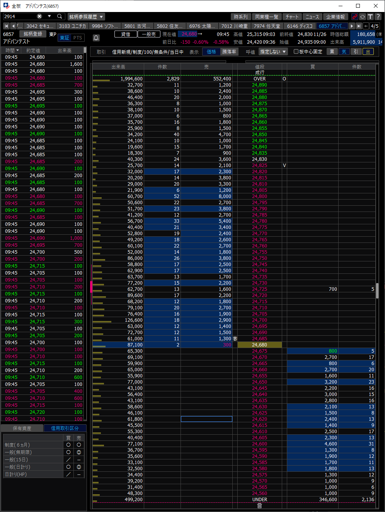
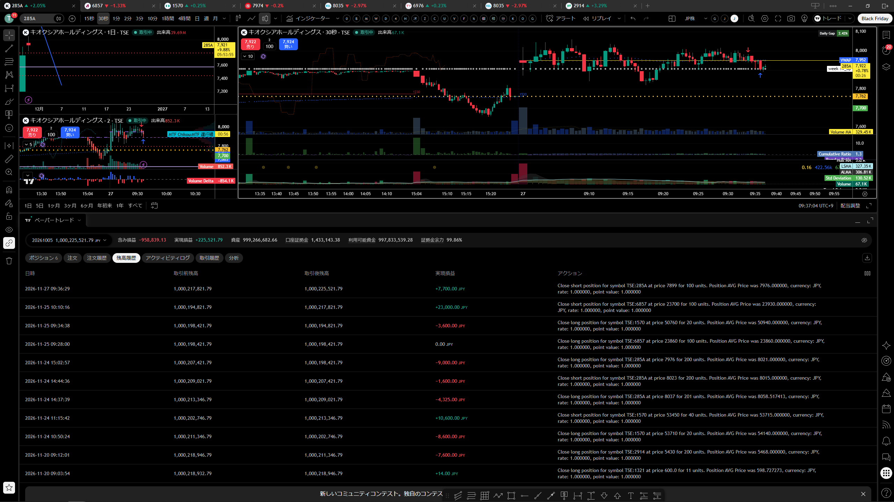
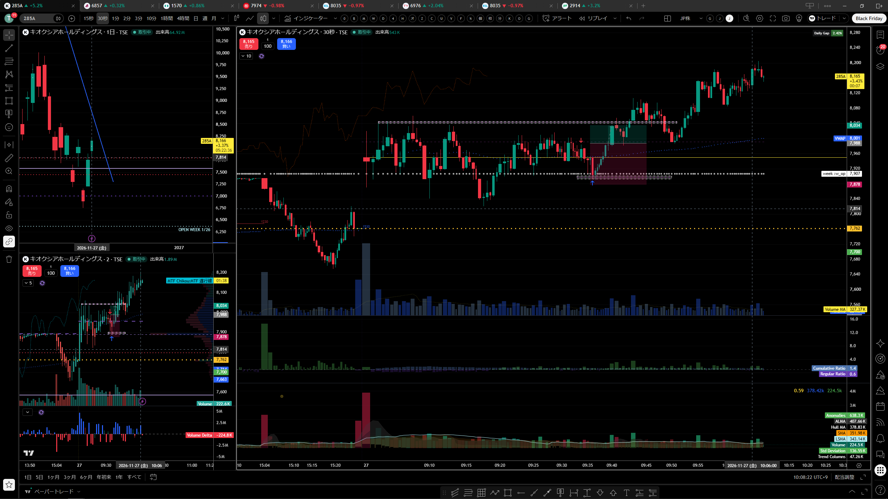

# 2026-11-27 トレード日誌

## 本日の要約（日本時間）

- **キオクシアHD（285A）**：上ヒゲが重なった場面から短いレンジの下限を狙った売り。TradingView Paper Tradingの残高履歴画面で、**平均7,976円のショート100株を9:36:29に7,899円で買い戻し、＋7,700円**の決済1件を確認。
- **アドバンテスト（6857）**：前場は上値の板の重さを観察。後場は日経225の1時間足BB収縮後の上抜けと連動銘柄の上昇を受けてロングしたとの本人申告。約定・損益は未照合。

## 朝の環境認識（本人実況・JST）

- 9:03から「一旦ストップ」までの実況メモでは、日経平均は日足で下降チャネル内、4時間足と1時間足はレンジ。1時間足の値幅は縮小しており、上下限の幅は約680円との見立て。レンジを抜けた方向についていく案を検討した。US100もレンジ内との観察。
- アドバンテスト（6857）は25,000円の節目を上抜けた後、同水準を維持できず下落したとの観察。東京エレクトロン（8035）とディスコも同方向。東京エレクトロンの売りを検討したが、上値がそれほど重く見えなかったため、アドバンテストを見直した。その後、この会話では東京エレクトロンや太陽誘電などに安値付近で買いが入っているように見えたとの報告。

- 米国の祝日を背景に、NY市場の影響は限られると見ていた。任天堂にも言及があったが、値動きや売買判断の詳細は未確認。

## キオクシア（285A）の観察と見送り判断

- ランキング上位で、5分足は下向き。3分足ではヒゲが多く、上に伸びにくいと観察。前日にストップ高に張り付いたとする価格より上で推移しているとの本人申告。
- 下方向を基本シナリオとしつつ、いったん下げた後に戻しが強まり、売り手を巻き込んで上に走る可能性も考えた。横向きの部分があり、雲にはまだ触れていないとの読みから、上方向の力が残ると判断。指標の詳細は未確認。
- 8,000円の節目を意識し、7,900〜8,000円のレンジ内の値幅を取る案も検討。方向を決めにくく、優先度の高いチャンスとは見なさず、基本は様子見とした。1570と6857も下げずに揉み合っているように見えた。
- 後半に「利確」への言及があったが、具体的な注文や決済を指すかは聞き取りが不明瞭。実取引・デモともに約定、数量、損益は未確認。ほかの銘柄やETFに関する末尾の発言も、銘柄と価格の対応は保留。

### 売りを見送った後の値動き（本人実況）

- キオクシアの上値付近で売りを検討したが、アドバンテストと東京エレクトロンにまだ上昇余地があると見て、エントリーを見送った。
- その後、東京エレクトロンは見ていた下限に到達し、アドバンテストも注目していた水準に到達したと実況。キオクシアは実際に上へ動いた。その後はアドバンテストの上値側の板が厚く上値が重いと見て、キオクシアも上値が重くなってきた可能性に言及した。
- 到達した価格や時刻は未確認。「857」「JT299」の意味と、「今日のノルマ」が何を指すかは聞き取り保留。この実況区間の売買・約定報告はなし。

### 9:47ごろの実況（日本時間・本人申告）

- 下値側にも厚い板があり、見直すとさらに厚く見えた。
- 「757あたり」で下げ止まり、下側にとどまっているように見えた。銘柄名と価格の全桁は聞き取りから特定できず。
- アドバンテスト（6857）は上値が重いと観察した。
- この区間の約定報告はなかった。

9:45のアドバンテスト（6857）の全板画面では、現在値24,680円、上値側の24,800円に8,000株の売り表示を確認。約定値や売り板の継続時間はこの静止画からは未確認。

### 9:53ごろの実況（日本時間）

- **東京エレクトロン（8035）** — 直前は下値を支える買いがはっきり見えず、上値も伸びにくい一方、値動き自体はあったとの観察。その後、見ていた水準を下抜けた。価格は未確認。
- **アドバンテスト（6857）** — 上値側の板が重いとの観察が続いた。
- **キオクシア（285A）** — 東京エレクトロンと同方向に下落。一度上を試したが戻ってきた。上値側の板は厚く、上下どちらかに動きが落ち着くのを待ちながら、もう一度上を試す可能性を見ていた。
- この区間の注文・約定の報告はなし。

### 日経225の下げ止まりと個別銘柄の反発（9:53以降・本人実況）

- 東京エレクトロンが反発し、日経225はいったん下げ止まったと観察。1570も上方向に動いた。アドバンテストは1分足で反発し、村田製作所・太陽誘電も上方向。ソフトバンクグループはチャートの形に迷いがあったものの、ほかの銘柄につられて上昇したとの見立て。
- キオクシアは再び下を試した後、下げが続かず上方向に戻った。日経225の下げ止まりと東京エレクトロン・アドバンテストの反発を見て、この場面では売りを見送った。キオクシアの板は厚く見えた。
- 前日終値で下げ止まったとの発言があった。1570とアドバンテストの比較中の発言で、対象銘柄は未確認。

## キオクシアの短時間の売りと反発の振り返り（本人申告）

- **売買と結果**　上昇中に上ヒゲが重なり、いったん上値を抑えられた場面で売り、短いレンジの下限付近までの値幅を取った。利益の本人概算は約5,000〜7,000円。対応候補のペーパー決済1件は画面で＋7,700円を確認。新規約定の正確な時刻、他口座での売買、本人実況との完全な対応は未照合。
- **反発の見立て**　日経225とアドバンテストなどの連動銘柄がそろって下げ止まったため、安値を割らなければキオクシアも小幅な下げを取り戻し、上方向に進むと見た。厚い板をこなして上へ進む展開も想定した。
- **太陽誘電・アドバンテスト**　下を試しても下がり切れず、上値側にも厚い板があり、上下ともに伸びにくく値幅が縮むと見た。
- **未実行案と検証課題**　値幅の収束を抜けた方向についていく案を事後に検討した。ブレイク前後の板・歩み値と日経225の動きを照合し、アドバンテストとキオクシアのどちらが狙いやすかったかを検証する。

### ペーパー決済とその後の反発（画像で確認）

キオクシアの30秒足とペーパー残高履歴（画面時計9:37:04）。残高履歴に9:36:29の買い戻し100株、決済値7,899円、平均建値7,976円、実現損益＋7,700円が表示されている。

10:08:22の30秒足画面では、戻した後の表示価格は8,165円付近。8,165円は画面時点の表示値。本人の約定・確定足終値は未確認。

| 照合時点（JST） | キオクシア・日経225の資料と値 | 本人の観察 |
|---|---|---|
| 9時台・売買前の環境 | 確定終値・画像未取得 | 朝の環境認識と9時台の実況を参照 |
| エントリー直前 | 時刻・確定終値・画像・板・歩み値未取得 | 上ヒゲが重なり、上値を抑えられた |
| エントリー10分後 | 基準時刻・確定終値・画像未取得 | 保有・決済の状態は未確認 |
| 前引け 11:30 | 終値・画像未取得 | 未記録 |
| 大引け 15:30 | 終値・画像未取得 | 未記録 |

## 後場の上昇とアドバンテストのロング（本人振り返り）

- 日経225ミニと監視していた連動銘柄はそろって上昇し、後場は日経225 CFDも上昇したとの観察。
- 60EMAを明確に上回った場面から保有を続けていれば、15:30までの右肩上がりを取れたとの振り返り。60EMAの時間足、上抜け時刻、15:30の価格は未確認。
- アドバンテスト（6857）はロングで入り、保有できたとの本人申告。約定時刻・価格・数量・損益、実取引／デモの区分と15:30まで保有したかは未確認。

### BBコンプの上抜けと後場の保有判断（本人振り返り）

- 日経225の1時間足では、ボリンジャーバンドが約680円幅まで収縮していた。下を試しても下落が続かず、その後に上抜けを見届けた時点で、後場は上方向に進むと見立てた。
- ブレイク直後は高値づかみに見えて入りづらかったが、本人のルールでは上抜け確認後がロングの場面。後場の終わりまで保有するのが想定したシナリオだった。
- アドバンテスト（6857）でこの上抜けを起点にロングし、後場の終わりまで保有できていれば、上昇の値幅を取れたという事後評価。ブレイク確認の時刻・価格、本人が申告したロングとの対応、実現損益は未確認。
- 後場は前場引けより高い水準で始まった（ギャップアップ）との本人観察。ギャップ幅は未確認。アドバンテストを含む監視銘柄に加え、日経225 CFD、S&P 500、US100もそろって上向きだったことを、後場に強気でロングを検討できた根拠として挙げた。

| 照合時点（JST） | アドバンテスト（6857）と日経225の確認状況 |
|---|---|
| 9時台・売買前の環境 | 朝の環境認識を参照。確定終値・画像は未取得 |
| エントリー直前 | 時刻、確定終値、板・歩み値・画像は未取得 |
| エントリー10分後 | 基準時刻、確定終値・画像は未取得 |
| 前引け 11:30 | 確定終値・画像は未取得 |
| 大引け 15:30 | 上昇が続いたとの本人観察。確定終値・画像は未取得 |

## 資料と検証課題

- 出典は当日の会話と9:03からの実況メモ（`2026-11-27_trade_live_notes.md`）。価格は本人の観察値。約定CSVと板・歩み値の原データは未取得。OneDriveの当日画像3枚を上記の場面に添付した。Dukascopyの取得一覧にも今回の観察に対応する日付のデータはなかった。[取得一覧](../../market_data/dukascopy/coverage.csv)
- 後から照合する際は、8,000円付近の板と歩み値で、ヒゲが出た後の安値更新の有無と、指数・半導体株の反発が同時だったかを確認する。9時台の確定終値、11:30・15:30の値、売買前後の足は未取得。
- 今回のキオクシアの売りは本人の振り返りに基づく。松井証券CSV・TradingViewの履歴CSVは未取得。ペーパーの決済1件は残高履歴の画面で確認。Axioryの日足に対象日のデータは確認できなかった。

## リプレイ取引｜11月27日の検証

TradingViewのリプレイ取引を、銘柄ごとの取引履歴と注文CSVで照合した。時刻はリプレイCSVの表示値。以下のUSD損益は、上記の当日ペーパートレード（キオクシア＋7,700円）とは別に記録する。

| 銘柄・方向 | 新規 | 決済 | 数量 | 純損益（CSV） |
|---|---|---|---:|---:|
| アドバンテスト（TSE:6857）LONG | 12:57、25,960円 | 15:30、26,585円 | 100株 | ＋392.31 USD |
| 日経225 CFD（OANDA:JP225YJPY）LONG | 58,543.0 | 58,705.5 | 10 | ＋10.20 USD |
| 日経225 CFD（OANDA:JP225YJPY）SHORT | 58,705.5 | 58,543.0 | 10 | ＋10.20 USD |

- **アドバンテスト**は12:57から15:30まで保有し、価格差は625円。後場のロングを大引けまで保有するシナリオのリプレイ結果として保存する。本人申告の当日ロングとの対応や、指数のBB上抜けを確認した時刻は未照合。
- **日経225 CFD**は20単位の売り注文が、ロング10単位の決済とショート10単位の新規に対応する。2件の純損益は計＋20.40 USD。すべての注文・取引がCSVで07:00表示のため、実際の市場時刻への対応、保有時間と各判断時点の足は未確認。
- **損益の集計**は決済行のみ。別々に書き出された2つのリプレイ記録の内訳を示す。

### 使用したリプレイCSV

- [日経225 CFD・注文](replay-trading-orders-all-2026-11-27T08_50_25.024Z.csv)
- [日経225 CFD・取引履歴](replay-trading-trade-history-2026-11-27T08_50_25.027Z.csv)
- [アドバンテスト・取引履歴](replay-trading-%E5%8F%96%E5%BC%95%E5%B1%A5%E6%AD%B4-2026-11-27T08_47_55.226Z.csv)
- [アドバンテスト・注文](replay-trading-%E6%B3%A8%E6%96%87-%E3%81%99%E3%81%B9%E3%81%A6-2026-11-27T08_47_55.221Z.csv)

## 寄り前の指数（Dukascopy CSVで確認）

取得一覧に11月26日UTC分が追加された。リポジトリの時刻仕様に従い、CSVの開始時刻に冬時間の7時間を足すと、両銘柄の最終行は11月27日08:00〜09:00（JST）の1時間足に当たる。

| 銘柄・価格系列 | 足の開始（JST） | 確定終値 | 出典 |
|---|---|---:|---|
| JP225 CFD（BID） | 11月27日08:00 | 57,796.366 | [Dukascopy JP225_H1.csv](../../market_data/dukascopy/JP225_H1.csv) |
| US100 CFD（BID） | 11月27日08:00 | 26,203.187 | [Dukascopy US100_H1.csv](../../market_data/dukascopy/US100_H1.csv) |

上表は寄り前のCFD参考値。日経平均現物の9:00始値、後場のBB上抜け・ギャップ幅、前引け・大引けの値は未照合。この欄を記録した時点では、11月27日UTC分の足は未受領だった。場中の1分足は末尾の追記を参照。[取得一覧](../../market_data/dukascopy/coverage.csv)・[時刻の仕様](../../market_data/dukascopy/README.md)

## 週末の地合いの振り返り（本人所感）

- 11月23日〜27日を振り返り、株式市場全体は下げ基調で、AI関連株に弱さがあり、米国株も下向きと見ていた。27日後場の日経225と連動銘柄の上昇は、当日の場中の動きとして上記に記録した。

## 追記｜11月27日場中のCFDを1分足で照合

取得一覧で11月27日UTC分のJP225・US100が追加されたことを確認した。以下はDukascopyのBID。リポジトリの時刻仕様に従い、CSVの足開始時刻に7時間を加えてJSTに換算した。個別銘柄や日経平均現物の価格、OANDAのリプレイ約定値とは配信系列が異なる。

| 基準時刻（JST） | 1分足の価格種別 | JP225 CFD | US100 CFD |
|---|---|---:|---:|
| 09:00 | 09:00開始足の始値 | 57,808.417 | 26,202.386 |
| 09:36 | 09:35開始足の確定終値 | 57,563.315 | 26,231.554 |
| 11:30 | 11:29開始足の確定終値 | 58,186.315 | 26,578.387 |
| 12:30 | 12:30開始足の始値 | 58,521.315 | 26,653.675 |
| 12:57 | 12:56開始足の確定終値 | 58,511.417 | 26,674.564 |
| 13:07 | 13:06開始足の確定終値 | 58,501.315 | 26,671.175 |
| 15:30 | 15:29開始足の確定終値 | 58,706.315 | 26,798.82 |

- キオクシアのペーパー買い戻しは09:36:29。表の09:36はその時点で確定していた両CFDの直前1分足の終値で、個別銘柄の約定値ではない。新規約定時刻は引き続き未確認。
- JP225 CFDは11:30基準の終値から12:30の始値まで335.000ポイント上昇。12:30の始値から15:30基準の終値までは185.000ポイント上昇した。現物市場の後場寄りのギャップ幅と、本人が見ていたボリンジャーバンド・60EMAの上抜け時刻は未照合。
- 12:57・13:07はアドバンテストのリプレイCSVにある新規時刻の表示を基に、同じ時計表示で比較するためのCFD参考値。当日ロングの約定時刻と、アドバンテストの該当1分足終値は未照合。

出典：[JP225 M1](../../market_data/dukascopy/m1/JP225_M1_2026-11.csv)、[US100 M1](../../market_data/dukascopy/m1/US100_M1_2026-11.csv)、[取得一覧](../../market_data/dukascopy/coverage.csv)。
